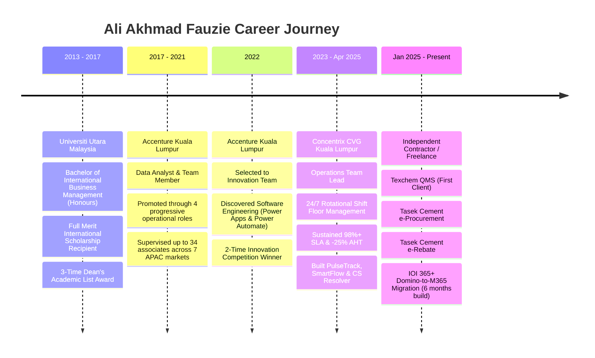

# MASTER FACTS: ALI AKHMAD FAUZIE (AL)
> **Single Source of Truth (SSOT)** for Career Milestones, Operational Governance, Software Architecture, and Portfolio Credentials.
> **Last Verified & Synchronized:** November 2026

---

## 1. Candidate Identity & Contact Information
* **Full Name:** Ali Akhmad Fauzie
* **Preferred Name / Moniker:** AL
* **Primary Locations:** Kuala Lumpur, Malaysia · Bandung, Indonesia
* **Contact Phone:** +62 851-1055-2118
* **Email Address:** aliakhmadfauzie@gmail.com
* **LinkedIn Profile:** [linkedin.com/in/aliakhmadf](https://www.linkedin.com/in/aliakhmadf)
* **Live Portfolio Website:** [https://aliakhmadfauzie.web.app](https://aliakhmadfauzie.web.app)
* **GitHub Repository:** [github.com/aliakhmadfauzie/al-resume](https://github.com/aliakhmadfauzie/al-resume)
* **Spoken Languages:**
  * **Bahasa Indonesia:** Native
  * **Bahasa Melayu:** Fluent
  * **English:** Professional Working / Fluent in Global BPO & High-Stakes Operations

---

## 2. Executive Career Positioning & The 3 Persona Profiles

Ali Akhmad Fauzie operates at the intersection of **High-Performance Frontline Operations Leadership** and **Full-Stack Enterprise Software Engineering / Solutions Architecture**.

### The 3 Personas:
1. **Operations Team Leader (`operations`):**
   * **Target Roles:** Team Leader for Content Moderation (Trust & Safety), Team Leader for Customer Service Operations.
   * **Primary Value Proposition:** 8+ years leading BPO operations, 24/7 rotational shifts (3 shifts/day), supervising 9 to 34 multilingual associates across 7 APAC markets. Sustains >98% contractual SLA compliance, cuts Average Handling Time (AHT) by 25% via Six Sigma DMAIC, and develops automated operational tooling saving 120+ leadership hours/week.
   * **Rule for Skills & Experience:** Managerial and operational leadership skills are discussed FIRST as the main highlight; tooling skills (Power Platform, PulseTrack, CRM, SQL) are integrated as supporting accelerators.
2. **Software Developer & Solutions Architect (`software`):**
   * **Target Roles:** Senior Full-Stack Developer, Enterprise Solutions Architect, Power Platform Lead.
   * **Primary Value Proposition:** Modernizing legacy architectures (retiring 365+ Lotus Domino DBs, saving $960K/yr in licenses), building offline-first React 19 / TypeScript / Cloud Firestore PWAs, building AST validation linters in CI for 7,878 YAML screens, and engineering Tri-Engine AI task routers.
   * **Chronological Anchor:** Discovered programming at Accenture in 2022 (2-Time Innovation Competition Winner with Power Apps & Power Automate), expanding into full-stack software and enterprise architecture.
3. **Dual-Track Hybrid (`both`):**
   * **Primary Value Proposition:** Symmetrical 50/50 balance uniting high-stakes floor leadership with hands-on systems architecture. Solves operational bottlenecks that non-technical leaders cannot fix and engineers systems that out-of-touch developers fail to design.

---

## 3. Strict Invariant: Freelance Experience
> [!IMPORTANT]
> **Strict Rule:** The freelance experience is 100% UNTOUCHED and invariant across all resumes, views, and profiles.

* **Period:** `Feb 2025 — Present` (Freelancing initiated January 2025, SOW delivery effective February 2025)
* **Title:** Enterprise Solutions Architect & Pre-Sales Lead
* **Company / Structure:** Self-Employed / Independent Contractor
* **Location:** Remote
* **Verified Deliverables & Metrics:**
  * Closed **RM 70,000+** in signed SOWs by converting discovery sessions into delivery contracts using rapid React/TypeScript prototypes and Dataverse architectures.
  * Led a **3-person technical pod**; managed sprint milestones, billable capacity, and QA to deliver client solutions on schedule with no scope overruns.
  * Scoped and secured executive sign-off for modernization of **365+ legacy applications across 28 business units** to Microsoft 365/SharePoint/Dataverse, defining a phased commercial roadmap.
  * Expanded account value by **35%** through workflow optimization and cross-selling integrations and ongoing automation support while sustaining **30–35% project margins**.
  * Accelerated sales velocity by delivering **working POCs within 72 hours**, shortening enterprise sales cycles by **~2 weeks**.

---

## 4. Chronological Career Timeline & Milestones

### Detailed Career Milestones:
1. **Accenture (Jul 2017 — Nov 2022) | Kuala Lumpur, Malaysia**
   * *Roles:* Progressed through 4 operational and analytical roles: Data Analyst → Quality Analyst → Workflow Specialist → Service Delivery Operations Senior Team Lead.
   * *Key Achievement:* Supervised up to 34 associates across 7 global APAC markets (Malaysia, Indonesia, China, Korea, Japan, Thailand, Vietnam).
   * *2022 Milestone:* Selected to the **Accenture Innovation Team** in 2022 after discovering software development with Microsoft Power Apps and Power Automate; became **2-Time Innovation Competition Winner**.
   * *Operations Impact:* Deployed Power BI shift telemetry dashboards, cutting SLA escalation turnaround from 4 hours to under 45 minutes (+15% throughput). Chaired Weekly Business Reviews (WBRs) using Six Sigma DMAIC root-cause analysis.
2. **Concentrix CVG (May 2023 — Apr 2025) | Kuala Lumpur, Malaysia**
   * *Role:* Operations Team Lead (BPO & Call Center Operations).
   * *Floor Ownership:* Managed 9 to 34 associates across 3 rotational shifts daily. Owned rostering, real-time adherence, attendance tracking, and shift handovers.
   * *SLA & AHT:* Sustained >98% contractual SLA compliance; reduced Average Handling Time (AHT) by 25% via DMAIC controls. Improved 90-day competency from 78% to 94% through structured 1:1 coaching and performance action plans.
   * *Custom Tooling:* Built **PulseTrack & SmartFlow** (Power Apps & Power Automate) to automate reporting and SLA escalations, eliminating ~90% of manual reporting friction, cutting administrative workload by 60–80%, and saving **120+ leadership hours weekly**.
   * *AI Routing:* Served as Tier-2 escalation SME and deployed **CS Resolver** (NLP ticket categorization via Microsoft AI Builder), reducing routing errors by ~50% and misclassification by 40–60%.
3. **Independent Freelance & Enterprise Solutions (Jan 2025 — Present)**
   * *Client 1 (Texchem):* Built Quality Management System (QMS) under GAMP 5 Category 4 / 21 CFR Part 11 validation.
   * *Client 2 (Tasek Cement):* Built **e-Procurement System** (cutting PO approval cycle from 3 days to under 15 minutes) followed by **e-Rebate System** (7-tier automated rebate formula with statutory RM 0.20/tonne cap, zero audit discrepancies).
   * *Enterprise Modernization (IOI Corporation):* 6-month full-time architecture retiring 365+ Lotus Domino databases into Microsoft 365 / Dataverse across 28 business units, saving **$960,000/year** in software licensing fees.

---

## 5. Job Description (JD) & Operational Scope as Team Leader

### A. Team Leader for Content Moderation (Trust & Safety / Policy Enforcement)
* **Floor Command & Queue Velocity:** Supervise daily high-volume content moderation queues (text, media, advertisements, user reports, and merchant fraud).
* **Policy Interpretation & Edge-Case Governance:** Act as Tier-2 escalation SME on community guidelines, hate speech, misinformation, copyright, and advertising integrity policies. Author decision trees and escalation matrices for ambiguous edge cases.
* **Accuracy & Calibration Audits:** Drive inter-rater reliability across the moderation floor; maintain 96%–99% quality audit scores. Chair bi-weekly calibration sessions between moderation squads and QA auditors.
* **Moderator Wellness & Resilience Protocols:** Manage rotational shifts and ergonomic break rotations to prevent operational fatigue and cognitive burnout in high-sensitivity queues.
* **Capacity & SLA Governance:** Monitor real-time queue volumes and backlogs; reallocate moderator pods during breaking news surges or viral spikes to sustain <1-hour turnaround times.

### B. Team Leader for Customer Service Operations
* **Shift Rostering & Adherence:** Own 3-shift rotational rosters (morning, afternoon, night) for 9 to 34 agents using Erlang-C capacity modeling; maintain >95% schedule adherence.
* **SLA & KPI Ownership:** Contractual SLA >98%, First Contact Resolution (FCR) >85%, Abandonment Rate <3%, Customer Satisfaction (CSAT) >90%.
* **Cycle-Time & AHT Optimization:** Apply Lean Six Sigma DMAIC methodology to eliminate redundant workflow steps and floor friction, achieving a verified 25% reduction in AHT.
* **Performance Coaching & 1-on-1 Reviews:** Conduct bi-weekly structured 1:1 coaching sessions with associates, utilizing data-backed scorecards to upskill 90-day competency from 78% to 94%.
* **Dispute Adjudication & Calibration:** Adjudicate disputed quality scores between agents and QA department; establish standardized defect taxonomies.
* **Weekly Business Reviews (WBRs):** Present operational telemetry, defect trends, attrition root causes, and capacity forecasts to Operations Managers and client site directors.

---

## 6. Tooling & Technical Expertise Matrix

### A. Operational & BPO Tooling
* **Workforce Management & Telemetry:** PulseTrack Operations Suite, Power BI real-time telemetry dashboards, Erlang-C capacity modeling, MS Excel (Power Query, Dynamic Arrays, Pivot Telemetry).
* **CRM & Service Desk:** Salesforce Service Cloud, Zendesk Support/Guide, Jira Service Management, ServiceNow.
* **Quality & Collaboration:** Microsoft Teams, Slack, Zoom, Lark Chat / Lark Base, QA scorecard portals.

### B. Enterprise Low-Code & Automation
* **Microsoft Power Platform:** Power Apps (Canvas YAML v3, Model-Driven Apps, PCF React controls), Power Automate (Cloud Flows, Desktop RPA, Business Process Flows), Power BI.
* **Cloud Persistence & Identity:** Microsoft Dataverse, SharePoint Online, Azure Active Directory (Microsoft Entra ID), Role-Based Access Control (RBAC).
* **AI & Knowledge Routing:** Microsoft AI Builder (NLP text categorization, entity extraction, sentiment analysis), DocFinder intelligent search engine.

### C. Pro-Code Software Engineering
* **Frontend:** React 19, TypeScript 5.8, Next.js, Vite, Tailwind CSS v4, Framer Motion, HTML5/Modern CSS.
* **Backend & Cloud:** Node.js, Express, Firebase Firestore (Real-time snapshots, offline persistence), Supabase PostgreSQL, RESTful APIs, Microsoft Graph API.
* **Quality & Validation Tooling:** Python 3.11+ AST parsing linters (`_validate_pa.py`), Playwright E2E browser automation, ReportLab, GAMP 5 Cat 4 CSV protocol.

---

## 7. Verified Quantifiable Impacts & Proof Points

* **$960,000 / Year:** Avoided enterprise software licensing costs by retiring 365+ legacy Lotus Domino DBs into Microsoft 365.
* **>98% Contractual SLA Compliance:** Sustained across 24/7 rotational shifts for 34 multilingual agents in 7 APAC countries.
* **25% AHT Reduction:** Achieved through Six Sigma DMAIC cycle-time analysis and single-pane tooling.
* **120+ Leadership Hours / Week Saved:** Frontline administrative reporting eliminated by PulseTrack & SmartFlow.
* **40%–60% Ticket Misclassification Cut:** Delivered via CS Resolver NLP routing in AI Builder.
* **800% Queue Surge Recovery in 48 Hours:** Platform crisis outage stabilized (Awarded Accenture Hang Tuah & Diamond Recognition).
* **<5% Annualized Attrition:** Maintained through structured onboarding nesting academies and career progression paths.
* **7,878 Canvas Screens Validated in CI:** 100% automated syntax verification without production downtime.

---

## 8. Education & Professional Certifications

### Education:
* **Bachelor of International Business Management (Honours)**
  * *Institution:* Universiti Utara Malaysia (Sintok, Kedah, Malaysia) | `2013 — 2017`
  * *Honors:* Full Merit International Scholarship Recipient · 3-Time Dean's Academic List Award · Special Leadership Award

### Certifications:
1. **Lean Six Sigma: Green Belt (DMAIC)**
2. **Microsoft Certified: Power Platform Functional Architecture (PL-200)**
3. **Microsoft Certified: PL-600 Solution Architect Candidate**
4. **Project & Portfolio Management Foundations**
5. **Career Essentials in Generative AI (Microsoft & LinkedIn)**
6. **Generative AI for Business Leaders**
