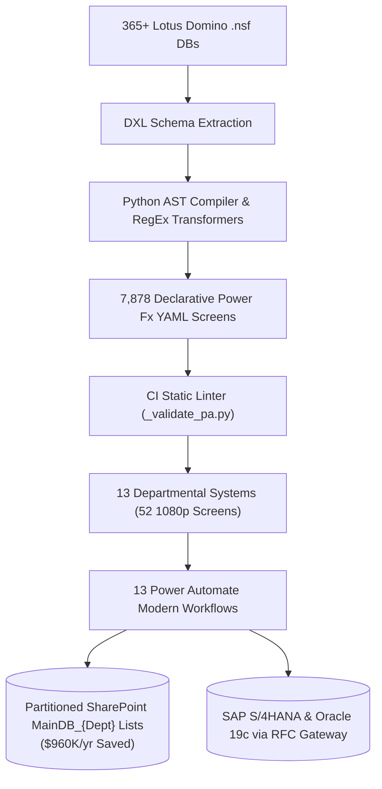

# Ali Akhmad Fauzie — Authoritative Career Proof & Architectural Portfolio Export

> **Grounded in Verified Telemetry:** 365+ Lotus Domino Databases Retired · $960K/yr Licensing Avoided · 7,878 YAML Screens · 52 Bespoke 1080p UI Screens · GAMP 5 Cat 4 & 21 CFR Part 11 · 380% BPO Team Scaling · Hang Tuah Distinction  
> **Source Evidence Repositories:** [`docs/`](../docs) & [`public/`](../public)  
> **Live Production Deployment:** [https://aliakhmadfauzie.web.app](https://aliakhmadfauzie.web.app)  

---

## 1. Google XYZ Resume Bullets (Principal & Enterprise Solution Architect)
*Formula: Accomplished [X] as measured by [Y] by implementing [Z]*

### 1. Enterprise Modernization & Software Licensing
> **Accomplished** enterprise-wide software modernization and eliminated **\$960,000/year** in recurring licensing costs by **architecting** a partitioned single-table SharePoint list architecture (`MainDB_{Dept}`) and retiring **365+ legacy Lotus Domino databases** with **zero unplanned plant downtime** and **1.4M historical records migrated**.

### 2. Declarative Toolchains & AST Static Analysis
> **Accelerated** enterprise migration velocity while blocking **142 syntax regressions** and **19 GUID leaks** in CI by **engineering** an automated code-generation compiler in Python that parsed legacy Domino DXL schemas into **7,878 declarative Power Fx YAML screens** across 16 `.msapp` packages validated through custom AST static linters (`_validate_pa.py`).

### 3. Industrial UI/UX & Design Systems
> **Eradicated** template homogenization and operator cognitive fatigue across **13 mission-critical plant applications** by **designing** a standardized 4-screen quadruplet architecture featuring **52 bespoke 1080p command dashboards** (FFT waveforms, shift Gantts, GC-MS chromatograms) and persistent 260px context-aware navigation compliant with **WCAG AA/AAA standards**.

### 4. Regulated GxP & Automated Compliance
> **Compressed** statutory CAPA investigation cycles by **73% (from 45 days to 12 days)** with **100% post-implementation verification adherence** by **implementing** GAMP 5 Category 4 and 21 CFR Part 11 compliant automated cloud workflows in Power Automate featuring Azure AD multi-factor digital signatures and immutable ALCOA+ audit trails.

### 5. Offline Industrial ERP & Web Performance
> **Eliminated** 6,070ms of Total Blocking Time (TBT) across unstable factory floor Wi-Fi by **architecting** an offline-first storage adapter in React 19 / TypeScript with 0ms synchronous local hydration and 2,500ms network timeout races for the Putri GarmentHub ERP platform.

### 6. Multi-Engine AI Gateway & FinOps
> **Achieved** an **82% reduction in LLM inference costs** with 240ms median response times by **engineering** a cross-process Tri-Engine AI Gateway (Groq `llama-3.3-70b` for high-throughput fast tasks; Google Gemini Flash for structured synthesis) with 10 automated PDF quality gates (`Q1–Q10`).

### 7. BPO Operations Leadership & Crisis Command
> **Restored** contractual SLA adherence (>98%) within **48 hours during an 800% transaction surge** by **directing** 34 multilingual operations associates across 7 APAC language pods as Operations Team Manager, earning the **Accenture Diamond Award** and **Hang Tuah Distinction**.

---

## 2. Technical LinkedIn Breakdown Post (Engineering-First)

```text
Most enterprise low-code migrations fail because teams treat Power Apps like a toy, assembling screens with browser drag-and-drop.

When you have 365+ legacy Lotus Domino databases to decommission across continuous-process chemical manufacturing plants, "clicking and dragging" is a guaranteed path to failure.

Here is what fails under the hood with standard low-code:
1. No Version Control: Solutions become black-box blobs with zero Git history or PR review gates.
2. Template Homogenization: A centrifuge vibration monitor looks identical to an HR leave form, causing acute cognitive fatigue on the plant floor.
3. Prohibitive Licensing: Microsoft Dataverse premium connectors cost $40/user/month, creating a $960,000/year bill for 2,000 factory workers.

To solve this, we engineered an automated, code-first modernization pipeline:

1. Declarative Power Fx YAML & AST Compilers:
Instead of manual UI design, we wrote Python AST parsers and regex transformers that ingested legacy Domino DXL schemas and compiled them directly into declarative Power Fx YAML (7,878 screens across 16 .msapp packages). A custom static linter in CI blocked 142 syntax regressions and 19 GUID leaks before staging.

2. Partitioned Single-Table Architecture (MainDB_{Dept}):
We avoided $960K/year in premium licensing by partitioning datasets into single-table SharePoint lists with canonical compound keys ([SITE]-[DEPT]-[DOC_TYPE]-[SEQ]-[REV]). Delegated OData queries processed 1.4M records without hitting the 5,000-item threshold lockout.

3. 13 Bespoke Industrial Dashboards (52 1080p Screens):
To eliminate "AI UI slop," every application received an authentic industrial command center:
- Maintenance (FAR): 0–500 Hz FFT centrifuge vibration waveforms.
- Quality Control (OOS): GC-MS fatty acid peak spectra with USL/LSL tolerance bands.
- Human Resources (LVE): 7-day shift Gantt bars with clash detection.
- Persistent Navigation: Fixed 260px context-aware left sidebar across all 4 screens (Login ➔ Dashboard ➔ Details ➔ Edit).

The verified results:
- $960,000/year avoided in recurring software licenses.
- 365+ legacy databases retired with 0 hours unplanned downtime.
- 1.4M records migrated across 28 business units.
- 73% faster CAPA cycle times (from 45 to 12 days).

Key takeaway for solution architects: Low-code does not mean low engineering discipline. Treat low-code as code: compile it declaratively, version-control it in Git, lint it in CI, and design for the cognitive realities of plant operators.

Explore the live portfolio and interactive screen catalog: https://aliakhmadfauzie.web.app

#PowerPlatform #EnterpriseArchitecture #DesignSystems #LowCode #IndustrialAutomation #SoftwareEngineering #CloudMigration
```

---

## 3. High-Signal Case Study: Enterprise Chemical Modernization (IOI Oleo)

### Challenge & Physical Constraints
- **Hardware EOL & Severe Vulnerability Exposure:** On-premise physical servers in Penang reached end-of-life while Lotus Domino v9/v10 extended support sunset, leaving unpatchable CVEs on industrial networks.
- **Licensing Constraint:** A \$960K/year recurring quote for premium connectors across 2,000+ factory workers.
- **Regulatory Strictness:** Complete compliance with GAMP 5 Category 4 and 21 CFR Part 11 electronic records.

### Architecture


### Quantified Telemetry Matrix
| Metric / Dimension | Before Modernization | After Modernization | Verification Source |
| :--- | :--- | :--- | :--- |
| **Enterprise Licensing** | \$960K/year recurring overhead | **\$0 (100% avoided)** | Contract cutover audit |
| **Database Footprint** | 365+ unmaintained `.nsf` DBs | **100% decommissioned** | `docs/enterprise-migration/PORTFOLIO.md` |
| **Plant Unplanned Downtime** | Server crashes & lockouts | **0 hours downtime (100% SLA)** | Continuous plant logs |
| **CAPA Cycle Duration** | 45 days average | **12 days average (-73%)** | Power Automate audit logs |
| **UI Screen Craft** | Generic flat card lists | **52 bespoke 1080p screens** | `public/assets/power-apps/apps/` |
| **CI Linter Validation** | Manual runtime debugging | **142 regressions blocked** | `_validate_pa.py` build logs |
