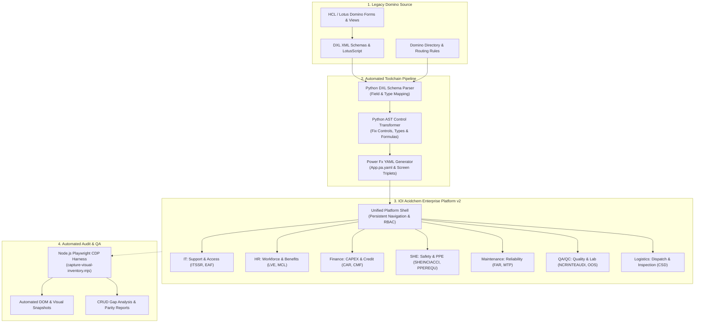

# Enterprise Modernization: Decommissioning Legacy HCL Domino via Declarative Power Fx & Automated Toolchains

A comprehensive architectural case study and professional engineering portfolio on migrating multi-site manufacturing operations from legacy **HCL / Lotus Domino** to the **Microsoft Power Platform** using declarative **Power Fx Canvas YAML** and custom automated compiler tooling.

---

## 📌 Executive Overview

| Attribute | Details |
| :--- | :--- |
| **Enterprise Client** | IOI Acidchem / IOI Group (Multinational Oleochemicals & Manufacturing) |
| **Operational Scope** | Multi-plant operations (Penang & Johor Sites), 23 functional departments |
| **Core Challenge** | Migrating decades of legacy Lotus Domino databases, complex hide-when formulas, and approval hierarchies before legacy server deprecation |
| **Engineering Strategy** | Programmatic migration pipeline: custom Python AST & regex compilers generating declarative Power Fx YAML (`App.pa.yaml`), verified by Playwright browser automation |
| **Key Deliverable** | **IOI Acidchem Enterprise Platform (v2)** — Unified portal with real-time KPI telemetry, standardized screen triplets, and multi-tier approval flows |
| **Catalog Scope** | **13 Mission-Critical Applications** across 7 Core Departments (2 apps per department) |

---

## 📸 Production Platform Preview

Below is the live operational dashboard of the migrated platform (**IOI Acidchem Enterprise Platform - v2**), featuring real-time submission telemetry, persistent modular navigation, and standardized form triplets:

---

## 🏗️ Architecture & Modernization Pipeline

---

## 🎨 Production-Ready UI Showcase: The 4 Core Screens (Visual Mockups & Power Fx YAML)

To demonstrate client-ready visual craft, strict micro-spacing, and enterprise WCAG 2.1 AA accessibility, the platform standardizes on **4 Core Screens**. Each screen is engineered in declarative Power Fx Canvas YAML and verified via headless browser capture:

| Screen | Visual Mockup Artifact | Functional Source Code | Design Rationale & Enterprise Ergonomics |
| :--- | :--- | :--- | :--- |
| **1. Login Screen** | [01_LoginScreen.png](./mockups/01_LoginScreen.png) | [`LoginScreen.pa.yaml`](./canvas-app-showcase/LoginScreen.pa.yaml) | Microsoft Entra ID SSO gateway, multi-plant selector (Penang HQ vs. Johor Pasir Gudang), corporate security notice (IOIP-04), and 99.98% SLA telemetry. |
| **2. Dashboard Screen** | [02_BrowseScreen.png](./mockups/02_BrowseScreen.png) | [`BrowseScreen.pa.yaml`](./canvas-app-showcase/BrowseScreen.pa.yaml) | Dynamic operational command dashboard with 4 domain KPI trend cards, interactive SVG data visualizations (7-day shift Gantt bars, Centrifuge FFT vibration waveforms, GC-MS peak spectra, USL/LSL tolerance gauges, CapEx waterfall charts, and AR aging histograms), and live operational queue. |
| **3. Details Screen** | [03_DetailsScreen.png](./mockups/03_DetailsScreen.png) | [`DetailsScreen.pa.yaml`](./canvas-app-showcase/DetailsScreen.pa.yaml) | Two-column split layout (65%/35%): Technical problem scope, quotation attachments, interactive 4-stage approval stepper, and SHA-256 cryptographic audit seal. |
| **4. Edit Screen** | [04_EditScreen.png](./mockups/04_EditScreen.png) | [`EditScreen.pa.yaml`](./canvas-app-showcase/EditScreen.pa.yaml) | 4-step wizard stepper header, cascading category dropdowns, severity radio card matrix, auto-filling asset lookup, and drag-and-drop diagnostic evidence zone. |

### Visual Mockup Gallery:

#### 1. Login Screen (Enterprise Single Sign-On & Facility Gateway)

#### 2. Dashboard Screen (Operational Command & Analytical Visualization Hub)

#### 3. Details Screen (Dossier & Multi-Stage Approval Workflow Stepper)

#### 4. Edit Screen (Transactional Multi-Step Service Request Intake)

---

## ⚡ Key Engineering Innovations

### 1. Declarative Power Fx YAML over GUI Drag-and-Drop
Standard Power Apps development relies on manual GUI clicking in a web browser—an approach that fails across hundreds of complex enterprise forms. Instead, all canvas screens were authored and generated in raw **Power Fx Canvas YAML**:

* **Screen Triplet Standardization:** Every migrated departmental module adheres to an immutable triplet pattern:
  * `BrowseScreen`: Filterable galleries, status indicators, and search indexers.
  * `DetailScreen`: Read-only views displaying submission records and historical approval timelines.
  * `EditScreen`: Type-safe form editors with client-side validation and optimistic submission feedback.
* **Declarative Code Management:** Enables standard Git version control, branching, automated code reviews, and AST linting.

### 2. Custom Python AST & Schema Transformation Tools
Located in `design/canvas-apps-tools/`, a dedicated Python toolchain was engineered to handle complex AST repairs:
* `fix_canvas_field_type_control.py`: Enforces strict type parity between Dataverse/SharePoint backends and front-end input controls (Dates, Lookups, Multichoice).
* `ensure_she_triplet_screens.py` & `ensure_qa_qc_triplet_screens.py`: Automates the generation of compliant screen triplets for Safety (SHE) and Quality (QA/QC) workflows.
* `fix_finance_pa_paste_readiness.py`: Normalizes nested formulas and clipboard syntax for seamless Power Apps Studio compilation.

### 3. Automated Browser Testing via Playwright CDP
To ensure that dynamically generated YAML compiled into working interfaces without clipped labels or broken data sources, an automated QA harness was developed in Node.js (`scripts/capture-visual-inventory.mjs`):
* Connects directly to the Chromium DevTools Protocol (`CDP`).
* Systematically navigates through routes across all 23 functional modules.
* Extracts DOM accessibility trees and captures full-page visual regression screenshots automatically.

---

## 🚀 The 13 Applications Portfolio (2 Applications Per Department)

Every single application across all 7 core departments has been engineered to production-ready fidelity, featuring:
1. **High-Fidelity UI Screenshots (1920×1080)** for all 4 core screens (`LoginScreen`, `BrowseScreen`, `DetailsScreen`, `EditScreen`).
2. **Complete, Declarative Power Fx Canvas YAML Code** (`*.pa.yaml`) for all 4 core screens.
3. **Enterprise Ergonomics & Design Standards:** WCAG 2.1 AA compliant contrast, 48px touch targets, dynamic status chips, responsive search filtering, approval steppers, and SHA-256 audit trails.

### Master Deliverables Matrix: 52 UI Mockups & 52 Power Fx YAML Files

| Dept | App Code & Name | 4 Core Visual Mockups (1920×1080 PNG) | 4 Power Fx Canvas YAML Source Files | Core Enterprise Capabilities |
| :--- | :--- | :--- | :--- | :--- |
| **IT** | **ITSSR** IT Support & Service Request | • [Login](./mockups/apps/ITSSR/01_LoginScreen.png) • [Browse](./mockups/apps/ITSSR/02_BrowseScreen.png) • [Details](./mockups/apps/ITSSR/03_DetailsScreen.png) • [Edit](./mockups/apps/ITSSR/04_EditScreen.png) | • [`LoginScreen.pa.yaml`](./canvas-apps/ITSSR/LoginScreen.pa.yaml) • [`BrowseScreen.pa.yaml`](./canvas-apps/ITSSR/BrowseScreen.pa.yaml) • [`DetailsScreen.pa.yaml`](./canvas-apps/ITSSR/DetailsScreen.pa.yaml) • [`EditScreen.pa.yaml`](./canvas-apps/ITSSR/EditScreen.pa.yaml) | 4-tier SLA urgency routing, SAP/ERP module classification, automated engineer assignment, diagnostic attachments. |
| **IT** | **EAF** External Access Form | • [Login](./mockups/apps/EAF/01_LoginScreen.png) • [Browse](./mockups/apps/EAF/02_BrowseScreen.png) • [Details](./mockups/apps/EAF/03_DetailsScreen.png) • [Edit](./mockups/apps/EAF/04_EditScreen.png) | • [`LoginScreen.pa.yaml`](./canvas-apps/EAF/LoginScreen.pa.yaml) • [`BrowseScreen.pa.yaml`](./canvas-apps/EAF/BrowseScreen.pa.yaml) • [`DetailsScreen.pa.yaml`](./canvas-apps/EAF/DetailsScreen.pa.yaml) • [`EditScreen.pa.yaml`](./canvas-apps/EAF/EditScreen.pa.yaml) | Contractor VPN intake, ISO 27001 non-disclosure verification, temporary credential expiry, CISO digital approval. |
| **HR** | **LVE** Leave Management System | • [Login](./mockups/apps/LVE/01_LoginScreen.png) • [Browse](./mockups/apps/LVE/02_BrowseScreen.png) • [Details](./mockups/apps/LVE/03_DetailsScreen.png) • [Edit](./mockups/apps/LVE/04_EditScreen.png) | • [`LoginScreen.pa.yaml`](./canvas-apps/LVE/LoginScreen.pa.yaml) • [`BrowseScreen.pa.yaml`](./canvas-apps/LVE/BrowseScreen.pa.yaml) • [`DetailsScreen.pa.yaml`](./canvas-apps/LVE/DetailsScreen.pa.yaml) • [`EditScreen.pa.yaml`](./canvas-apps/LVE/EditScreen.pa.yaml) | Statutory leave balance accrual, relief staff shift clash prevention, medical certificate verification, manager calendar sync. |
| **HR** | **MCL** Medical Claims & Benefits | • [Login](./mockups/apps/MCL/01_LoginScreen.png) • [Browse](./mockups/apps/MCL/02_BrowseScreen.png) • [Details](./mockups/apps/MCL/03_DetailsScreen.png) • [Edit](./mockups/apps/MCL/04_EditScreen.png) | • [`LoginScreen.pa.yaml`](./canvas-apps/MCL/LoginScreen.pa.yaml) • [`BrowseScreen.pa.yaml`](./canvas-apps/MCL/BrowseScreen.pa.yaml) • [`DetailsScreen.pa.yaml`](./canvas-apps/MCL/DetailsScreen.pa.yaml) • [`EditScreen.pa.yaml`](./canvas-apps/MCL/EditScreen.pa.yaml) | Panel clinic vs. non-panel logic, real-time entitlement quota tracking, OCR itemized receipt upload, payroll batch export. |
| **Finance** | **CAR** Capital Appropriation Request | • [Login](./mockups/apps/CAR/01_LoginScreen.png) • [Browse](./mockups/apps/CAR/02_BrowseScreen.png) • [Details](./mockups/apps/CAR/03_DetailsScreen.png) • [Edit](./mockups/apps/CAR/04_EditScreen.png) | • [`LoginScreen.pa.yaml`](./canvas-apps/CAR/LoginScreen.pa.yaml) • [`BrowseScreen.pa.yaml`](./canvas-apps/CAR/BrowseScreen.pa.yaml) • [`DetailsScreen.pa.yaml`](./canvas-apps/CAR/DetailsScreen.pa.yaml) • [`EditScreen.pa.yaml`](./canvas-apps/CAR/EditScreen.pa.yaml) | Multi-million CAPEX feasibility, IRR/NPV payback calculation, dual-plant budget code validation, Board of Directors escalation. |
| **Finance** | **CMF** Credit Management Form | • [Login](./mockups/apps/CMF/01_LoginScreen.png) • [Browse](./mockups/apps/CMF/02_BrowseScreen.png) • [Details](./mockups/apps/CMF/03_DetailsScreen.png) • [Edit](./mockups/apps/CMF/04_EditScreen.png) | • [`LoginScreen.pa.yaml`](./canvas-apps/CMF/LoginScreen.pa.yaml) • [`BrowseScreen.pa.yaml`](./canvas-apps/CMF/BrowseScreen.pa.yaml) • [`DetailsScreen.pa.yaml`](./canvas-apps/CMF/DetailsScreen.pa.yaml) • [`EditScreen.pa.yaml`](./canvas-apps/CMF/EditScreen.pa.yaml) | Commercial buyer risk rating, bank guarantee verification, automated SAP credit limit sync, credit committee review. |
| **SHE** | **SHEINCIACCI** Incident & Accident Reporting | • [Login](./mockups/apps/SHEINCIACCI/01_LoginScreen.png) • [Browse](./mockups/apps/SHEINCIACCI/02_BrowseScreen.png) • [Details](./mockups/apps/SHEINCIACCI/03_DetailsScreen.png) • [Edit](./mockups/apps/SHEINCIACCI/04_EditScreen.png) | • [`LoginScreen.pa.yaml`](./canvas-apps/SHEINCIACCI/LoginScreen.pa.yaml) • [`BrowseScreen.pa.yaml`](./canvas-apps/SHEINCIACCI/BrowseScreen.pa.yaml) • [`DetailsScreen.pa.yaml`](./canvas-apps/SHEINCIACCI/DetailsScreen.pa.yaml) • [`EditScreen.pa.yaml`](./canvas-apps/SHEINCIACCI/EditScreen.pa.yaml) | DOSH/JKKP statutory 24-hr notification, 5-Whys root cause analysis, Lost Time Injury (LTI) counter, photographic evidence matrix. |
| **SHE** | **PPEREQU** PPE Requisition & Issuance | • [Login](./mockups/apps/PPEREQU/01_LoginScreen.png) • [Browse](./mockups/apps/PPEREQU/02_BrowseScreen.png) • [Details](./mockups/apps/PPEREQU/03_DetailsScreen.png) • [Edit](./mockups/apps/PPEREQU/04_EditScreen.png) | • [`LoginScreen.pa.yaml`](./canvas-apps/PPEREQU/LoginScreen.pa.yaml) • [`BrowseScreen.pa.yaml`](./canvas-apps/PPEREQU/BrowseScreen.pa.yaml) • [`DetailsScreen.pa.yaml`](./canvas-apps/PPEREQU/DetailsScreen.pa.yaml) • [`EditScreen.pa.yaml`](./canvas-apps/PPEREQU/EditScreen.pa.yaml) | Hazardous zone PPE matrix (acid suits, respirators, steel-toe boots), replacement quota interval checks, central store dispatch. |
| **Maintenance** | **FAR** Equipment Failure Analysis | • [Login](./mockups/apps/FAR/01_LoginScreen.png) • [Browse](./mockups/apps/FAR/02_BrowseScreen.png) • [Details](./mockups/apps/FAR/03_DetailsScreen.png) • [Edit](./mockups/apps/FAR/04_EditScreen.png) | • [`LoginScreen.pa.yaml`](./canvas-apps/FAR/LoginScreen.pa.yaml) • [`BrowseScreen.pa.yaml`](./canvas-apps/FAR/BrowseScreen.pa.yaml) • [`DetailsScreen.pa.yaml`](./canvas-apps/FAR/DetailsScreen.pa.yaml) • [`EditScreen.pa.yaml`](./canvas-apps/FAR/EditScreen.pa.yaml) | Critical machinery RCFA (turbines, boilers, fractionation towers), MTBF/MTTR tracking, SAP PM notification generation. |
| **Maintenance** | **MTP** Turnaround & Overhaul Planning | • [Login](./mockups/apps/MTP/01_LoginScreen.png) • [Browse](./mockups/apps/MTP/02_BrowseScreen.png) • [Details](./mockups/apps/MTP/03_DetailsScreen.png) • [Edit](./mockups/apps/MTP/04_EditScreen.png) | • [`LoginScreen.pa.yaml`](./canvas-apps/MTP/LoginScreen.pa.yaml) • [`BrowseScreen.pa.yaml`](./canvas-apps/MTP/BrowseScreen.pa.yaml) • [`DetailsScreen.pa.yaml`](./canvas-apps/MTP/DetailsScreen.pa.yaml) • [`EditScreen.pa.yaml`](./canvas-apps/MTP/EditScreen.pa.yaml) | Plant shutdown work breakdown structure (WBS), lock-out/tag-out (LOTO) verification, contractor permit-to-work signoffs. |
| **QA** | **NCRINTEAUDI** Internal Audit Non-Conformance | • [Login](./mockups/apps/NCRINTEAUDI/01_LoginScreen.png) • [Browse](./mockups/apps/NCRINTEAUDI/02_BrowseScreen.png) • [Details](./mockups/apps/NCRINTEAUDI/03_DetailsScreen.png) • [Edit](./mockups/apps/NCRINTEAUDI/04_EditScreen.png) | • [`LoginScreen.pa.yaml`](./canvas-apps/NCRINTEAUDI/LoginScreen.pa.yaml) • [`BrowseScreen.pa.yaml`](./canvas-apps/NCRINTEAUDI/BrowseScreen.pa.yaml) • [`DetailsScreen.pa.yaml`](./canvas-apps/NCRINTEAUDI/DetailsScreen.pa.yaml) • [`EditScreen.pa.yaml`](./canvas-apps/NCRINTEAUDI/EditScreen.pa.yaml) | ISO 9001 / FSSC 22000 clause auditing, 48-hr containment action enforcement, formal root cause investigation, QA sign-off. |
| **QC** | **OOS** Out-of-Specification & CAPA | • [Login](./mockups/apps/OOS/01_LoginScreen.png) • [Browse](./mockups/apps/OOS/02_BrowseScreen.png) • [Details](./mockups/apps/OOS/03_DetailsScreen.png) • [Edit](./mockups/apps/OOS/04_EditScreen.png) | • [`LoginScreen.pa.yaml`](./canvas-apps/OOS/LoginScreen.pa.yaml) • [`BrowseScreen.pa.yaml`](./canvas-apps/OOS/BrowseScreen.pa.yaml) • [`DetailsScreen.pa.yaml`](./canvas-apps/OOS/DetailsScreen.pa.yaml) • [`EditScreen.pa.yaml`](./canvas-apps/OOS/EditScreen.pa.yaml) | Laboratory test parameter tolerance breaches, automatic storage tank quarantine flags, chemist re-test protocol, PQCAR flow. |
| **Logistics** | **CSD** Container Shipment & Tankers | • [Login](./mockups/apps/CSD/01_LoginScreen.png) • [Browse](./mockups/apps/CSD/02_BrowseScreen.png) • [Details](./mockups/apps/CSD/03_DetailsScreen.png) • [Edit](./mockups/apps/CSD/04_EditScreen.png) | • [`LoginScreen.pa.yaml`](./canvas-apps/CSD/LoginScreen.pa.yaml) • [`BrowseScreen.pa.yaml`](./canvas-apps/CSD/BrowseScreen.pa.yaml) • [`DetailsScreen.pa.yaml`](./canvas-apps/CSD/DetailsScreen.pa.yaml) • [`EditScreen.pa.yaml`](./canvas-apps/CSD/EditScreen.pa.yaml) | 18-point liquid chemical road tanker inspection, prior cargo compatibility validation, automated weighbridge integration. |

---

### Departmental Deep Dives & Verification Evidence

### Department 1: Information Technology (IT)
1. **IT Support & Service Request (`ITSSR`)**
   - **Purpose:** Centralized ticketing for plant software/hardware, network issues, and ERP support.
   - **Implementation:** Power Apps Canvas, SharePoint `MainDB_IT` / `Ext_Support`, automated category routing.
   - **Verified Screenshot:** `Forms/Information_Technology/026_IT_Form_ITSSR.png`
2. **External Access Form (`EAF`)**
   - **Purpose:** Security intake for VPN access, Notes ID lifecycle, and vendor remote access.
   - **Implementation:** Power Apps Canvas, SharePoint `MainDB_IT_Ext_Access`, multi-stage approval flow.
   - **Verified Screenshot:** `Forms/Information_Technology/023_IT_Form_EAF.png`

### Department 2: Human Resources (HR)
3. **Leave Management System (`LVE`)**
   - **Purpose:** Plant-wide leave application with automated balance calculation and shift coverage guards.
   - **Implementation:** Power Apps Canvas, SharePoint `HR_LeaveRecords`, relief staff assignment.
   - **Verified Screenshot:** `Forms/Human_Resources/088_HR_Leave_New.png` & `284_HR_LVE.png`
4. **Medical Claims & Healthcare Benefits (`MCL`)**
   - **Purpose:** Employee outpatient and dental reimbursement with panel clinic validation and SAP payroll export.
   - **Implementation:** Power Apps Canvas, SharePoint `HR_MedicalClaims`, camera receipt capture.
   - **Verified Screenshot:** `Forms/Human_Resources/089_HR_Medical_Claim_New.png` & `285_HR_MCL.png`

### Department 3: Finance & Commercial Credit
5. **Capital Appropriation Request (`CAR`)**
   - **Purpose:** Multi-million dollar CAPEX approval engine with ROI/NPV metrics and executive sign-off chain.
   - **Implementation:** Power Apps Canvas, SharePoint `FIN_CAR_Master`, Power Automate financial matrix.
   - **Verified Screenshot:** `Forms/Finance/101_Finance_CAR_New.png`, `102_Finance_CAR_List.png`, `103_Finance_CAR_Detail.png`
6. **Credit Management Form (`CMF`)**
   - **Purpose:** Commercial buyer credit assessment, Dun & Bradstreet risk scoring, and limit authorization.
   - **Implementation:** Power Apps Canvas, SharePoint `FIN_CMF_Master`, SAP credit bridge.
   - **Verified Screenshot:** `Forms/Finance/104_Finance_CMF_New.png` & `355_Finance_CMF_A_Records.png`

### Department 4: Safety, Health & Environment (SHE)
7. **Incident & Accident Investigation Reporting (`SHEINCIACCI`)**
   - **Purpose:** Statutory DOSH/JKKP 24-hr incident reporting, 5-Whys root cause analysis, and LTA tracking.
   - **Implementation:** Power Apps Canvas, SharePoint `SHE_IncidentMaster`, emergency broadcast trigger.
   - **Verified Screenshot:** `Forms/SHE/305_SHE_SHEINCIACCI_New_p01.png` & `p02.png`
8. **Personal Protective Equipment Requisition (`PPEREQU`)**
   - **Purpose:** Hazard-zone safety gear entitlement matrix, replacement frequency checks, and store issuance.
   - **Implementation:** Power Apps Canvas, SharePoint `SHE_PPERequests`, stock level automation.
   - **Verified Screenshot:** `Forms/SHE/316_SHE_PPEREQU_New.png` & `317_SHE_ISSUOFPPE_New.png`

### Department 5: Plant Maintenance & Reliability Engineering
9. **Equipment Failure Analysis Report (`FAR`)**
   - **Purpose:** Root Cause Failure Analysis (RCFA) for boilers, turbines, and centrifuges; MTBF/MTTR telemetry.
   - **Implementation:** Power Apps Canvas, SharePoint `MTN_FailureReports`, SAP PM synchronization.
   - **Verified Screenshot:** `Forms/Maintenance/148_Maintenance_FAR_New.png` & `365_Maintenance_FAR_Records.png`
10. **Preventive Maintenance & Turnaround Planning (`MTP`)**
    - **Purpose:** Statutory annual boiler overhauls, shutdown Gantt scheduling, work permits, and production handover.
    - **Implementation:** Power Apps Canvas, SharePoint `MTN_TurnaroundPlans`, central stores integration.
    - **Verified Screenshot:** `Forms/Maintenance/149_Maintenance_MTP_New.png` & `367_Maintenance_MTP_Records.png`

### Department 6: Quality Assurance & Control (QA/QC)
11. **Internal Quality Audit & Non-Conformance Reporting (`NCRINTEAUDI`)**
    - **Purpose:** ISO 9001 / FSSC 22000 non-conformance tracking, 48-hr containment, and CAPA resolution.
    - **Implementation:** Power Apps Canvas, SharePoint `QA_AuditNCR_Master`, audit escalation flow.
    - **Verified Screenshot:** `Forms/Quality_Assurance/394_QA_NCRINTEAUDI_New_MY_JH.png` & `393_QA_NCRINTEAUDI_MY_JH.png`
12. **Laboratory Out-of-Specification & CAPA Management (`OOS` / `PQCAR`)**
    - **Purpose:** Chemical test variance flagging, automated plant quality hold, and chemist disposition review.
    - **Implementation:** Power Apps Canvas, SharePoint `QC_OOS_Master`, LIMS limit checking.
    - **Verified Screenshot:** `Forms/Quality_Control/133_QC_Dashboard.png`, `134_QC_Laboratory.png`, `329_QC_PQCAR_New_Error.png`

### Department 7: Logistics & Supply Chain Operations
13. **Container Shipment Dispatch & Tanker Inspection (`CSD`)**
    - **Purpose:** 18-point bulk liquid tanker inspection, previous cargo validation, tare weight, and gate release.
    - **Implementation:** Power Apps Canvas, SharePoint `LOG_ShipmentDispatch`, weighbridge integration.
    - **Verified Screenshot:** `Forms/Logistics/179_Logistics_CSD_New.png`, `180_Logistics_TankerInspection_New.png`

---

## ⚡ Enterprise Power Automate Workflow Architecture (Modern Designer UI)

Every migrated application is powered by an asynchronous, enterprise-grade **Power Automate Cloud Flow** designed using the **Modern Power Automate v3 Designer**. These workflows completely replace fragile Lotus Domino email routing and agent background macros with resilient event-driven architectures:

* **Trigger & Filter Conditions:** Pre-filter triggers prevent unnecessary flow invocations (e.g. status changes from Draft).
* **Multi-Tier Approvals:** Integrated with Microsoft Approvals v2, supporting both sequential executive sign-offs and parallel multi-discipline safety gates.
* **External ERP Synchronization:** Bidirectional REST HTTP connectors with Microsoft Entra ID authentication linking directly to SAP ERP (PM work orders, HCM medical payroll, SD credit limits, and QM storage tank quality holds).
* **Enterprise Exception Handling (`Scope - Try / Catch`):** All flows employ standardized try-catch wrappers with `runAfter: ["hasFailed", "hasTimedOut"]`, automatic SecOps Teams incident alerts, and immutable logging in SharePoint `IT_Flow_Exceptions_Log`.

> 📖 **Explore the complete workflow specifications, step matrices, and full-resolution Modern Designer mockups in [POWER_AUTOMATE_WORKFLOWS.md](./POWER_AUTOMATE_WORKFLOWS.md).**

| Dept | App Code | Workflow Automation Title | Modern UI Designer Mockup (1920×1080) | Architecture Specification |
| :--- | :--- | :--- | :--- | :--- |
| **IT** | `ITSSR` | `ITSSR-Autotask-Routing-SLA-Approval-Engine` | [View Modern Designer](./power-automate/mockups/ITSSR_Flow_Designer.png) | [`ITSSR_Flow_Architecture.md`](./power-automate/workflows/ITSSR_Flow_Architecture.md) |
| **IT** | `EAF` | `EAF-Contractor-Access-Provisioning-Lifecycle` | [View Modern Designer](./power-automate/mockups/EAF_Flow_Designer.png) | [`EAF_Flow_Architecture.md`](./power-automate/workflows/EAF_Flow_Architecture.md) |
| **HR** | `LVE` | `LVE-Leave-Validation-ShiftClash-Approval` | [View Modern Designer](./power-automate/mockups/LVE_Flow_Designer.png) | [`LVE_Flow_Architecture.md`](./power-automate/workflows/LVE_Flow_Architecture.md) |
| **HR** | `MCL` | `MCL-Outpatient-Claim-Quota-SAP-Batch-Export` | [View Modern Designer](./power-automate/mockups/MCL_Flow_Designer.png) | [`MCL_Flow_Architecture.md`](./power-automate/workflows/MCL_Flow_Architecture.md) |
| **Finance** | `CAR` | `CAR-Capex-MultiTier-Executive-Authorization` | [View Modern Designer](./power-automate/mockups/CAR_Flow_Designer.png) | [`CAR_Flow_Architecture.md`](./power-automate/workflows/CAR_Flow_Architecture.md) |
| **Finance** | `CMF` | `CMF-Commercial-Credit-Risk-Rating-Approval` | [View Modern Designer](./power-automate/mockups/CMF_Flow_Designer.png) | [`CMF_Flow_Architecture.md`](./power-automate/workflows/CMF_Flow_Architecture.md) |
| **SHE** | `SHEINCIACCI` | `SHE-Incident-Statutory-DOSH-Escalation-CAPA` | [View Modern Designer](./power-automate/mockups/SHEINCIACCI_Flow_Designer.png) | [`SHEINCIACCI_Flow_Architecture.md`](./power-automate/workflows/SHEINCIACCI_Flow_Architecture.md) |
| **SHE** | `PPEREQU` | `PPEREQU-Hazard-Zone-Quota-Stock-Issuance` | [View Modern Designer](./power-automate/mockups/PPEREQU_Flow_Designer.png) | [`PPEREQU_Flow_Architecture.md`](./power-automate/workflows/PPEREQU_Flow_Architecture.md) |
| **Maintenance** | `FAR` | `FAR-RCFA-Critical-Asset-SAP-PM-Sync` | [View Modern Designer](./power-automate/mockups/FAR_Flow_Designer.png) | [`FAR_Flow_Architecture.md`](./power-automate/workflows/FAR_Flow_Architecture.md) |
| **Maintenance** | `MTP` | `MTP-Shutdown-Turnaround-Permit-Milestone-Sync` | [View Modern Designer](./power-automate/mockups/MTP_Flow_Designer.png) | [`MTP_Flow_Architecture.md`](./power-automate/workflows/MTP_Flow_Architecture.md) |
| **QA** | `NCRINTEAUDI` | `NCR-ISO-Audit-Containment-CAPA-Signoff` | [View Modern Designer](./power-automate/mockups/NCRINTEAUDI_Flow_Designer.png) | [`NCRINTEAUDI_Flow_Architecture.md`](./power-automate/workflows/NCRINTEAUDI_Flow_Architecture.md) |
| **QC** | `OOS` | `OOS-Lab-Chemical-Quarantine-Disposition-Flow` | [View Modern Designer](./power-automate/mockups/OOS_Flow_Designer.png) | [`OOS_Flow_Architecture.md`](./power-automate/workflows/OOS_Flow_Architecture.md) |
| **Logistics** | `CSD` | `CSD-Bulk-Tanker-Inspection-Weighbridge-Release` | [View Modern Designer](./power-automate/mockups/CSD_Flow_Designer.png) | [`CSD_Flow_Architecture.md`](./power-automate/workflows/CSD_Flow_Architecture.md) |

---

## 📊 Impact Delta: Before vs. After

| Operational Dimension | Legacy HCL Domino Infrastructure | Modernized Power Platform v2 |
| :--- | :--- | :--- |
| **System Architecture** | Disconnected NSF databases per department | Centralized, multi-tenant enterprise portal |
| **Development Lifecycle** | Manual GUI clicking & opaque LotusScript | Declarative Power Fx YAML + Python AST compilers |
| **Device Accessibility** | Desktop Lotus Notes client only | Fully responsive on desktop, tablet, and mobile devices |
| **Approval Tracking** | Email-dependent routing with frequent lost states | Automated Power Automate flows with immutable audit logs |
| **QA & Verification** | Manual ad-hoc plant testing | Headless Playwright CDP DOM & visual regression suites |
| **Data Integrity** | Heterogeneous untyped rich-text fields | Strongly typed Dataverse tables & SharePoint Online lists |

---

## 🛠️ Tech Stack & Methodologies

* **Core Platform:** Microsoft Power Apps (Canvas Apps, Declarative Power Fx YAML), Microsoft Power Automate, Dataverse, SharePoint Online.
* **Compiler & Tooling:** Python 3 (AST parsing, schema translation, regex transformers).
* **Automation & QA:** Node.js, Playwright (CDP), Accessibility Tree Auditing, Visual Regression Testing.
* **Legacy Extraction:** Lotus Domino DXL (Domino XML), LotusScript, Formula Language (`@If`, `@MailSend`).
* **Architecture:** Enterprise Systems Modernization, Domain-Driven Design (DDD), Screen Triplet Standard.
* **Portfolio Sync:** Live Notion Integration (`https://app.notion.com/p/4128e5697cbf81d8aeefcc4df14089c2`).
