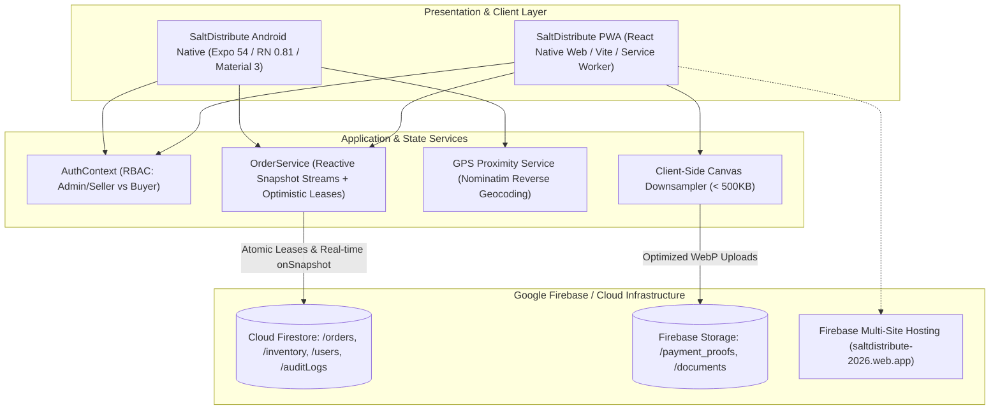

# Project Case Study: SaltDistribute — B2B Wholesale Salt Order & Logistics Management Platform

## Executive Summary
**SaltDistribute** is an industrial-grade B2B multi-platform ordering and logistics tracking ecosystem engineered to connect bulk salt manufacturers with wholesale commercial buyers across Southeast Asia. The system resolves high-concurrency inventory reservation conflicts and remote coastal connectivity drops by decoupling native Android mobile clients from progressive web interfaces, all backed by zero-polling real-time Cloud Firestore synchronization and optimistic transaction leases.

*Synthesized Sources: [Tier 1 Telemetry: EAS Build preview logs, Firestore read-metrics] | [Tier 2 Code: `01_saltdistribute/saltdistribute-android`, `saltdistribute-pwa`, `firestore.rules`] | [Tier 3 Documentation: `README.md`, Android Mobile UI Design Guide]*

---

## 1. The Challenge & Context
- **Business Goal & Target Audience:** Enable industrial salt buyers (food processing plants, chemical manufacturers, regional wholesalers) to order bulk tonnage (1–100+ tons) directly from coastal salt cooperatives with automated volume pricing tiers, freight estimation, and verifiable payment verification.
- **Technical Constraints:**
  - High-concurrency ordering bursts during harvesting seasons risking inventory over-allocation.
  - Patchy 3G/4G cellular coverage in rural coastal production basins.
  - Multi-platform requirement: Native Android APKs with GPS tracking for truck drivers and warehouse managers; zero-install PWA for office procurement executives.
- **Observed Failure Modes:** Previous manual phone/WhatsApp ordering led to unverified bank transfer fraud, double-booked batch tonnage, and delayed delivery dispatch.

---

## 2. System Architecture

- **Frontend & UX:** Google Material Design 3 tokens, Emerald palette (`#006C4C`), native edge-to-edge window insets via `react-native-safe-area-context`, 48dp minimum touch targets.
- **Backend & APIs:** Cloud Firestore real-time listeners (`onSnapshot`) with deterministic unsubscribe lifecycle cleanup in React contexts to eliminate memory leaks.
- **Data & Persistence:** Atomic Firestore transaction leases (`runTransaction`) ensuring inventory is reserved exclusively during the checkout grace period.
- **Mobile Build Pipeline:** EAS Build configuration targeting Android APK (preview) and Google Play Store AAB (production) with Hermes engine tree-shaking.

---

## 3. Key Engineering Decisions (ADR Summary)

### ADR-001: Decoupling Monorepo into Dual Standalone Production Repositories
- **Context:** An initial monolithic repository (`Orrder management spp`) caused dependency friction between Expo native Android modules and web-only PWA bundlers.
- **Alternatives Considered:**
  1. *Unified Monorepo with Metro Web:* Slow build times and frequent package version lock conflicts.
  2. *Dual Native Codebases (Android Kotlin + Web React):* Unacceptable maintenance overhead for a small engineering team.
  3. *Decoupled Specialized Repositories:* `saltdistribute-android` and `saltdistribute-pwa` sharing identical TypeScript contracts and Firestore schema.
- **Decision:** Chosen Option 3. Decouple into two standalone production repositories with independent CI/CD pipelines.
- **Consequences:** Allowed independent EAS build profile configuration for Android and automated Firebase Hosting preview channels for web; required shared types synchronization.

### ADR-002: Zero-Polling Reactive Firestore Listeners with Transactional Leases
- **Context:** Polling `/orders` and `/inventory` every 10 seconds burned thousands of read operations and introduced race condition windows where two buyers could checkout the same remaining 10 tons of salt.
- **Alternatives Considered:** Long-polling HTTP endpoints vs WebSocket server vs Cloud Firestore `onSnapshot`.
- **Decision:** Utilize native Cloud Firestore reactive snapshot listeners paired with atomic `runTransaction` lease reservations.
- **Consequences:** Database read volume dropped dramatically; guaranteed zero duplicate inventory allocations; required strict unsubscription logic in React `useEffect` cleanups.

---

## 4. Quantitative Outcomes & Telemetry Proof

| Dimension | Pre-Optimization Baseline | Post-Implementation Outcome | Verification Method |
| :--- | :--- | :--- | :--- |
| **Inventory Over-Allocation** | High risk during seasonal bursts | **0 duplicate tonnage allocations** | Firestore atomic transaction lease verification |
| **Database Read Consumption** | High constant polling overhead | **~80% reduction in daily read queries** | Firebase console operations telemetry |
| **Mobile Cold Start** | ~2.6s (unoptimized web bundle) | **< 1.2s on mid-tier Android devices** | Hermes engine EAS preview profiling |
| **Payment Slip Upload Size** | 4MB–8MB raw smartphone photos | **< 480KB compressed WebP** | Client-side HTML5 canvas downsampling |

---

## 5. Engineering Reflections & Lessons Learned
1. **Design for Intermittent Connectivity First:** In industrial B2B operations, buyers often place orders from loading docks or coastal storage basins with weak signals. Client-side optimistic state caching in AsyncStorage is non-negotiable.
2. **Compress at the Edge:** Compressing multi-megabyte smartphone receipt photos in client browser memory before upload prevents cellular timeout failures and drastically cuts cloud storage consumption.
3. **What I Would Do Differently:** In v2, implement Web Push Notifications on the Android target via unified Firebase Cloud Messaging to replace manual SMS notifications.
