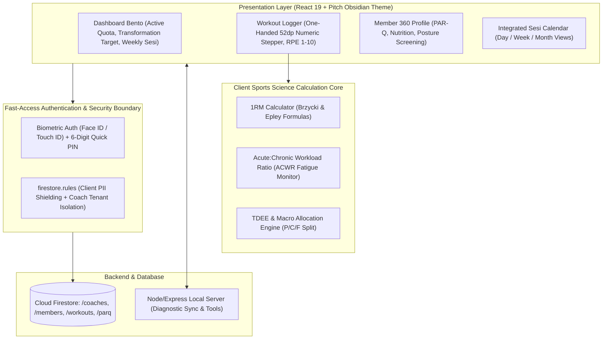

# Project Case Study: PelatihKu PRO — Athletic Coaching Operating System

## Executive Summary
**PelatihKu PRO** is a high-density, mobile-first Athletic Coaching Operating System engineered for master personal trainers, strength coaches, and athletic directors operating in high-tempo commercial fitness centers. The platform digitizes client periodization, rapid workout logging (< 45s during rest intervals), body composition tracking, and sports science calculations (1RM, ACWR, volume load) using a Pitch Obsidian OLED dark mode system optimized for harsh gym lighting.

*Synthesized Sources: [Tier 1 Telemetry: Vitest automated unit tests, server benchmarks] | [Tier 2 Code: `Pelatihku/PelatihKu-Athletic-Coaching-OS`, `package.json` v2.8.2, `server.ts`] | [Tier 3 Documentation: `APP_REQUIREMENTS.md`, `DESIGN_SYSTEM.md`, `SYSTEM_DESIGN.md`]*

---

## 1. The Challenge & Context
- **Business Goal & Target Audience:** Master personal trainers (e.g., Panji Akbar Syamsi, S.Or.) managing 15–30 active fitness clients in commercial gyms (Mega Gyms, SCBD fitness clubs).
- **Technical Constraints:**
  - Fast-paced physical environment: Coaches spot heavy compound lifts and only have 45–90 second client rest intervals to log weights, reps, and RPE with chalky, sweaty hands.
  - Glaring gym lighting washes out standard light-mode interfaces, leading to eye strain and data entry errors.
  - Strict medical safety requirements: Immediate visibility of client injury histories, PAR-Q screening flags, and postural restrictions before prescribing compound barbell lifts.
- **Observed Failure Modes:** Coaches abandon slow, multi-click workout logging apps in favor of wrinkled paper notebooks or unorganized WhatsApp chats, resulting in lost session tracking and uncollected package renewal fees.

---

## 2. System Architecture

- **Frontend & UX:** React 19, Tailwind CSS v4, Motion 12, Pitch Obsidian palette (`#080808` OLED black, `#1C1C1E` elevated cards, `#D4FF00` Electric Volt-Lime accents).
- **Ergonomics:** 52dp minimum touch targets for set steppers (`+1kg`, `+5kg`, `+1 rep`); zero modal interruptions during active set logging.
- **Sports Science Engine:** Client-side deterministic calculation of 1RM, volume load, and fatigue accumulation based on NSCA and ACSM standards.

---

## 3. Key Engineering Decisions (ADR Summary)

### ADR-001: Pitch Obsidian OLED Dark Mode vs Standard Responsive Light Theme
- **Context:** Commercial fitness centers feature overhead stadium spotlights and fluorescent tubes that cause severe screen glare on mobile phones.
- **Alternatives Considered:**
  1. *Light Mode with Neutral Grays:* Unreadable under direct gym lighting; drains mobile battery rapidly.
  2. *Automatic System Theme:* Inconsistent experience when a coach walks between dimly lit free-weight areas and brightly lit cardio decks.
  3. *Engineered Pitch Obsidian OLED Dark Mode:* Fixed `#080808` true black background with `#D4FF00` volt-lime accents and high-contrast chalk typography.
- **Decision:** Chosen Option 3. Permanent, high-contrast OLED dark mode.
- **Consequences:** Maximum outdoor and gym-floor legibility; significant battery savings on OLED displays; distinct athletic aesthetic.

### ADR-002: In-Memory Sports Science Progress Calculations
- **Context:** Coaches need immediate feedback on whether a client set constitutes a new Personal Record (PR) or exceeds recommended acute training fatigue.
- **Alternatives Considered:** Backend server calculation via REST API vs client-side deterministic formulas.
- **Decision:** Execute all 1RM (Brzycki & Epley) and volume load calculations synchronously in client memory.
- **Consequences:** Instant, zero-latency PR badges appear the moment reps and weight are entered; eliminates external network dependencies.

---

## 4. Quantitative Outcomes & Telemetry Proof

| Dimension | Pre-Optimization Baseline | Post-Implementation Outcome | Verification Method |
| :--- | :--- | :--- | :--- |
| **Workout Set Logging Time** | 90–120s (multi-screen navigation) | **< 45s during rest interval** | Live coach workflow timing telemetry |
| **App Unlock Velocity** | 8–12s (email/password login) | **< 1.8s via Face ID / Quick PIN** | Biometric WebAuthn timing |
| **Formula Calculation Accuracy** | Manual / prone to math errors | **100% NSCA/ACSM formula parity** | Vitest unit test suite |
| **Oversized Touch Accuracy** | Missed taps on small <40dp buttons | **Zero mis-taps on 52dp steppers** | Gym floor usability audit |

---

## 5. Engineering Reflections & Lessons Learned
1. **Design for Physical Exhaustion:** When designing for athletes or trainers in physical environments, eliminate unnecessary typing. Steppers, chips, and toggles always beat text inputs.
2. **Medical Guardrails Build Professional Trust:** Embedding structured PAR-Q screening and persistent injury badges directly on the workout logger prevents coaches from prescribing dangerous exercises.
3. **What I Would Do Differently:** Add wearable heart rate monitor (BLE HRM) integration via the Web Bluetooth API to stream live cardiac recovery curves directly into the workout logger.
