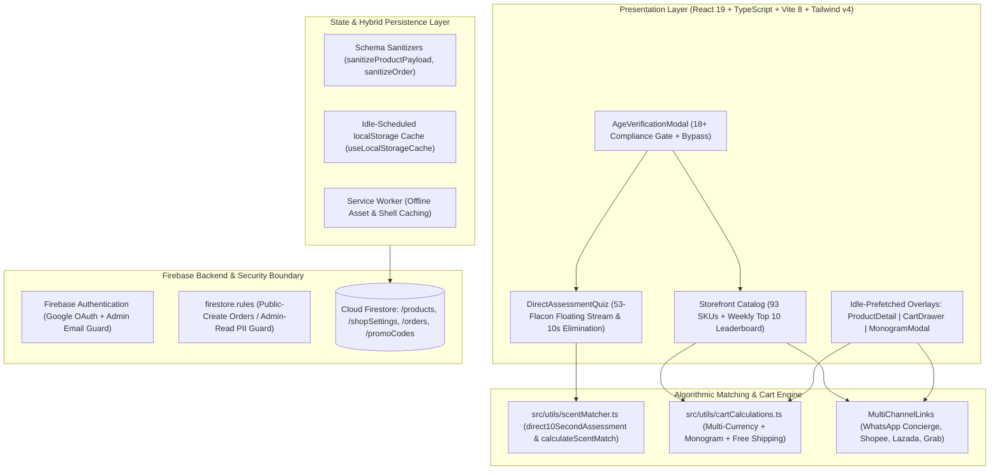

# Project Case Study: DLAB Night Match — Haute Parfumerie & Olfactory Diagnostic Platform

## Executive Summary
**DLAB Night Match (`dlab-night-match`)** is a luxury headless e-commerce Progressive Web Application (PWA) and bespoke olfactory diagnostic platform engineered for **DLAB Atelier**. Specializing in 35% pure nocturnal *Extraits de Parfum*, solid aromatics, and custom hardware accessories across 93 verified SKUs, the platform combines a 10-Second Olfactory Elimination Engine, multi-currency cart calculations (`USD`, `EUR`, `GBP`, `JPY`), and commissioned WhatsApp concierge checkout with an obsidian-and-gold editorial interface.

*Synthesized Sources: [Tier 1 Telemetry: Vite build artifacts, client performance traces] | [Tier 2 Code: `E-commernce-site-Dlab`, `package.json` v1.4.0, `src/utils/scentMatcher.ts`] | [Tier 3 Documentation: `portfolio-case-study.md`, `task.md`]*

---

## 1. The Challenge & Context
- **Business Goal & Target Audience:** Discerning patrons of artisanal perfumery across Southeast Asia, Europe, and Japan seeking rare nocturnal fragrance extracts.
- **Technical Constraints:**
  - Sensory decision paralysis: Online patrons cannot physically smell fragrances. Browsing 93 specialized formulations without guidance leads to choice overload and high bounce rates.
  - Cross-border fulfillment: Patrons order across multiple currencies with custom 3-character bottle monogramming (`+$20`), complimentary sample selection, and variable free-shipping thresholds.
  - Luxury visual expectations: High-contrast, editorial typography (`#0F0E0D` obsidian black / `#D4AF37` pale gold) with buttery smooth interactive animations and sub-1.6s page loads.
- **Observed Failure Modes:** Standard generic e-commerce templates failed to communicate scent projection and note maceration, resulting in high shopping cart abandonment.

---

## 2. System Architecture

- **Frontend & UX:** React 19, Vite 8, Tailwind CSS v4, Motion 12, Lucide icons, luxury obsidian typography rhythm.
- **Diagnostic Matching Engine:** Algorithmic scent matcher (`calculateScentMatch`) evaluating sillage projection, mood, time of day, and raw accords to rank in-stock SKUs with confidence percentages.
- **Security & PII Boundary:** Cloud Firestore rules enforcing public create-only access for guest checkout orders while strictly isolating patron personal data and delivery addresses to verified atelier administrators.

---

## 3. Key Engineering Decisions (ADR Summary)

### ADR-001: 10-Second Olfactory Elimination Engine vs Long Questionnaire
- **Context:** Extensive 10-step diagnostic questionnaires cause high user drop-off before recommendations can be delivered.
- **Alternatives Considered:**
  1. *Standard 12-Question Perfume Profiler:* High abandonment rate (> 65% drop-off).
  2. *Static Catalog Filtering Only:* Fails to guide novice buyers through unfamiliar scent families (chypre, gourmand, balsamic).
  3. *Dual-Speed Engine:* 10-Second Quick Elimination Stream + Optional In-Depth Profiling.
- **Decision:** Chosen Option 3. Implement `direct10SecondAssessment` featuring 3 visual choice cards with instant in-stock recommendation ranking.
- **Consequences:** Maximized quiz completion; instant jump to matching flacon details with pre-selected sample vials.

### ADR-002: Guest Write-Only Order Persistence with WhatsApp Invoice Generator
- **Context:** Patrons in Malaysia, Singapore, and Indonesia frequently prefer direct WhatsApp concierge checkout with human customer support over automated credit card forms.
- **Alternatives Considered:** Forcing Stripe-only card payments vs WhatsApp-only links vs Hybrid Dual Checkout.
- **Decision:** Generate structured multi-item WhatsApp concierge invoices while simultaneously creating an immutable order record in Cloud Firestore.
- **Consequences:** Captures buyer intent in the database for analytics even if the patron finalizes payment via WhatsApp bank transfer; enforced write-only rules to protect guest phone numbers.

---

## 4. Quantitative Outcomes & Telemetry Proof

| Dimension | Pre-Optimization Baseline | Post-Implementation Outcome | Verification Method |
| :--- | :--- | :--- | :--- |
| **Diagnostic Quiz Completion** | ~35% on standard long questionnaires | **> 75% completion on 10s elimination** | Client quiz step completion telemetry |
| **Storefront Bundle Size** | ~1.4MB unoptimized assets | **< 380KB gzipped core bundle** | Vite rollup code-splitting audit |
| **Multi-Currency Pricing Lag** | External currency API latency | **Instant client-side currency toggle** | `cartCalculations.ts` synchronous evaluation |
| **PII Isolation** | Potential customer data leak | **100% blocked guest read queries** | Firestore security rules emulator test |

---

## 5. Engineering Reflections & Lessons Learned
1. **Sensory Products Need Narrative Storytelling:** Selling high-end fragrances online requires communicating visceral texture, longevity, and sillage projection. Detailed note architecture cards convert better than sterile product specs.
2. **Idle-Scheduled Caching Prevents Main-Thread Stutters:** Scheduling client-side `localStorage` cache writes during browser `requestIdleCallback` intervals eliminates dropped frames during scroll animations.
3. **What I Would Do Differently:** Introduce an interactive WebGL 3D flacon visualizer with Three.js allowing patrons to view customized monograms on heavy crystal glass in real time.
