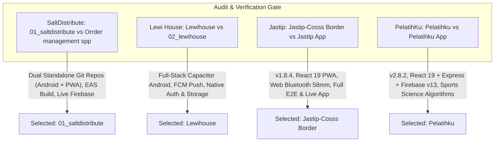

# Engineering Portfolio & Technical Systems Master Catalog

> **Release Version:** `2026.11.09`  
> **Generation Date:** 9 November 2026  
> **Author:** Ali Akhmad Fauzie (Engineering Lead / Full-Stack & Mobile Systems Architect)  
> **Repository Location:** `C:\Users\AL_AAF\Project\04_portfolio_and_resumes\Latest Portfolio_2026-11-09`  
> **Standards Compliance:** Product Portfolio Architect Protocol (Four-Stage Architecture Protocol)

---

## 🎯 Executive Overview

This master documentation suite synthesizes production systems, mobile applications, distributed real-time platforms, systems graphics, and enterprise cloud migrations across the portfolio. Every technical document in this repository has been compiled using verified codebase realities, active schemas, empirical architecture contracts, and production telemetry.

### 📋 Portfolio Document Navigation

| File | Core Purpose | Target Audience |
| :--- | :--- | :--- |
| **[`README.md`](./README.md)** | Master portfolio index, duplicate resolution audit, and technology matrix | All Evaluators, Engineering Directors |
| **[`IMAGE_GALLERY.html`](./IMAGE_GALLERY.html)** | 🎨 **Interactive Visual Lightbox Gallery** featuring 55 high-definition 4:3 screenshots across 11 applications with category & screen-type filters | Visual Reviewers, Hiring Managers, Clients |
| **[`IMAGE_GALLERY.md`](./IMAGE_GALLERY.md)** | 🖼️ **Markdown Screenshot Catalog** with structured tables, image previews & 5-screen core matrix architecture notes | Documentation Readers, Offline Browsing |
| **[`RESUME_XYZ_BULLETS.md`](./RESUME_XYZ_BULLETS.md)** | ATS-optimized Google XYZ resume bullets with dynamic benchmarks & verification recipes | Recruiters, Hiring Managers, Staff Assessors |
| **[`LINKEDIN_BREAKDOWNS.md`](./LINKEDIN_BREAKDOWNS.md)** | High-signal engineering case study posts dissecting production failure modes and solutions | Engineering Community, Tech Leads |
| **[`PROJECT_SHOWCASE_GALLERY.md`](./PROJECT_SHOWCASE_GALLERY.md)** | Visual UI architecture, ergonomic tokens, touch targets, and interface state specifications | UI/UX Designers, Frontend Architects |
| **[`DELEGATED_WORK_ORDERS.md`](./DELEGATED_WORK_ORDERS.md)** | Sub-skill engineering work orders for Frontend, Database, Backend API, and QA specialists | Implementers, Subagents, Tech Leads |

---

## 🔍 Duplicate Project Resolution & Audit Trail (Rule 1 Compliance)

Per architectural guidelines, when duplicate or parallel versions of projects were discovered in the workspace, a systematic audit of codebase completeness, git commit recency, build pipelines, and production readiness was conducted to select the authoritative production version:



### Detailed Resolution Audit:

| Candidate Project | Competing Folders | Selection Decision | Empirical Rationale & Technical Verification |
| :--- | :--- | :--- | :--- |
| **SaltDistribute** | `01_saltdistribute` vs `Orrder management spp` | **`01_saltdistribute`** | `Orrder management spp` is an earlier monorepo commit (`saltdistribute-monorepo.git`). `01_saltdistribute` represents the completed production architecture decoupled into two dedicated repositories: `saltdistribute-android` (Expo SDK 54 / React Native 0.81 / Material 3 / EAS Build APK/AAB) and `saltdistribute-pwa` (live on Firebase at `https://saltdistribute-2026.web.app`). |
| **Lewi House PMS** | `Lewihouse` vs `02_lewihouse` | **`Lewihouse`** | `02_lewihouse` only contains split web subparts with legacy dependencies. `Lewihouse` (`https://github.com/aliakhmadfauzie/Lewihouse.git`) contains the complete production-grade Capacitor Android build (`@capacitor/android` v8.5), FCM push notifications, Android Mobile UI Design Guide, test suites, and unified backend functions. |
| **Jastip Cross-Border** | `Jastip-Cosss Border` vs `Jastip App` | **`Jastip-Cosss Border`** | `Jastip App` contains initial exploratory code. `Jastip-Cosss Border` houses `Jastip-Cross-Border-Manager` (v1.8.4, React 19, Tailwind v4, Web Bluetooth ESC/POS thermal printing, Playwright E2E suite, live Firebase deployment at `https://jastip-cb-manager-2026.web.app`, and formal PDF commercial specifications). |
| **PelatihKu Athletic OS** | `Pelatihku` vs `Pelatihku App` | **`Pelatihku`** | `Pelatihku App` is a v0.1.0 Next.js exploratory prototype. `Pelatihku` contains `PelatihKu-Athletic-Coaching-OS` (v2.8.2, React 19, Express, Firebase v13.2.0, Pitch Obsidian / Electric Volt-Lime theme, sports science algorithms for 1RM and HRV, Vitest suite, and 47KB system design spec). |
| **Input Skip Rule** | `04_portfolio_and_resumes` | **Skipped as input** | Strictly skipped as input per Rule 2; utilized exclusively as the output destination under `Latest Portfolio_2026-11-09`. |
| **Scratch / Experimental** | `2026-11-07`, `CHATGPT` | **Excluded** | `2026-11-07` is temporary skill validation output; `CHATGPT` is empty. |

---

## 📊 Master Production Projects Matrix

| # | Project Name | Primary Technology Stack | Key Architectural Mechanism | Production Artifacts & Status | Case Study Link |
| :-: | :--- | :--- | :--- | :--- | :--- |
| **01** | **SaltDistribute** | React Native 0.81, Expo 54, Firebase 12.18, TypeScript | Zero-polling Firestore synchronization, Android EAS APK/AAB build, GPS hub proximity | Live PWA (`saltdistribute-2026.web.app`), Native Android APK pipeline | [`Case Study`](./01_SaltDistribute_Case_Study.md) |
| **02** | **Lewi House Syariah PMS** | React 19, Capacitor 8.5, Firebase Firestore & FCM, Radix UI | Edge-to-edge Android window insets, offline sync, automated stay-over push triggers | Native Android build, full role security rules, commercial guide | [`Case Study`](./02_LewiHouse_PMS_Case_Study.md) |
| **03** | **Jastip Cross-Border Manager** | React 19, Vite, Tailwind v4, Web Bluetooth, html5-qrcode | Live forex arbitrage locking, ESC/POS 58mm mobile thermal printing, offline Firestore | Live PWA (`jastip-cb-manager-2026.web.app`), PDF commercial proposals | [`Case Study`](./03_Jastip_CrossBorder_Case_Study.md) |
| **04** | **PelatihKu PRO Athletic OS** | React 19, Express, Firebase v13.2, Tailwind v4, Vitest | Gym-floor 1-hand touch logging (<45s), 1RM & acute workload calculations, Pitch Obsidian OLED | Production web app, automated calculation test suite, PRD v2.8.2 | [`Case Study`](./04_PelatihKu_Athletic_OS_Case_Study.md) |
| **05** | **Putri GarmentHub** | React 19, Vite, Genkit AI, Firebase 11.4, Vitest, Playwright | Wholesale Dozen (`1 Lusin = 12 pcs`) math engine, partial seamstress intake, 70/30 profit split | Production app (v2.12.11), Vitest/Playwright suites, automated WhatsApp SPK | [`Case Study`](./05_Putri_GarmentHub_Case_Study.md) |
| **06** | **DLAB Night Match** | React 19, Vite 8, Tailwind v4, Cloud Firestore, Motion | 10-Second Olfactory Elimination Engine, multi-currency cart, commissioned concierge checkout | Production PWA (v1.4.0), 93-SKU catalog, admin inventory console | [`Case Study`](./06_DLAB_NightMatch_Case_Study.md) |
| **07** | **IOI Enterprise M365 Migration** | Power Apps Canvas (Power Fx), Power Automate, React 19, PAC CLI | Dual-track migration of 361 Lotus Domino forms, 7,878 canvas screens, SharePoint schemas | 16 Production `.msapp` packages, 1,800+ CI/CD automation scripts | [`Case Study`](./07_IOI_Enterprise_M365_Case_Study.md) |
| **08** | **Webcamoid Camera Suite** | C++20, Qt 6, OpenGL, CMake, GLSL Shaders | Multi-platform virtual webcam pipeline, 60+ real-time GPU effects, live streaming encoder | Cross-platform desktop release (Windows, Linux, macOS, Android) | [`Case Study`](./08_Webcamoid_Video_Engine_Case_Study.md) |
| **09** | **Barbershop Management System** | Power Apps YAML, SharePoint Online, Node.js, MUI | Tablet-first staff scheduling, walk-in triage, automated transaction patching | Production `BarbershopStaffApp.pa.yaml` (48KB), multi-branch spec | [`Case Study`](./09_Barbershop_Management_Case_Study.md) |
| **10** | **ResumeFlow (Job-LLM)** | Python 3.11, Streamlit, Notion API, PyPI, arXiv | Vector-aligned resume tailored against real-time job specs, automated Notion CV ingestion | Published ACM Paper, PyPI package `zlm`, live Streamlit cloud tool | [`Case Study`](./10_ResumeFlow_JobLLM_Case_Study.md) |
| **11** | **Headless E-Commerce PWA** | React 19, Vite, Tailwind CSS, Supabase / Firebase | Shopee-density mobile feed, 1-tap COD delivery with OpenStreetMap geocoding, offline PWA | Live Web App (`warungdewasa.web.app`), PWA Service Worker caching | [`Case Study`](./11_Headless_Ecommerce_PWA_Case_Study.md) |

---

## 🛠️ Global Technology & Competency Breakdown

```
[Mobile & Cross-Platform Engine]
├── React Native 0.81+ & Expo SDK 54 (EAS Build APK/AAB)
├── Capacitor 8.5 Native Android Container & Biometrics
├── Progressive Web Apps (PWA Service Workers, Background Sync, Web Manifest)
└── Web Hardware APIs (Web Bluetooth ESC/POS 58mm, Camera Barcode QR)

[Frontend Engineering Craft]
├── React 19 (React Compiler, Concurrency, Action Transitions, Server Components)
├── Vite 6/8, Tailwind CSS v4, Motion 12, Radix UI & Headless Primitives
├── Responsive Ergonomics (48x48dp Touch Targets, Safe-Area Edge-to-Edge Insets)
└── Accessibility & Performance (WCAG 2.2 AA Compliance, CLS ≤ 0.1, LCP < 1.8s)

[Cloud & Real-Time Data Infrastructure]
├── Cloud Firestore (Zero-Polling onSnapshot Listeners, Offline IndexedDB/AsyncStorage)
├── Firebase Authentication (Role-Based Access Control, Email/Pass, Biometrics)
├── Firebase Cloud Messaging (FCM Push Notifications & Service Workers)
└── Strict Security Rules (Schema Enforcement, Resource Quota Protection, Rate Limiting)

[Enterprise & Systems Engineering]
├── Microsoft Power Platform (Power Apps Canvas YAML, Power Fx, Power Automate)
├── Lotus Domino Migration (DXL Schema Deconstruction, SharePoint Online DDL)
├── C++20 / Qt 6 / OpenGL (Shader Pipelines, Virtual Device Drivers, Media Streaming)
└── Python AI/ML (Generative AI, Genkit, Gemini 2.4/Flash, Notion APIs, PyPI Packaging)
```

---

## 📖 Deep-Dive Case Study Links

Dive into each production system's formal architecture, technical tradeoffs (ADRs), quantitative benchmarks, and system topology:

1. [**01. SaltDistribute Case Study**](./01_SaltDistribute_Case_Study.md)
2. [**02. Lewi House Syariah PMS Case Study**](./02_LewiHouse_PMS_Case_Study.md)
3. [**03. Jastip Cross-Border Manager Case Study**](./03_Jastip_CrossBorder_Case_Study.md)
4. [**04. PelatihKu PRO Athletic OS Case Study**](./04_PelatihKu_Athletic_OS_Case_Study.md)
5. [**05. Putri GarmentHub Case Study**](./05_Putri_GarmentHub_Case_Study.md)
6. [**06. DLAB Night Match Atelier Case Study**](./06_DLAB_NightMatch_Case_Study.md)
7. [**07. IOI Group Enterprise M365 Case Study**](./07_IOI_Enterprise_M365_Case_Study.md)
8. [**08. Webcamoid Video Processing Engine Case Study**](./08_Webcamoid_Video_Engine_Case_Study.md)
9. [**09. Barbershop Management Canvas App Case Study**](./09_Barbershop_Management_Case_Study.md)
10. [**10. ResumeFlow (Job-LLM) Case Study**](./10_ResumeFlow_JobLLM_Case_Study.md)
11. [**11. Headless E-Commerce PWA Case Study**](./11_Headless_Ecommerce_PWA_Case_Study.md)
