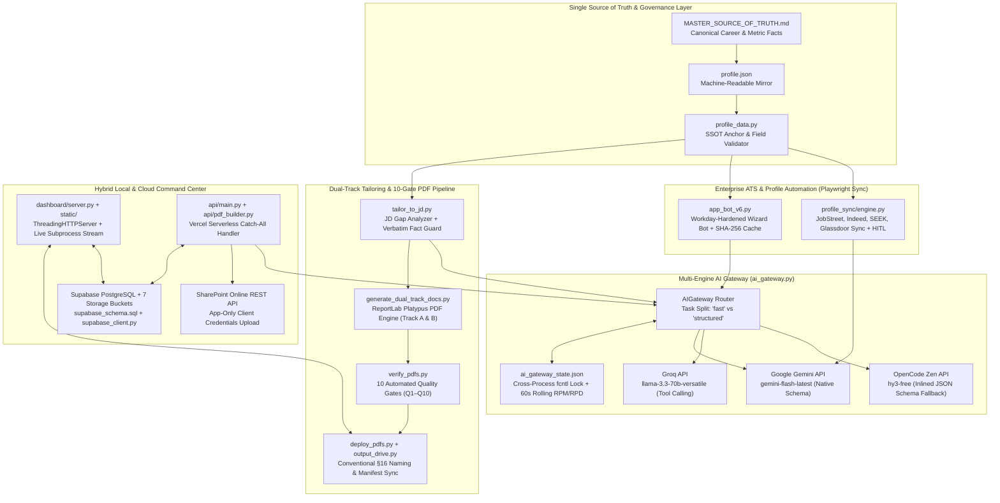

# ATS Automation — Dual-Track AI Tailoring, Workday Bot & Profile Sync Engine (`ats-automation`)

> **Repository:** [`AlTechSolutions-AAF/ats-automation`](https://github.com/AlTechSolutions-AAF/ats-automation)  
> **Local Workspace:** `C:\Users\AL_AAF\Project\04_portfolio_and_resumes\al-resume-projects\ATS AUTOMAYTION\ats-automation`  
> **Role:** Principal AI Automation & Full-Stack Systems Architect

---

## 1. Project Overview & Problem Solved

### The Enterprise Job Application & Profile Governance Challenge
Senior engineers and solution architects operating across dual career tracks—such as **Track A (Enterprise Power Platform & Dynamics 365 Solution Architecture)** and **Track B (Operations Team Leadership & AI QA Management)**—face four compounding engineering bottlenecks during job applications:

1. **LLM Hallucinations & Resume Fact Drift:** Generic AI resume tailors invent metrics, fabricate employers, drop critical technical keywords, or conflate distinct enterprise products (such as confusing *Dynamics 365 Customer Engagement (CE)* with *Dynamics 365 Finance & Operations (F&O)*), creating severe credibility and audit risks.
2. **Hostile Multi-Step ATS Portals (Workday / Greenhouse):** Enterprise portals like **Workday** (`myworkdayjobs.com`) render forms asynchronously after `DOMContentLoaded`, hide `<input type="file">` controls behind custom drop-zones, implement custom ARIA listbox dropdowns (`button[aria-haspopup='listbox']`) instead of native `<select>` elements, keep `Next` buttons enabled-but-inert while parsing resumes, and reject names containing more than two capital letters.
3. **Free-Tier LLM API Rate Limits (429 Resource Exhaustion):** Running multi-step form completion alongside full-schema resume and cover letter tailoring quickly exhausts single-provider RPM/RPD quotas when multiple CLI processes and dashboard workers run concurrently.
4. **Cross-Platform Profile Desynchronization:** Keeping candidate profiles consistent across **JobStreet**, **Indeed**, **SEEK**, and **Glassdoor** while respecting each platform's character limits and Terms of Service requires a governed, Human-in-the-Loop (HITL) synchronization pipeline anchored to a single source of truth.

### The Solution
**ATS Automation (`ats-automation`)** is an end-to-end, governance-enforced career automation platform and hybrid local/cloud command center. Every component is anchored to a single authoritative specification—[`MASTER_SOURCE_OF_TRUTH.md`](file:///C:/Users/AL_AAF/Project/04_portfolio_and_resumes/al-resume-projects/ATS%20AUTOMAYTION/ats-automation/MASTER_SOURCE_OF_TRUTH.md) and its validated machine mirror [`profile.json`](file:///C:/Users/AL_AAF/Project/04_portfolio_and_resumes/al-resume-projects/ATS%20AUTOMAYTION/ats-automation/profile.json)—and comprises five integrated subsystems:

1. **Tri-Engine AI Router & Cross-Process Rate Limiter (`ai_gateway.py`):** Combines **Google Gemini (`gemini-flash-latest`)**, **Groq (`llama-3.3-70b-versatile`)**, and **OpenCode Zen (`hy3-free`)** with task-specific routing (`"fast"` vs. `"structured"`), rolling 60-second RPM + daily RPD counters, `fcntl` file locking across processes, and automatic 429 cooldown failover.
2. **Governance-Gated Dual-Track JD Tailoring Pipeline (`tailor_to_jd.py`, `verify_pdfs.py`, `generate_dual_track_docs.py`):** Analyzes Job Descriptions (via text, file, or URL), rewrites the summary and reorders skills using only verified facts while copying experience/project/education bullets **verbatim**, generates ATS-safe ReportLab PDFs (`AliAkhmadFauzie_Resume_<Role>_<Company>.pdf`), outputs a `JD_MATCH_REPORT.md` scorecard, and enforces **10 automated quality gates (`Q1–Q10`)**.
3. **Workday-Hardened Playwright Application Bot (`app_bot_v6.py`):** Automates multi-step ATS wizards with option-aware SHA-256 disk caching (`response_cache.json`), polymorphic DOM input dispatching, Workday ARIA listbox resolution, resume upload parse detection, DOM state fingerprinting, and Human-in-the-Loop (HITL) CAPTCHA/submission gates.
4. **Multi-Platform Profile Sync Engine (`profile_sync.py`, `profile_sync/`):** Synchronizes candidate profiles across **JobStreet**, **Indeed**, **SEEK**, and **Glassdoor** using XPath case-insensitive label heuristics, Gemini character-limit trimming (`gemini_trim_copy`), audit manifest logging (`PROFILE_SYNC_LOG.md`), and mandatory human review before saving.
5. **Zero-Dependency Local & Vercel/Supabase Cloud Command Center (`dashboard/server.py`, `api/main.py`, `supabase_client.py`):** Provides a local `ThreadingHTTPServer` web dashboard with live subprocess stdout progress streaming (`0..100%`), paired with a Vercel serverless API backed by **Supabase PostgreSQL + Storage** (`jobs`, `files`, `applications`, `profiles`) and **SharePoint App-Only OAuth2** direct PDF archival.

---

## 2. Tech Stack & Architecture Choices

### System Architecture Diagram



### Technology Stack Table

| Subsystem | Technology / Library | Purpose & Architectural Role |
| :--- | :--- | :--- |
| **Core Runtime** | Python 3.11+ (`stdlib`, `threading`, `subprocess`, `fcntl`) | Powers the CLI pipelines, thread/process-safe AI gateway, and zero-dependency local HTTP server (`ThreadingHTTPServer`). |
| **LLM Orchestration** | `google-genai`, `httpx`, `pydantic` (`v2`), `pydantic-settings` | Tri-engine routing across Gemini (`response_schema`), Groq (`tools` function calling), and OpenCode Zen (`json_object` mode). |
| **Browser Automation** | Playwright Sync API (`playwright.sync_api`) | Persistent Chromium context (`--disable-blink-features=AutomationControlled`) for Workday wizards and job board profile sync. |
| **PDF Generation & Verification** | `reportlab` (`platypus`), `pypdf` (`PdfReader`) | Generates ATS-parseable single-column PDFs and extracts text/annotations to enforce quality gates `Q1–Q10`. |
| **Cloud Database & Storage** | Supabase (`supabase-py`, PostgreSQL, RLS, 7 Storage Buckets) | Stores `jobs`, `files`, `applications`, and `profiles` with `pgcrypto` UUIDs and `touch_updated_at()` triggers (`supabase_schema.sql`). |
| **Serverless & Enterprise Sync** | Vercel Python Runtime (`api/main.py`), Google Drive OAuth2 (`drive_upload.py`), SharePoint REST API | Enables cloud JD extraction, in-memory PDF generation (`api/pdf_builder.py`), and automatic upload to SharePoint & Google Drive. |
| **Automated Test Suite** | `pytest` (`tests/test_*.py`) | 7 unit and E2E test suites covering `ai_gateway`, `governance_gate`, `dashboard_api`, `output_drive`, `pdf_naming`, and `verify_pdfs`. |

---

## 3. Key Features & UI Implementation

### 1. ATS Automation Command Center Dashboard (`dashboard/server.py`, `dashboard/static/`, `public/`)
- **Zero-Dependency Local Control Panel (`dashboard/server.py`, `lines 1–1097`):** Built entirely on Python's standard library (`ThreadingHTTPServer` and `BaseHTTPRequestHandler`), serving a responsive web UI at `http://127.0.0.1:8765` with zero framework overhead.
- **Whitelisted Background Subprocess Runner with Live Progress (`lines 45–160`):** Launches allowed pipeline scripts (`generate_dual_track_docs.py`, `verify_pdfs.py`, `deploy_pdfs.py`, `tailor_to_jd.py`, `drive_sync.py`, `output_drive.py`) in daemon threads with `PYTHONIOENCODING="utf-8"` for Windows `cp1252` pipe safety (`lines 122–134`). Parses stdout lines against `_STAGE_MARKERS` (`lines 95–102`) to drive a real-time `0% → 100%` stage progress bar in the UI (`AI tailoring — engine running` → `Match scoring & report` → `Resume PDF written` → `Quality gate passed` → `Complete`).
- **Guided Pipeline & Paired PDF Previewer (`lines 386–454`, `616–656`):** Pairs newly generated resumes (`AliAkhmadFauzie_Resume_<tag>.pdf`) with their matching cover letters (`AliAkhmadFauzie_CoverLetter_<tag>.pdf`) and serves inline PDF previews via `/pdfs/root/` and `/pdfs/drive/` (proxying Google Drive files server-side so OAuth tokens never leak to the browser, `lines 639–656`).
- **Live Tri-Engine AI & Hybrid Cloud Telemetry (`lines 524–531`, `772–800`):** Exposes `/api/ai/status` for real-time RPM/RPD quota bars across Groq, Gemini, and OpenCode Zen, `/api/supabase/status` for database/bucket health, and `/api/nb/status` for Google Cloud NotebookLM integration.

### 2. Dual-Track JD Gap Analyzer & Governance Gate (`tailor_to_jd.py` & `verify_pdfs.py`)
- **Dual-Track Specialization (`tailor_to_jd.py`, `lines 73–88`):** Supports **Track A** (*Enterprise Power Platform & Dynamics 365 Solution Architect | AI & ALM Lead*) and **Track B** (*Operations Team Leader | QA Lead (AI Moderation & Safety) | Process Automation*).
- **Strict Verbatim Fact Lock (`lines 284–315`):** Instructs the AI engine via Pydantic schema `TailoredDocument` (`lines 119–129`) to copy `experience`, `projects`, and `education` bullets **verbatim** from the base resume, reorder `skills` without dropping or inventing items, check certification gaps against the SSOT, and never confuse *Dynamics 365 CE* with *Dynamics 365 F&O/SCM*.
- **10-Gate PDF Verification Suite (`verify_pdfs.py`, `lines 155–263`):** Validates every generated PDF across 10 deterministic gates:
  - `Q1 Selectable text` (`>= 50` words extracted via `pypdf`)
  - `Q2 Hyperlinks` (4 required URI annotations on cover letters; plain-text URLs on resumes so annotations never leak into ATS parsers)
  - `Q3 Metric consistency` (verifies canonical metrics like `"365+"`, `"878"`, `"98%"` and blocks stale numbers like `"7,878"`, `"16 production"`, `"361+"`)
  - `Q4 Title correctness` (`(Freelance)`, never `(Contract)`)
  - `Q5 No placeholders` (blocks `example.com`, `your_key`, `[Date]`)
  - `Q6 Contact accuracy` (`+62 851-1055-2118`, `+60 13-295 7406`, email, LinkedIn, portfolio)
  - `Q7 Page count` (Resume `<= 2` pages, Cover Letter `== 1` page)
  - `Q8 SSOT integrity`, `Q9 Content phrasing quality`, and `Q10 Header structure` (enforces proper-case `"Ali Akhmad Fauzie"` and `"Bandung, West Java 40111, Indonesia"`).

### 3. Workday-Hardened Playwright Application Bot (`app_bot_v6.py`)
- **Option-Aware SHA-256 Disk Cache (`lines 128–163`):** Hashes `question + field_type + sorted(options)` using SHA-256 (`response_cache.json`) so identical ATS questions across job applications resolve instantaneously without burning LLM quota.
- **Polymorphic Input & Fuzzy Dropdown Dispatcher (`lines 286–356`):** Handles `<select>` (via 3-pass exact → substring → label fallback matching), checkboxes, `contenteditable` divs, radio button groups (`handle_radio_groups`, `lines 418–471`), and multi-artifact file uploads (`resume`, `cover_letter`, `portfolio`, `transcript`, `lines 472–513`).

### 4. Multi-Platform Profile Sync Engine (`profile_sync.py`, `profile_sync/`)
- **Adapter-Driven Architecture (`profile_sync/engine.py`, `lines 70–136`):** Synchronizes candidate profiles across `jobstreet`, `indeed`, `seek`, and `glassdoor`, generating a full markdown diff manifest (`PROFILE_SYNC_LOG.md`) before touching any browser state, and pausing at `_human_review_pause` (`lines 237–250`) so final publication is always human-verified.

---

## 4. Technical Challenges Overcome

### Challenge 1: Multi-Engine AI Routing, Tool-Call Incompatibility & Cross-Process Rate Limiting
**Problem:** A single free-tier LLM API key cannot sustain concurrent requests from `tailor_to_jd.py` (which requires large, strict JSON schema outputs) and `app_bot_v6.py` (which fires rapid, short form-field queries), especially when separate CLI processes run simultaneously. Furthermore, while Groq (`llama-3.3-70b-versatile`) supports OpenAI function/tool calling for schema adherence, OpenCode Zen's `hy3-free` model rejects `tools` payloads with `HTTP 400`.

**Solution:** Engineered [`ai_gateway.py`](file:///C:/Users/AL_AAF/Project/04_portfolio_and_resumes/al-resume-projects/ATS%20AUTOMAYTION/ats-automation/ai_gateway.py#L88-L91) with task-specific routing orders (`"fast": ["groq", "opencode", "gemini"]` vs. `"structured": ["gemini", "opencode", "groq"]`), cross-process `fcntl.flock` state persistence (`ai_gateway_state.json`, `lines 186–250`), immediate pre-flight request accounting (`_record_attempt`, `lines 255–271`), and automatic fallback from function-calling to system-prompt schema inlining (`supports_tools: False`, `lines 351–377`).

```python
# ai_gateway.py (lines 88–91 & 351–376)
ROUTING_ORDER: Dict[str, list] = {
    "fast": ["groq", "opencode", "gemini"],        # quick, low-stakes answers
    "structured": ["gemini", "opencode", "groq"],  # schema-validated / PDF-heavy output
}
# ...
        if schema is not None and hasattr(schema, "model_json_schema"):
            if cfg.get("supports_tools", True):
                # Stronger schema adherence: function calling with the JSON schema.
                payload["tools"] = [{
                    "type": "function",
                    "function": {
                        "name": "generate_output",
                        "description": "Generate the structured output matching the provided schema.",
                        "parameters": schema.model_json_schema(),
                    },
                }]
                payload["tool_choice"] = {
                    "type": "function",
                    "function": {"name": "generate_output"},
                }
            else:
                # Provider rejects tool-calling (e.g. OpenCode Zen hy3-free ->
                # HTTP 400). Fall back to JSON mode with the schema inlined in
                # the system prompt so the model still sees the shape.
                schema_json = json.dumps(schema.model_json_schema(), ensure_ascii=False)
                messages[0]["content"] = (
                    sys_msg +
                    "\nRespond with valid JSON only, matching this JSON schema exactly:\n" +
                    schema_json
                )
                payload["response_format"] = {"type": "json_object"}
```

---

### Challenge 2: Defeating Workday SPA Quirks (Hidden File Inputs, ARIA Listboxes, Name Validators & Inert 'Next' Buttons)
**Problem:** Automating Workday (`myworkdayjobs.com`) exposed five subtle DOM traps:
1. Workday hides `<input type="file">` behind a custom drop-zone; skipping invisible inputs left the resume unattached.
2. Workday's `Next` button remains *enabled* (`disabled=false`) but completely inert while the backend parses the uploaded resume, and later flickers enabled/disabled during async field hydration.
3. Workday dropdowns (`Phone Device Type`, `How Did You Hear About Us?`) are rendered as `<button aria-haspopup='listbox'>` rather than `<select>`.
4. Workday's phone group includes `phoneNumber--extension` and `phoneNumber--countryPhoneCode` inputs that match naive `"phone"` substring checks—overwriting them corrupts the phone group.
5. Workday's name validator rejects `Given Name` / `Family Name` fields containing more than two capital letters (e.g., `"ALI"` or `"AKHMAD FAUZIE"`).

**Solution:** Built targeted Workday handlers in [`app_bot_v6.py`](file:///C:/Users/AL_AAF/Project/04_portfolio_and_resumes/al-resume-projects/ATS%20AUTOMAYTION/ats-automation/app_bot_v6.py):
- `normalize_name()` (`lines 55–73`) converts all-caps or irregular names into proper title-case while preserving hyphens and apostrophes.
- `handle_file_uploads()` (`lines 472–538`) attaches files directly to hidden `<input type="file">` elements and calls `_wait_resume_parsed()` (`lines 514–537`) to wait for `'resume.pdf'` or `'successfully uploaded'` in `document.body.innerText` plus a 6-second autofill buffer.
- `handle_workday_dropdowns()` (`lines 539–603`) clicks `button[aria-haspopup='listbox']` triggers still showing `"Select One"` and selects matching `[role='option']` items.
- Explicit no-op guards (`lines 646–657`) protect `extension` and `countryPhoneCode` from being overwritten with the full phone number.
- `_form_fingerprint()` (`lines 689–718`) and `_wait_next_enabled()` (`lines 719–756`) require the `Next` button to remain continuously enabled for `>= 3.0s` and verify that the active wizard step fingerprint actually changes after clicking.

```python
# app_bot_v6.py (lines 55–73 & 719–756)
def normalize_name(value: str) -> str:
    """Title-case a person's name to satisfy ATS capitalization validators."""
    if not value:
        return value
    lowered = value.strip().lower()
    return re.sub(
        r"(^|[\s\-'\u2019])([a-z])",
        lambda m: m.group(1) + m.group(2).upper(),
        lowered,
    )
# ...
    def _wait_next_enabled(self, page: Page, timeout: int = 45000) -> bool:
        """Wait for a visible, ENABLED wizard 'Next/Continue/Submit/Apply'
        button that STAYS enabled for ~3s (stability check)."""
        deadline = time.time() + timeout
        stable_since = None
        while time.time() < deadline:
            # ... evaluates visible buttons for 'next'|'continue'|'submit'|'apply' ...
            if enabled:
                if stable_since is None:
                    stable_since = time.time()
                elif time.time() - stable_since >= 3.0:
                    return True
            else:
                stable_since = None
            time.sleep(0.5)
        return False
```

---

### Challenge 3: Preventing LLM Metric Hallucinations & Fact Dropping During JD Tailoring
**Problem:** Even with strict system prompts and temperature `0.3`, LLMs tailoring a resume to a Job Description occasionally invent percentage gains or drop canonical product names required by the JD.

**Solution:** Implemented a post-generation programmatic `governance_gate()` in [`tailor_to_jd.py`](file:///C:/Users/AL_AAF/Project/04_portfolio_and_resumes/al-resume-projects/ATS%20AUTOMAYTION/ats-automation/tailor_to_jd.py#L164-L221) that extracts text from the compiled PDFs via `PdfReader` and performs two verification passes before allowing deployment or tracker logging:
1. **JD-Aware Fact Preservation (`lines 190–203`):** Verifies that every canonical evidence item in `PRESERVE_FACTS` (`"Oracle PowerBiz"`, `"Copilot Studio"`, `"Dataverse"`, `"React 19"`, `"365+"`, `"28+"`, `"98%"`) present in the base resume and relevant to the JD is retained in the tailored output.
2. **Regex Metric Cross-Reference Against SSOT (`lines 204–221`):** Extracts all numeric percentage and count tokens (`\b\d+%\+?|\b\d+\+`) from the tailored PDF text and verifies that every single metric exists in `MASTER_SOURCE_OF_TRUTH.md` or the base resume—immediately aborting with exit code `1` if any fabricated number is detected.

```python
# tailor_to_jd.py (lines 204–221)
    # SSOT cross-reference: extract numeric metrics (e.g., "20%", "878", "365+")
    # from the tailored text and verify each appears in the SSOT. This catches
    # hallucinated numbers that the AI may have invented.
    if ssot_text:
        tailored_metrics = set(re.findall(r"\b\d+%\+?|\b\d+\+", text))
        ssot_metrics = set(re.findall(r"\b\d+%\+?|\b\d+\+", ssot_text))
        fabricated = []
        for m in tailored_metrics:
            if m not in ssot_metrics and m not in base_text:
                fabricated.append(m)
        if fabricated:
            problems.append(
                f"Metrics in tailored output not found in SSOT or base resume "
                f"(possible hallucination): {fabricated}"
            )
    return problems
```

---

### Challenge 4: Resilient XPath Label Resolution & Character-Limit Trimming Across Job Boards
**Problem:** Job portals (**JobStreet**, **Indeed**, **SEEK**, **Glassdoor**) frequently obfuscate CSS classes and vary DOM structures between wrapped `<label><input/></label>`, adjacent `<label/><input/>`, and `aria-label` attributes, while enforcing strict character limits on profile summary fields.

**Solution:** Implemented a hierarchical, case-insensitive XPath locator generator `_candidate_locators()` in [`profile_sync/engine.py`](file:///C:/Users/AL_AAF/Project/04_portfolio_and_resumes/al-resume-projects/ATS%20AUTOMAYTION/ats-automation/profile_sync/engine.py#L42-L55) and [`lines 191–224`](file:///C:/Users/AL_AAF/Project/04_portfolio_and_resumes/al-resume-projects/ATS%20AUTOMAYTION/ats-automation/profile_sync/engine.py#L191-L224) using XPath `translate()` for case folding and `concat()` literal escaping (`_xpath_lit`), paired with `gemini_trim_copy()` in [`profile_sync/adapters.py`](file:///C:/Users/AL_AAF/Project/04_portfolio_and_resumes/al-resume-projects/ATS%20AUTOMAYTION/ats-automation/profile_sync/adapters.py#L68-L101) to condense summaries within `spec.max_chars` without altering factual metrics.

```python
# profile_sync/engine.py (lines 42–55 & 212–223)
def _xpath_lit(value: str) -> str:
    """Quote a string as an XPath literal (handles embedded double quotes)."""
    if '"' not in value:
        return f'"{value}"'
    return f"concat('{value.replace(chr(39), chr(39)+chr(34)+chr(39)+chr(34)+chr(39))}')"

def _ci_contains(expr: str, value: str) -> str:
    """Case-insensitive contains() for an attribute/path expression."""
    lit = _xpath_lit(value.lower())
    return (
        f"contains(translate({expr}, '{_UPPER}', '{_LOWER}'), {lit})"
    )
# ...
            label_x = (
                f"//label[{_ci_contains('normalize-space(.)', low)}]"
            )
            for tag in tags:
                locs.append(f"{label_x}/descendant::{tag}[1]")
                locs.append(f"{label_x}/following-sibling::{tag}[1]")
                locs.append(f"{label_x}/following::{tag}[1]")
```
