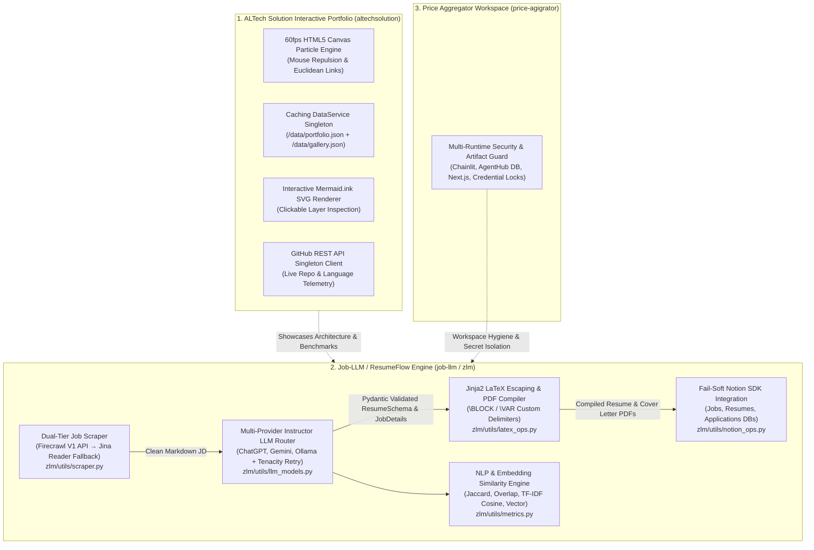

# ALTech Solution & Custom AI Tools Suite (Enterprise Portfolio + Job-LLM + Price Aggregator)


## 1. Project Overview & Problem Solved

Modern AI-augmented software engineering requires more than isolated scripts—it requires cohesive, resilient pipelines that bridge **executive architecture showcases**, **multi-provider LLM orchestration with guaranteed structured outputs**, **anti-bot web scraping**, and **automated workspace synchronization**. Across this 3-repository AI & Developer Tools suite, we solved three interconnected engineering problems:

1. **Interactive Enterprise Architecture & Telemetry Showcase (`altechsolution`)**: Static text portfolios fail to convey the depth of large-scale enterprise systems (365+ migrated forms, 16 production Power Apps, 7,878 Canvas screens, and 50+ AI agents). Located at `C:/Users/AL_AAF/Project/06_ai_and_tools/altechsolution`, we built an interactive React 19 + TypeScript showcase featuring clickable Mermaid.js architecture layers, live GitHub REST API repository telemetry, interactive Power Fx & SharePoint schema deep-dives, a filterable multi-department project gallery with portal lightboxes, and a 60fps HTML5 Canvas particle network.
2. **End-to-End LLM Job Application, LaTeX Rendering & Notion CRM Pipeline (`job-llm` / `ResumeFlow`)**: Located at `C:/Users/AL_AAF/Project/06_ai_and_tools/job-llm`, applying to technical roles at scale requires scraping JavaScript-heavy job boards, extracting structured JSON schemas from unstructured PDFs and job descriptions across heterogeneous LLM providers (OpenAI, Google Gemini, local Ollama), compiling publication-grade LaTeX PDFs without special-character syntax crashes, quantifying resume-to-JD alignment via NLP/embedding similarity metrics, and syncing applications into a relational Notion workspace.
3. **Agentic Workspace & Price Aggregation Sandbox (`price-aggregator/price-agigrator`)**: Located at `C:/Users/AL_AAF/Project/06_ai_and_tools/price-aggregator/price-agigrator`, automated data-aggregation and multi-agent workflows require strict workspace hygiene, credential isolation (`*token.json*`, `*credentials.json*`, `memory/test_credentials.md`), and multi-environment build artifact exclusions across Next.js, Python virtual environments, Chainlit agent runtimes, and local databases.

---

## 2. Tech Stack & Architecture Choices

### System Architecture Diagram



### Technology Stack Table

| Subsystem | Technology | Version | Architectural Role |
| :--- | :--- | :--- | :--- |
| **ALTech Portfolio Frontend** | React 19 + TypeScript + Vite | `19.x` | Interactive SPA with custom HTML5 Canvas particle physics, IntersectionObserver nav, and print-ready `resume.html` |
| **Architecture Visualization** | `mermaid.ink` Dynamic SVG Pipeline | REST / SVG | Renders `graph TB` definitions into interactive DOM nodes with `data-layer` click handlers |
| **Job-LLM Core Orchestrator** | Python + Poetry (`zlm` package) | `>=3.11.6,<3.13` | `AutoApplyModel` pipeline coordinating scraping, extraction, tailoring, PDF compilation, and Notion sync |
| **Structured LLM Outputs** | `instructor` + Pydantic + `tenacity` | `>=1.0.0` / `>=8.0.0` | Enforces schema-validated JSON responses across `openai` (`^1.41.0`), `google-generativeai` (`^0.7.2`), and `langchain-ollama` (`^0.1.1`) |
| **Web Scraping Engine** | `firecrawl-py` + `httpx` (Jina Reader) | `>=1.0.0` / `>=0.27.0` | Anti-bot JS rendering via Firecrawl with zero-config fallback to `https://r.jina.ai/` |
| **Typesetting Engine** | `jinja2` + TeX Live / `fpdf2` | `^2.8.1` | Custom-delimiter LaTeX template rendering (`resume.tex.jinja`) and automated PDF compilation |
| **Similarity Analytics** | `scikit-learn` + `nltk` | `^1.5.1` / `^3.8.1` | Porter stemming, TF-IDF cosine similarity, Jaccard index, Overlap coefficient, and vector embedding cosine similarity |
| **Workspace CRM Sync** | `notion-client` + `python-dotenv` | `^2.2.0` | Automated provisioning and two-way sync across 3 relational Notion databases (`Jobs`, `Resumes`, `Applications`) |

---

## 3. Key Features & UI Implementation

### 1. ALTech Solution Interactive Architecture & Telemetry Portal (`altechsolution`)
- **Interactive 5-Layer System Architecture Explorer** ([`assets/index-Bny4VPu3.js`](file:///C:/Users/AL_AAF/Project/06_ai_and_tools/altechsolution/assets/index-Bny4VPu3.js#L132-L180)): Encodes a 5-subgraph Mermaid diagram (`PRESENTATION`, `INTEGRATION`, `DATA_LAYER`, `ENTERPRISE`, `DEVOPS`), fetches the rendered SVG from `https://mermaid.ink/svg/`, rewrites `<g class="node default ...">` elements to inject `data-layer` attributes, and binds click listeners so users can click directly on diagram nodes or legend pills to inspect architectural decisions (`DEC-2026-001` through `DEC-2026-007`), Power Fx patterns (`scrIT_ITSSR_New.pa.yaml`), and SharePoint/Dataverse schemas.
- **60fps Interactive Canvas Particle Network & Mouse Parallax**: Renders 40–50 autonomous nodes on a HiDPI-scaled `<canvas>` (`window.devicePixelRatio`), drawing Euclidean distance edges (`It < connectionDistance`) with distance-proportional alpha blending (`(1 - It / N) * 0.15`) and cursor repulsion physics (`Ee < 150`).
- **Cached Portfolio DataService & Live GitHub Client**: Implements a singleton `DataService` with TTL memory caching (`300,000ms`), runtime structural type-guard validation, and static fallback (`portfolio.json`), alongside a singleton GitHub API client fetching live repository stars, forks, and language color badges.
- **Filterable Enterprise Application Showcase & Lightbox Gallery**: Displays 365+ modernized forms across 28+ departments ([`data/portfolio.json`](file:///C:/Users/AL_AAF/Project/06_ai_and_tools/altechsolution/data/portfolio.json#L1-L120)), complete with React Portal modal lightboxes (`ESC` key listener + body scroll lock), Core Web Vitals rings (Lighthouse `98` Performance, `100` Accessibility, `1.2s` LCP, `48ms` INP), and a dual-column print-optimized [`resume.html`](file:///C:/Users/AL_AAF/Project/06_ai_and_tools/altechsolution/resume.html#L1-L120).

### 2. Job-LLM (`ResumeFlow`) Automated Tailoring & Notion Pipeline (`job-llm`)
- **Multi-Provider `AutoApplyModel` Pipeline** ([`zlm/__init__.py`](file:///C:/Users/AL_AAF/Project/06_ai_and_tools/job-llm/zlm/__init__.py#L35-L406)): Exposes both a Python SDK and CLI ([`main.py`](file:///C:/Users/AL_AAF/Project/06_ai_and_tools/job-llm/main.py#L15-L52)) that ingests a candidate's master resume (`.pdf`, `.json`, or Notion page) and a job posting URL, extracts structured `JobDetails`, rewrites each resume section (`work_experience`, `projects`, `skill_section`, `education`, `certifications`, `achievements`) against its own Pydantic schema, generates a tailored cover letter, and compiles LaTeX to PDF.
- **Multi-Metric Alignment Benchmarking** ([`zlm/utils/metrics.py`](file:///C:/Users/AL_AAF/Project/06_ai_and_tools/job-llm/zlm/utils/metrics.py#L43-L140)): Evaluates every generated resume across three distinct pairs—`User Personalization Score (resume, master_data)`, `Job Alignment Score (resume, JD)`, and `Job Match Score (master_data, JD)`—using `jaccard_similarity`, `overlap_coefficient`, and TF-IDF `cosine_similarity`.
- **Two-Way Notion Workspace Provisioning & Sync** ([`zlm/utils/notion_ops.py`](file:///C:/Users/AL_AAF/Project/06_ai_and_tools/job-llm/zlm/utils/notion_ops.py#L51-L375) & [`setup_notion.py`](file:///C:/Users/AL_AAF/Project/06_ai_and_tools/job-llm/setup_notion.py#L1-L49)): Automatically creates three linked Notion databases (`ResumeFlow — Jobs`, `ResumeFlow — Resumes` with a single-relation foreign key to `Jobs`, and `ResumeFlow — Applications`), pulls fenced ```` ```json ```` master CVs from Notion pages, and pushes generated PDFs and application tracker entries back to Notion.

---

## 4. Technical Challenges Overcome

### Challenge 1: Guaranteed Structured Pydantic Outputs & Exponential Backoff Across OpenAI, Gemini, and Ollama
**Problem**: Resume generation requires strict JSON conformance for nested sections (`work_experience`, `skill_section`, `JobDetails`), but different LLM providers handle JSON mode differently and frequently throw transient rate-limit (`RateLimitError`, `ResourceExhausted`) or timeout exceptions during multi-section pipeline runs.
**Solution**: In [`zlm/utils/llm_models.py`](file:///C:/Users/AL_AAF/Project/06_ai_and_tools/job-llm/zlm/utils/llm_models.py#L40-L293), we wrapped `ChatGPT` (`instructor.from_openai`) and `Gemini` (`instructor.from_gemini(..., mode=instructor.Mode.GEMINI_JSON)`) with `Instructor` (`max_retries=3` on Pydantic validation failure) and provider-specific `tenacity` exponential backoff decorators (`wait_exponential(multiplier=1, min=2, max=30)`). For local `OllamaModel` instances—which do not natively support Instructor's retry loop—we enabled `format="json"` and implemented explicit `response_model.model_validate(json.loads(content))` verification:

```python
# File: C:\Users\AL_AAF\Project\06_ai_and_tools\job-llm\zlm\utils\llm_models.py (Lines 158-195)
    def _make_instructor_client(self):
        """Build a fresh Instructor-patched Gemini client."""
        genai_model = genai.GenerativeModel(
            model_name=self.model,
            system_instruction=self.system_prompt,
        )
        return instructor.from_gemini(client=genai_model, mode=instructor.Mode.GEMINI_JSON)

    @retry(**_gemini_retry)
    def get_response(
        self,
        prompt: str,
        expecting_longer_output: bool = False,
        response_model: Type[BaseModel] | None = None,
    ):
        if response_model is not None:
            client = self._make_instructor_client()
            extra = {}
            if expecting_longer_output:
                extra["max_tokens"] = 4000
            return client.chat.completions.create(
                messages=[{"role": "user", "content": prompt}],
                response_model=response_model,
                max_retries=3,
                **extra,
            )
```

### Challenge 2: Dual-Strategy Web Scraping with Firecrawl v1/v4 SDK Compatibility & Jina Reader Fallback
**Problem**: Job boards heavily rely on client-side JavaScript rendering and anti-bot protections that block standard `requests` / `BeautifulSoup` scrapers. Furthermore, `firecrawl-py >= 4.0` introduced breaking API changes—splitting `FirecrawlApp` into `V1FirecrawlApp`, changing `params={"formats": ["markdown"]}` to `formats=["markdown"]`, and returning a Pydantic model instead of a `dict`.
**Solution**: In [`zlm/utils/scraper.py`](file:///C:/Users/AL_AAF/Project/06_ai_and_tools/job-llm/zlm/utils/scraper.py#L28-L124), we implemented runtime SDK introspection that gracefully supports both `firecrawl-py >= 4` and `< 4`, and automatically falls back to Jina Reader (`https://r.jina.ai/{url}`) via `httpx` with redirect following if `FIRECRAWL_API_KEY` is unset or Firecrawl fails:

```python
# File: C:\Users\AL_AAF\Project\06_ai_and_tools\job-llm\zlm\utils\scraper.py (Lines 28-69 & 104-124)
try:
    try:
        from firecrawl import V1FirecrawlApp as _FirecrawlApp
    except ImportError:
        from firecrawl import FirecrawlApp as _FirecrawlApp
    _firecrawl_available = True
except ImportError:
    _firecrawl_available = False

def _scrape_firecrawl(url: str) -> str | None:
    api_key = os.environ.get("FIRECRAWL_API_KEY", "").strip()
    if not api_key or not _firecrawl_available:
        return None
    try:
        app = _FirecrawlApp(api_key=api_key)
        try:
            result = app.scrape_url(url, formats=["markdown"])
        except TypeError:
            result = app.scrape_url(url, params={"formats": ["markdown"]})
        markdown = (result.get("markdown") if isinstance(result, dict) else getattr(result, "markdown", None) or "").strip()
        return markdown or None
    except Exception:
        return None
```

### Challenge 3: Collision-Free Jinja2 LaTeX Template Rendering & Recursive Character Escaping
**Problem**: Standard Jinja2 delimiters (`{{ ... }}`, ``, `{# ... #}`) collide directly with LaTeX macro braces (`\textbf{...}`, `\begin{itemize}`), and unescaped characters in LLM-generated resume bullets (`&`, `%`, `$`, `#`, `_`, `~`, `^`) cause `pdflatex` compilation to abort.
**Solution**: In [`zlm/utils/latex_ops.py`](file:///C:/Users/AL_AAF/Project/06_ai_and_tools/job-llm/zlm/utils/latex_ops.py#L16-L78), we wrote a recursive sanitizer `escape_for_latex(data)` that traverses nested dictionaries, lists, and strings to escape 15 LaTeX control characters before passing the payload into a custom `jinja2.Environment` configured with LaTeX-native `\BLOCK{...}` and `\VAR{...}` delimiters:

```python
# File: C:\Users\AL_AAF\Project\06_ai_and_tools\job-llm\zlm\utils\latex_ops.py (Lines 52-69)
        latex_jinja_env = jinja2.Environment(
            block_start_string=r"\BLOCK{",
            block_end_string="}",
            variable_start_string=r"\VAR{",
            variable_end_string="}",
            comment_start_string=r"\#{",
            comment_end_string="}",
            line_statement_prefix="%-",
            line_comment_prefix="%#",
            trim_blocks=True,
            autoescape=False,
            loader=jinja2.FileSystemLoader(templates_path),
        )

        escaped_json_resume = escape_for_latex(json_resume)
        resume_latex = use_template(latex_jinja_env, escaped_json_resume)
```

### Challenge 4: Respecting Notion's 2,000-Character Rich-Text Block Limits & Fail-Soft Degradation
**Problem**: The Notion REST API rejects `pages.create` requests if any `rich_text` item or paragraph block exceeds 2,000 characters, which frequently occurs when pushing full Job Descriptions or multi-paragraph responsibilities.
**Solution**: In [`zlm/utils/notion_ops.py`](file:///C:/Users/AL_AAF/Project/06_ai_and_tools/job-llm/zlm/utils/notion_ops.py#L48-L134), we implemented `_rich_text` and `_blocks_from_text` chunking helpers that slice long strings at `_RICH_TEXT_LIMIT = 1900` boundaries and paginate `blocks.children.list` via `next_cursor` when reading multi-block pages back into the pipeline:

```python
# File: C:\Users\AL_AAF\Project\06_ai_and_tools\job-llm\zlm\utils\notion_ops.py (Lines 78-104)
    @staticmethod
    def _blocks_from_text(text: Optional[str], max_len: int = _RICH_TEXT_LIMIT) -> List[Dict[str, Any]]:
        """Split text into paragraph blocks (one per non-empty line, chunked)."""
        if not text:
            return []
        blocks: List[Dict[str, Any]] = []
        for line in text.split("\n"):
            line = line.rstrip()
            if not line:
                continue
            for i in range(0, len(line), max_len):
                chunk = line[i:i + max_len]
                blocks.append({
                    "object": "block",
                    "type": "paragraph",
                    "paragraph": {"rich_text": [{"type": "text", "text": {"content": chunk}}]},
                })
        return blocks
```
