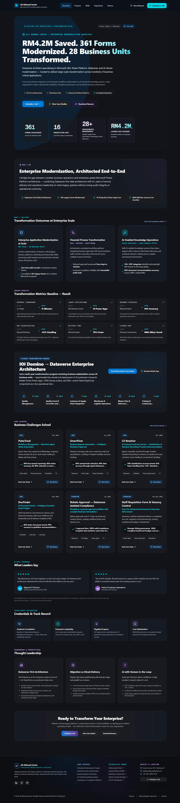

# Al Resume & Interview Prep Portfolio (`al-resume-portfolio`)

**Repositories:**
- Primary Interactive Executive Portfolio (`Al Resume`): `aliakhmadfauzie/al-resume` (`C:\Users\AL_AAF\Project\04_portfolio_and_resumes\al-resume-projects\Al Resume`)
- Editorial & Multi-Persona Portfolio (`Resume-Website/resume_al`): `aliakhmadfauzie/al-resume-builder` (`C:\Users\AL_AAF\Project\04_portfolio_and_resumes\al-resume-projects\Resume-Website\resume_al`)

---

## 1. Project Overview & Problem Solved

### Executive Summary
The **Al Resume & Interview Prep Portfolio** is a dual-surface, interactive technical showcase and executive briefing platform engineered for **Ali Akhmad Fauzie** (Enterprise Solution Architect, Fullstack & Mobile Developer, and Operations Leader). Rather than presenting recruiters and hiring executives with a static, one-dimensional PDF resume, this ecosystem pairs two complementary React 19 + TypeScript single-page applications:
1. **The Dark-Mode Enterprise Command & Interview Prep Hub (`Al Resume`)** — A high-density, glassmorphic dark UI (`#111318` base with `#0078d4` Azure Blue and `#00dbe7` Cyan accents) featuring 7 live enterprise simulation sandboxes, a structured 10-minute Executive Briefing / Hiring Manager Experience, and the **Ask Ali** intent-routed conversational knowledge assistant.
2. **The Editorial Multi-Persona & ATS Resume Studio (`Resume-Website/resume_al`)** — A warm editorial light-mode publication (`#fdfdfc` newsprint canvas) equipped with a real-time **Profile Mode Switcher** (`Full` | `Architecture` | `Operations`), an interactive SVG **Impact Dashboard**, a 30fps `requestAnimationFrame` Katakana/Hex **Matrix Rain** canvas overlay, client-side custom technical article publishing (`localStorage`), and a multi-format **ATS Plain-Text / vCard (`.vcf`) / Print-Ready Resume Generator**.

### The Core Problem Solved
Senior hybrid leaders who bridge **Enterprise Solution Architecture** (361+ Lotus Domino databases catalogued and migrated to Microsoft 365/Dataverse, 60+ Dataverse tables, 40+ C# plugins, 16+ production mobile/web apps) and **Global Operations Management** (scaling a 34-person multilingual BPO organization across 7 APAC markets at >98% SLA compliance) face three recurring friction points during executive hiring:
- **Context Overload Across Different Evaluators:** A VP of Engineering wants to inspect Dataverse plugin pipelines, C# stage 10/20/40 execution, and system architecture diagrams, whereas a COO or Head of Service Delivery wants to evaluate SLA governance, escalation triage, and 90-day operational roadmaps. Static resumes force both personas to wade through irrelevant detail.
- **Inability to Demonstrate Proprietary Enterprise Platforms:** Enterprise intranet systems—such as FinOps cloud spend governance, 7-component commercial rebate calculators, and SAP-synchronized warehouse container inspection apps—sit behind corporate firewalls and NDAs. Candidates can rarely show live working software during interviews.
- **Passive Interview Dynamics:** Traditional portfolio websites act as passive brochures rather than active interview companions that guide a 10-minute executive walkthrough or answer ad-hoc hiring manager questions with grounded evidence.

The **Al Resume & Interview Prep Portfolio** solves all three challenges by introducing **persona-scoped state filtering**, **7 anonymized interactive enterprise simulators**, and a **dual Guided/Explore Interview Mode** backed by deterministic keyword-intent routing.

---

## 2. Tech Stack & Architecture Choices

### System Architecture Diagram

```mermaid
flowchart TB
    subgraph ClientLayer["Presentation & Dual-Surface UI Layer (React 19 + Tailwind CSS 4)"]
        direction LR
        subgraph DarkApp["Al Resume (Enterprise Command & Interview Prep)"]
            NavDark["Sticky Navbar & Skip-to-Content A11y"]
            HomeDark["HomeView & Transformation Metrics"]
            ProjDark["ProjectsView & Migration Slices (A–G)"]
            DemosView["LiveDemosView (7 Interactive Sandboxes)"]
            BriefingView["ExecutiveBriefing & InterviewModeView"]
            AskAli["Ask Ali Intent-Routed Chat Engine"]
        end

        subgraph EditorialApp["Resume-Website/resume_al (Editorial & ATS Studio)"]
            BgCanvas["ShaderBackground + 30fps MatrixRain Canvas"]
            ModeSwitch["ProfileMode Switcher (Full / Architecture / Operations)"]
            ImpactDash["ImpactDashboard (12 KPIs + SVG Donut & Bars)"]
            ArticleCMS["ArticlesSection & CreateArticleModal"]
            ATSModal["ResumeModal (Print PDF / ATS Plain-Text / .vcf)"]
        end
    end

    subgraph StateEngine["Client State, Code-Splitting & Persistence Layer"]
        ReactLazy["React.lazy() + Suspense Boundary (9 Below-Fold Chunks)"]
        Motion["Motion (Framer Motion 12) AnimatePresence Transitions"]
        LocalStore["Browser localStorage ('ali_resume_custom_articles_v1')"]
        ClipboardAPI["Navigator Clipboard & Blob URL Generator (.vcf / ATS)"]
    end

    subgraph DataLayer["Strongly-Typed Domain & Knowledge Layer (src/data/)"]
        PortData["portfolioData.ts (Projects, Slices, Governance)"]
        HMData["hiringManagerData.ts (Case Studies, 90-Day Plan, Prompts)"]
        ResData["resumeData.ts (Multi-Persona Titles, Timeline, Certs)"]
        ArtData["articlesData.ts (Seed Engineering Articles)"]
    end

    subgraph Hosting["Multi-Cloud Static Edge Deployment"]
        Vercel["Vercel Edge Network (al-resume.vercel.app)"]
        FirebaseHost["Firebase Hosting CDN (aliakhmadfauzie.my.id)"]
    end

    DarkApp --> Motion
    EditorialApp --> ReactLazy
    EditorialApp --> Motion
    BriefingView --> AskAli
    AskAli --> HMData
    DemosView --> PortData
    ModeSwitch --> ResData
    ImpactDash --> ResData
    ArticleCMS --> LocalStore
    ArticleCMS --> ArtData
    ATSModal --> ClipboardAPI
    ClientLayer --> Vercel
    ClientLayer --> FirebaseHost
```



### Technology Stack Table

| Layer | Technology / Library | Version | Architectural Rationale |
| :--- | :--- | :--- | :--- |
| **Core UI Framework** | React + React DOM | `^19.0.1` | Leverages React 19 concurrent rendering, `React.lazy` + `<Suspense>` code splitting, and zero-overhead functional hooks (`useCallback`, `useMemo`, `useRef`). |
| **Language & Typing** | TypeScript | `~5.8.2` | Enforces strict domain contracts across 25+ interfaces (`ProjectItem`, `MigrationSlice`, `DeliveryCaseStudy`, `AskAliPrompt`, `ProfileMode`). |
| **Build Tool & Bundler** | Vite + `@vitejs/plugin-react` | `^6.2.3` | Instant HMR during development and optimized Rollup chunk splitting for below-the-fold lazy components in production builds. |
| **Styling Engine** | Tailwind CSS + `@tailwindcss/vite` | `^4.1.14` | Zero-runtime CSS utility generation supporting both the dark glassmorphic executive theme (`#111318`) and the warm editorial theme (`#fdfdfc`) with `@media print` overrides. |
| **Animation & Transitions** | Motion (`motion/react`) | `^12.23.24` | Powers `<AnimatePresence mode="wait">` tab routing, guided interview progress bars, and micro-interaction transitions. |
| **Content Rendering** | `react-markdown` | `^10.1.0` | Renders rich Markdown engineering case studies and user-authored technical articles in `ArticleDetailView.tsx`. |
| **Iconography & Visuals** | `lucide-react` + `canvas-confetti` | `^0.546.0` / `^1.9.4` | Consistent vector iconography and tactile celebratory feedback (`confetti()`) upon approving commercial rebates in live demos. |
| **AI & Knowledge SDK** | `@google/genai` + Local Intent Router | `^2.4.0` | Supports Gemini API extensibility alongside a zero-latency, deterministic client-side keyword-matching engine (`ASK_ALI_PROMPTS`) that guarantees 100% factual portfolio grounding. |
| **Deployment & Hosting** | Vercel + Firebase Hosting | Dual-CDN | Redundant global edge delivery with SPA rewrite rules (`index.html`) and immutable asset caching (`max-age=31536000`). |

---

## 3. Key Features & UI Implementation

### 1. Seven Interactive Enterprise Modernization Simulators (`LiveDemosView.tsx`)
Instead of static screenshots, `Al Resume/src/components/views/LiveDemosView.tsx` (1,024 lines) embeds seven interactive enterprise sandboxes, each paired with a structured **Architecture Strategy Block** (`Challenge` → `Transformation Approach` → `Business Result` → `Potential Enterprise Benefits`):
- **FinOps Governance Platform (`finops`):** Displays `$3,200,000` allocated budget, `$2,847,500` MTD burn rate (`88.9%`), and an interactive **SmartFlow Executive Requisition Approval Table** (`REQ-4921`, `REQ-4922`, `REQ-4923`) where evaluators can toggle live sign-off states.
- **Industrial Nexus ITSM Service Desk (`it-service`):** Simulates a 56-column mapped service desk with live ticket creation (`INC-2025-XXX`), priority badges, SLA countdown timers, and a governed 72-hour acceptance window.
- **Enterprise Core ERP Procurement Center (`erp`):** Showcases a 4-tier approval flow and a mandatory 5-day internal posting lockout tracker for staff requisitions (`REQ-STAFF-014`).
- **Warehouse Central & Pre-Loading Inspection Hub (`warehouse`):** Simulates Slice D logistics operations with geo-tagged Power Apps Mobile container seal verification (`#ML-99042`), automated gate pass issuance, and SAP-synchronized batch movement logs.
- **Maintenance HQ Command & Server Audit Register (`maintenance`):** Tracks plant OEE (`78.4%`), automated server checklist numbering (`Server Checklist-2025-W12-004`), vibration telemetry, and ISO 27001 Dataverse disaster recovery metrics (`RPO < 15 min`, `RTO < 1 hr`).
- **7-Component Commercial Rebate Formula Simulator (`rebate`):** An interactive financial pricing engine with real-time range sliders for Base Tier Rate, Order Volume, Distance, Special Term, Seasonal, Tax, and Credit Deduction, enforcing a statutory ceiling cap of `RM 0.20 / Tonne` and firing `canvas-confetti` upon executive approval.
- **AI-Enabled SOP Classification Engine (`cs-resolver`):** Simulates natural-language ticket triage across 120+ SOP categories, dynamically computing confidence scores (`93.5%`–`98.4%`) and routing operators to the exact resolution protocol (`SOP-QA-042`, `SOP-IT-018`, `SOP-FIN-009`, `SOP-LOG-027`).

### 2. Guided & Free-Explore Hiring Manager Experience (`InterviewModeView.tsx` & `ExecutiveBriefing.tsx`)
Designed specifically for live interviews and asynchronous executive evaluations, `InterviewModeView.tsx` provides three distinct state modes (`'landing' | 'guided' | 'explore'`):
- **Guided 7-Step Walkthrough (`mode === 'guided'`):** Steps hiring managers sequentially through *Career Journey*, *Flagship Delivery Portfolio* (`Situation` → `Approach` → `Architecture` → `Outcomes` → `Lessons Learned`), *4-Phase Solution Methodology*, *Leadership Operating System* (Monday–Friday cadence, team management, decision framework), *AI Workforce Stack*, *First 90 Days Plan* (`Days 1–30`, `Days 31–60`, `Days 61–90`), and *Ask Ali*. Includes an animated Framer Motion progress bar and instant section-jump chips.
- **Ask Ali Intent-Routed Assistant:** Evaluators can click suggested executive prompts or submit questions; the assistant matches intent keywords against verified portfolio evidence and renders deep-link jump buttons (`onJumpToSection`) that scroll directly to the supporting architectural section.

### 3. Multi-Persona Editorial Switcher & Visual Impact Dashboard (`Resume-Website/resume_al`)
In `Resume-Website/resume_al/src/App.tsx` and `ImpactDashboard.tsx`, recruiters can switch the entire portfolio between `'full'`, `'architecture'`, and `'operations'` tracks:
- **12-Tile Scannable KPI Grid:** Dynamically filters headline metrics (e.g., `418+ Lotus Forms Modernized`, `60+ Dataverse Tables`, `40+ C# Plugins`, `MYR 360K/yr License Cost Saved` for Architecture vs. `34 Multilingual Agents Scaled`, `98% SLA Compliance`, `-90% Manual Reporting Cut` for Operations).
- **Custom SVG Data Visualizations:** Hand-crafted, zero-dependency SVG charts including a multi-segment **Track Mix Donut Chart** (`strokeDasharray` / `strokeDashoffset` geometry across 19 engagements), a **By the Numbers Horizontal Bar Chart**, and **Speed Wins Cycle Compression Chips** (`3 days → 15 min` Rebate Approval, `6 hrs → 5 min` Onboarding).

### 4. Multi-Format ATS Resume, vCard (`.vcf`), & Custom Article Studio (`ResumeModal.tsx` & `CreateArticleModal.tsx`)
- **3-in-1 Resume Export (`ResumeModal.tsx`):** Provides a print-styled A4/Letter sheet (`#printable-resume`), a one-click **Copy Plain Text (ATS)** serializer that formats the active persona track into clean ASCII sections for applicant tracking systems, and a browser-generated **vCard 3.0 (`.vcf`)** download (`Ali_Akhmad_Fauzie.vcf`).
- **Client-Side Technical Blog CMS:** Users can read deep-dive engineering articles or create new custom articles via `CreateArticleModal.tsx`, which persists custom posts to `localStorage` under `ali_resume_custom_articles_v1` and merges them seamlessly with seed articles.

---

## 4. Technical Challenges Overcome

### Challenge 1: Optimizing Largest Contentful Paint (LCP) & Initial Bundle Size on a Content-Rich Portfolio
**Problem:** `Resume-Website/resume_al` combines a WebGL-style shader grid, a HTML5 Canvas Matrix rain animation, a 12-tile KPI dashboard, a full project gallery, a Markdown blog reader, an architecture diagram, a skill heatmap, and three complex modals. Importing all components eagerly bloated the main JavaScript bundle and delayed initial rendering.

**Solution:** In `Resume-Website/resume_al/src/App.tsx` (lines 17–51), all below-the-fold sections and interaction-driven modals are code-split using `React.lazy()` with named-export promise adapters and wrapped in `<Suspense fallback={null}>` boundaries so the above-the-fold Hero, Executive Summary, and Impact Dashboard paint immediately.

```tsx
// File: Resume-Website/resume_al/src/App.tsx (Lines 17-51)
// Code-split below-the-fold sections and interaction-driven modals so they don't
// block the initial render (improves LCP) nor inflate the main bundle.
const ArticleDetailView = lazy(() =>
  import('./components/ArticleDetailView').then((m) => ({ default: m.ArticleDetailView }))
);
const CreateArticleModal = lazy(() =>
  import('./components/CreateArticleModal').then((m) => ({ default: m.CreateArticleModal }))
);
const ArchitectureDiagram = lazy(() =>
  import('./components/ArchitectureDiagram').then((m) => ({ default: m.ArchitectureDiagram }))
);
const TimelineSection = lazy(() =>
  import('./components/TimelineSection').then((m) => ({ default: m.TimelineSection }))
);
const TestimonialsSection = lazy(() =>
  import('./components/TestimonialsSection').then((m) => ({ default: m.TestimonialsSection }))
);
const SkillsSection = lazy(() =>
  import('./components/SkillsSection').then((m) => ({ default: m.SkillsSection }))
);
const SkillHeatmap = lazy(() =>
  import('./components/SkillHeatmap').then((m) => ({ default: m.SkillHeatmap }))
);
const CertificationsSection = lazy(() =>
  import('./components/CertificationsSection').then((m) => ({ default: m.CertificationsSection }))
);
const ContactSection = lazy(() =>
  import('./components/ContactSection').then((m) => ({ default: m.ContactSection }))
);
const ProjectDetailModal = lazy(() =>
  import('./components/ProjectDetailModal').then((m) => ({ default: m.ProjectDetailModal }))
);
const ResumeModal = lazy(() =>
  import('./components/ResumeModal').then((m) => ({ default: m.ResumeModal }))
);
```

---

### Challenge 2: CPU-Safe, Accessibility-Compliant Canvas Animation (`MatrixRain.tsx`)
**Problem:** Running a full-viewport HTML5 `<canvas>` digital rain effect behind a scrolling React page can easily cause 60fps main-thread jank, drain laptop batteries when the tab is backgrounded, and violate WCAG motion-sensitivity guidelines (`prefers-reduced-motion: reduce`).

**Solution:** In `Resume-Website/resume_al/src/components/MatrixRain.tsx` (lines 22–96), the animation loop throttles `requestAnimationFrame` painting to ~30fps (`fpsInterval = 1000 / 30`), checks `window.matchMedia('(prefers-reduced-motion: reduce)')` to render a single static frame when reduced motion is requested, and binds a `document.addEventListener('visibilitychange', ...)` listener to cancel the animation frame immediately when the browser tab is hidden.

```tsx
// File: Resume-Website/resume_al/src/components/MatrixRain.tsx (Lines 28-95)
    const reduced = window.matchMedia('(prefers-reduced-motion: reduce)').matches;

    let raf = 0;
    let w = 0;
    let h = 0;
    const fontSize = 16;
    let columns = 0;
    let drops: number[] = [];
    let last = 0;
    const fpsInterval = 1000 / 30; // cap ~30fps for perf
    // ...
    const draw = (t: number) => {
      raf = requestAnimationFrame(draw);
      if (t - last < fpsInterval) return;
      last = t;
      ctx.fillStyle = 'rgba(253,253,252,0.10)';
      ctx.fillRect(0, 0, w, h);
      paint();
    };

    // Under reduced motion, paint a single faint static frame and stop.
    if (reduced) {
      resize();
      ctx.fillStyle = 'rgba(253,253,252,1)';
      ctx.fillRect(0, 0, w, h);
      paint();
      return;
    }

    resize();
    window.addEventListener('resize', resize);
    raf = requestAnimationFrame(draw);

    const onVisibility = () => {
      if (document.hidden) {
        cancelAnimationFrame(raf);
      } else {
        last = 0;
        raf = requestAnimationFrame(draw);
      }
    };
    document.addEventListener('visibilitychange', onVisibility);
```

---

### Challenge 3: Real-Time 7-Component Commercial Rebate Governance & Statutory Ceiling Enforcement
**Problem:** To prove enterprise domain mastery in `Al Resume`, the Tasek Cement Rebate Simulator needed to replicate a real 7-variable commercial formula where multiple additive incentives and credit deductions are dynamically summed, capped at a strict statutory ceiling of `RM 0.20 / Tonne`, and multiplied by metric tonnage with instant visual feedback when the cap is triggered.

**Solution:** In `Al Resume/src/components/views/LiveDemosView.tsx` (lines 162–177), reactive state variables compute `rawRebatePerTonne`, apply `Math.min(rawRebatePerTonne, 0.20)` for the governed ceiling, derive the boolean `isCapped` flag to trigger warning badges in the UI, and calculate the exact total payout in Malaysian Ringgit (`RM`).

```tsx
// File: Al Resume/src/components/views/LiveDemosView.tsx (Lines 162-177)
  // State for Rebate Calculator
  const [rebateBaseRate, setRebateBaseRate] = useState<number>(0.08);
  const [rebateVolume, setRebateVolume] = useState<number>(1200); // tonnes
  const [rebateDistance, setRebateDistance] = useState<number>(0.03);
  const [rebateSpecialTerm, setRebateSpecialTerm] = useState<number>(0.02);
  const [rebateSeasonal, setRebateSeasonal] = useState<number>(0.01);
  const [rebateTax, setRebateTax] = useState<number>(0.01);
  const [rebateCreditDeduction, setRebateCreditDeduction] = useState<number>(0.01);
  const [rebateApproved, setRebateApproved] = useState<boolean>(false);

  // Rebate calculations
  const rawRebatePerTonne = Math.max(
    0,
    rebateBaseRate + rebateDistance + rebateSpecialTerm + rebateSeasonal + rebateTax - rebateCreditDeduction
  );
  const cappedRebatePerTonne = Math.min(rawRebatePerTonne, 0.20);
  const isCapped = rawRebatePerTonne > 0.20;
  const totalRebateAmountRM = (cappedRebatePerTonne * rebateVolume).toFixed(2);
```

---

### Challenge 4: Hallucination-Free "Ask Ali" Executive Assistant with Cross-Mode Deep-Linking
**Problem:** Embedding a free-form LLM chat widget on a portfolio site introduces API key exposure risks, network latency, and the danger of hallucinating unverified metrics during a high-stakes hiring manager review. Furthermore, clicking a reference link inside a chat answer must work seamlessly whether the user is currently in step-by-step `guided` mode or full-page `explore` mode.

**Solution:** In `Al Resume/src/components/views/InterviewModeView.tsx` (lines 65–114), `handleAsk` normalizes user queries and matches them against `ASK_ALI_PROMPTS` (keyword arrays and prompt labels) with a clean `typingTimeoutRef` lifecycle cleanup on unmount. When the user clicks a deep-link chip on an answer, `jumpToSection` inspects the current `mode`: if in `'guided'` mode, it transitions directly to the matching step index (`goToStep(index)`); if in `'explore'` mode, it switches modes and smoothly scrolls to `#hm-section-${sectionId}` after an 80ms DOM paint tick.

```tsx
// File: Al Resume/src/components/views/InterviewModeView.tsx (Lines 65-114)
  const scrollToSection = useCallback((sectionId: string) => {
    // Wait a tick so the DOM (explore mode) is rendered before scrolling
    setTimeout(() => {
      const el = document.getElementById(`hm-section-${sectionId}`);
      if (el) {
        el.scrollIntoView({ behavior: 'smooth', block: 'start' });
      }
    }, 80);
  }, []);

  const jumpToSection = useCallback(
    (sectionId: string) => {
      const index = GUIDED_SECTIONS.findIndex((s) => s.id === sectionId);
      if (mode === 'guided' && index >= 0) {
        goToStep(index);
      } else {
        setMode('explore');
        scrollToSection(sectionId);
      }
    },
    [mode, scrollToSection]
  );

  const handleAsk = useCallback((text: string) => {
    const userMessage: ChatMessage = {
      id: messageIdRef.current++,
      role: 'user',
      text
    };
    setMessages((prev) => [...prev, userMessage]);
    setIsTyping(true);

    typingTimeoutRef.current = setTimeout(() => {
      const normalized = text.toLowerCase();
      const matched =
        ASK_ALI_PROMPTS.find((prompt) =>
          prompt.keywords.some((keyword) => normalized.includes(keyword))
        ) || ASK_ALI_PROMPTS.find((prompt) => normalized.includes(prompt.label.toLowerCase()));

      const aliMessage: ChatMessage = {
        id: messageIdRef.current++,
        role: 'ali',
        text: matched ? matched.answer : FALLBACK_ANSWER,
        sectionId: matched?.sectionId,
        sectionLabel: matched?.sectionLabel
      };
      setMessages((prev) => [...prev, aliMessage]);
      setIsTyping(false);
    }, 900);
  }, []);
```

---

### Challenge 5: Dynamic Persona-Aware ATS Plain-Text & RFC-2426 vCard Serialization (`ResumeModal.tsx`)
**Problem:** Hiring teams often need to paste a candidate's resume into an internal ATS portal or save contact details directly to mobile address books, while still preserving the role focus (`Architecture` vs. `Operations`) currently selected by the reviewer.

**Solution:** In `Resume-Website/resume_al/src/components/ResumeModal.tsx` (lines 41–117), `handleCopyPlainText` and `handleDownloadVCard` dynamically inspect `selectedFocus` (`'architecture' | 'operations' | 'full'`), select the corresponding executive title and summary, serialize all structured arrays (`skillCategories`, `timelineData`, `projectsData`, `certificationsData`) into clean ATS-parseable text or an RFC-2426 `text/vcard` Blob, and trigger instant clipboard copy or `.vcf` file download.

```tsx
// File: Resume-Website/resume_al/src/components/ResumeModal.tsx (Lines 92-117)
  const handleDownloadVCard = () => {
    const isArch = selectedFocus === 'architecture' || selectedFocus === 'architect';
    const vCardData = `BEGIN:VCARD
VERSION:3.0
N:Fauzie;Ali;Akhmad;;
FN:Ali Akhmad Fauzie
ORG:Enterprise Architecture & Operations
TITLE:${isArch ? personalInfo.titles.architect : personalInfo.titles.operations}
TEL;TYPE=CELL,VOICE:${personalInfo.phoneMY}
TEL;TYPE=CELL,VOICE:${personalInfo.phoneID}
EMAIL;TYPE=INTERNET,PREF:${personalInfo.email}
URL:${personalInfo.portfolioUrl}
URL;TYPE=LinkedIn:${personalInfo.linkedin}
ADR;TYPE=WORK:;;Kuala Lumpur;Federal Territory;Malaysia
NOTE:Power Platform Architect & Operations Leader. 365+ DBs migrated, 34-member team scaled.
END:VCARD`;

    const blob = new Blob([vCardData], { type: 'text/vcard;charset=utf-8' });
    const url = URL.createObjectURL(blob);
    const link = document.createElement('a');
    link.href = url;
    link.setAttribute('download', 'Ali_Akhmad_Fauzie.vcf');
    document.body.appendChild(link);
    link.click();
    document.body.removeChild(link);
  };
```
