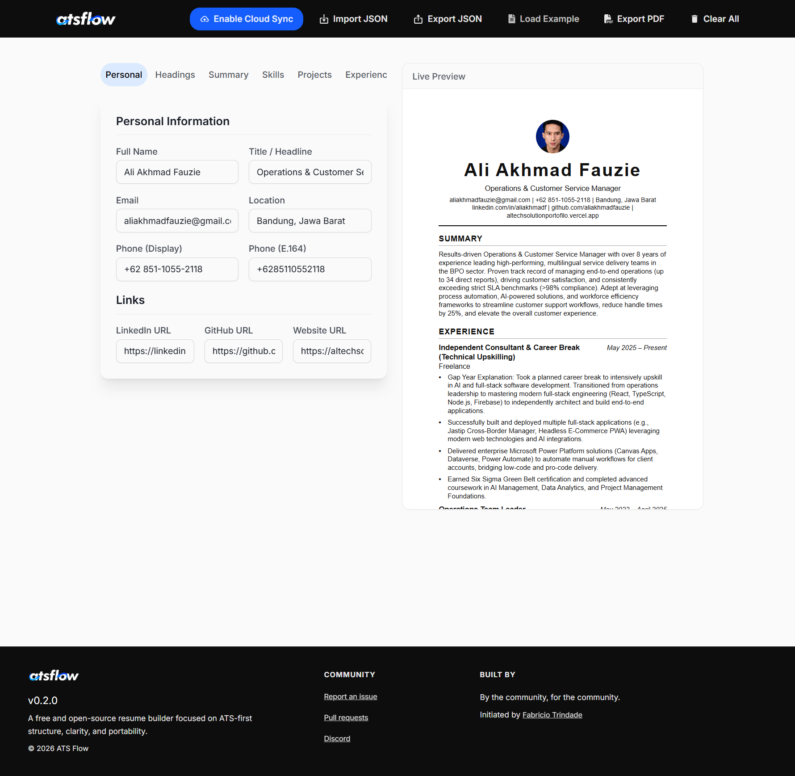
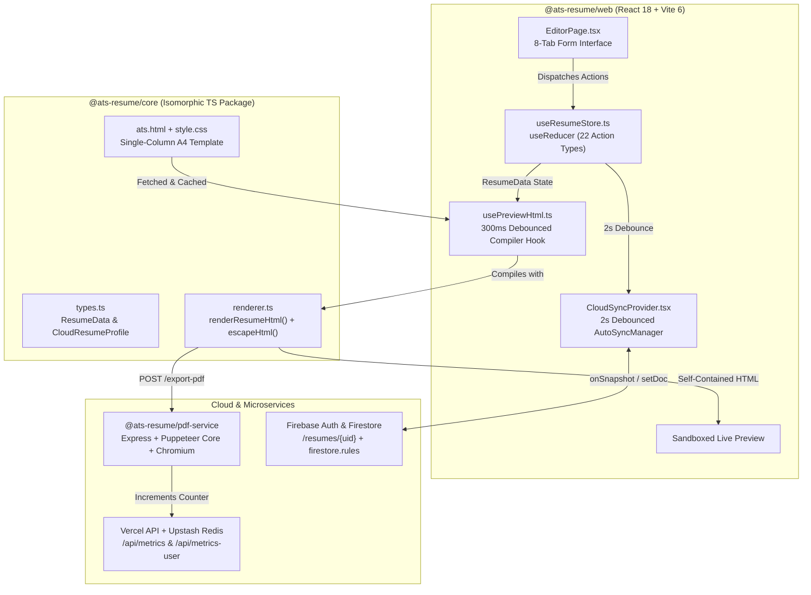

# Portfolio Case Study: ATS Flow — Deterministic ATS-First Resume Builder



---

## 1. Project Overview & Problem Solved

**ATS Flow** (`@ats-resume/*` v0.2.0) is an open-source, privacy-first web application and document compilation pipeline designed for software engineers, operations leaders, and technical professionals who require complete ownership over their resume data and formatting.

### The Problem
Most commercial resume builders suffer from four structural flaws that hurt job seekers and technical candidates:
1. **ATS Parsing Failures:** Multi-column layouts, floating text boxes, canvas-rendered text, and decorative icons frequently scramble text extraction order in Applicant Tracking Systems (Workday, Greenhouse, Lever, Taleo).
2. **Vendor Lock-In & Paywalls:** Users spend hours entering career history only to hit subscription paywalls when exporting to PDF, with no way to export underlying raw structured data.
3. **Lack of Reproducibility:** WYSIWYG drag-and-drop editors introduce inconsistent spacing, orphaned headings, and unpredictable pagination across edits.
4. **Privacy Erosion:** Career histories and personal contact details are permanently stored on third-party servers with mandatory account creation and analytics tracking.

### The Solution
ATS Flow solves these problems through a **content-first, deterministic compilation architecture**:
- **Structured Data Portability:** A candidate's entire resume lives in a strictly typed JSON schema (`ResumeData` in [`packages/core/src/types.ts`](packages/core/src/types.ts)) that can be imported, exported, version-controlled in Git, or edited visually in the browser.
- **Deterministic Semantic HTML Engine:** The shared `@ats-resume/core` engine compiles structured JSON into clean, single-column semantic HTML (`<header>`, `<section>`, `<h1>`–`<h2>`, `<ul>/<li>`) with inlined print-safe CSS rules (`break-inside: avoid`, `@page { size: A4; margin: 0.5in; }`).
- **1:1 Print-Ready PDF Generation:** A containerized Node.js + Express + `puppeteer-core` microservice (`@ats-resume/pdf-service`) renders the exact self-contained HTML document via headless `@sparticuz/chromium` into an A4 PDF with clickable links (`mailto:`, `tel:`, `https://`) intact.
- **Zero-Account Privacy with Opt-In Cloud Sync:** The editor runs 100% client-side by default, while offering optional, one-click anonymous Firebase Authentication and Firestore real-time synchronization (`CloudSyncProvider`) for cross-session persistence and public read-only recruiter share links.

---

## 2. Tech Stack & Architecture Choices

### Technology Stack

| Layer | Technology | Role & Justification |
| :--- | :--- | :--- |
| **Monorepo & Tooling** | `pnpm` Workspaces (`pnpm@10.28.0`), TypeScript `5.9.3` | Enforces strict boundary separation between the pure rendering core (`@ats-resume/core`) and the React web client (`@ats-resume/web`). |
| **Core Compiler** | `@ats-resume/core` (Zero-DOM TypeScript) | Isomorphic template engine and domain schema shared across browser live previews, serverless functions, and CLI build scripts (`render_html.mjs`). |
| **Frontend Framework** | React `18.2.0`, Vite `6.4.1`, React Router `6.26.2` | Fast HMR development, modular client-side routing (`/` landing page and `/editor` workspace), and custom Vite dev middleware. |
| **Styling & UI System** | Tailwind CSS `4.1.0` (`@tailwindcss/vite`), React Aria Components `1.9.0` | Modern CSS-first `@theme` design tokens (`packages/web/src/styles/theme.css`), accessible UI primitives, and glassmorphic surfaces. |
| **Cloud Sync & Auth** | Firebase `12.19.0` (Anonymous Auth + Cloud Firestore) | Opt-in real-time document synchronization (`onSnapshot`), debounced auto-saving, and security-rule-enforced public share links (`firestore.rules`). |
| **PDF Microservice** | Node.js `20-slim`, Express `4.19.2`, `puppeteer-core` `24.0.0`, `@sparticuz/chromium` `131.0.0`, Docker | Headless Chromium microservice (`services/pdf`) producing deterministic A4 PDFs with print backgrounds and CSS page size enforcement. |
| **Serverless Telemetry** | Vercel Serverless Functions (`@vercel/node`), Upstash Redis (`@upstash/redis` `1.36.2`) | Lightweight, privacy-preserving counters for unique users (`metrics:users_total`) and generated PDFs (`metrics:pdfs_total`). |

### System Architecture



### Architectural Decisions
1. **Isomorphic Core Package (`packages/core`):** By keeping [`packages/core/src/renderer.ts`](packages/core/src/renderer.ts) free of browser-specific DOM APIs, the exact same `renderResumeHtml(data, templateHtml, css)` function runs inside the React hook (`usePreviewHtml.ts`) and inside standalone Node.js automation scripts ([`render_html.mjs`](render_html.mjs)).
2. **State Management via `useReducer` (`useResumeStore.ts`):** Rather than introducing external state libraries (Redux/Zustand), a single strongly-typed `resumeReducer` handles 22 distinct action types covering scalar fields, custom section labels, and nested array CRUD operations (`skills`, `projects`, `project.links`, `experience`, `education`, `languages`).
3. **Decoupled PDF Microservice (`services/pdf`):** Headless Chromium binaries exceed typical frontend bundle constraints. Isolating `puppeteer-core` and `@sparticuz/chromium` in a dedicated Dockerized Express service (`services/pdf/Dockerfile`) allows the frontend to deploy as a static/serverless bundle on Vercel while delegating heavy A4 PDF rendering to `VITE_PDF_SERVICE_URL`.

---

## 3. Key Features & UI Implementation

### Split-Pane Visual Editor with Sandboxed Live Preview
The main workspace ([`packages/web/src/pages/EditorPage.tsx`](packages/web/src/pages/EditorPage.tsx)) uses a responsive split-pane layout:
- **Left Pane — 8-Tab Structured Editor:** Organizes complex resume data into focused tabs (`Personal`, `Headings`, `Summary`, `Skills`, `Projects`, `Experience`, `Education`, `Languages`). Dynamic array sections (`SkillsTab`, `ProjectsTab`, `ExperienceTab`, `EducationTab`, `LanguagesTab`) provide inline creation, multi-line bullet parsing (`value.split("\n")`), nested project link management, and destructive action styling.
- **Right Pane — Sticky `<iframe srcDoc>` Preview:** The compiled HTML is rendered inside a sticky `<iframe sandbox="allow-same-origin" srcDoc={previewHtml} />` (`EditorPage.tsx`, lines 470–476). Using `srcDoc` guarantees complete CSS style encapsulation—the host app's Tailwind CSS v4 styles (`theme.css`, `globals.css`) never leak into the resume's print-specific A4 stylesheet (`templates/style.css`).
- **Destructive Action Confirmation Modal:** Clearing the workspace triggers a custom accessible `ConfirmModal` (`EditorPage.tsx`, lines 120–155) with backdrop overlay dismissal to prevent accidental data loss.

### Customizable Section Headings (`HeadingsTab`)
To support international resumes and role-specific terminology without hardcoding section titles, `ResumeData` includes an optional `labels?: Partial<Record<SectionKey, string>>` map. Users can customize section headers (`SUMMARY`, `SKILLS`, `PROJECTS`, `EXPERIENCE`, `EDUCATION`, `LANGUAGES`) in real time via `HeadingsTab` (`EditorPage.tsx`, lines 1170–1238), while `getLabel()` in `packages/core/src/renderer.ts` automatically falls back to default English headings when left blank.

### JSON Portability & Defensive Schema Sanitization
Users can export their current state to `resume.json` (`exportJson`), load a pre-populated production example (`loadExample` fetching `/examples/resume.example.json`), or import an existing `.json` file (`loadJson`). Upon import, `loadJson` in [`packages/web/src/hooks/useResumeStore.ts`](packages/web/src/hooks/useResumeStore.ts) (lines 327–387) performs field-by-field runtime type checking (`typeof raw.name === "string"`, `Array.isArray(raw.skills)`) against a clean `emptyResume()` baseline so malformed or partial JSON files never crash the React tree.

### Opt-In Cloud Sync & Public Recruiter Share Dialog
Implemented via [`packages/web/src/providers/cloud-sync-provider.tsx`](packages/web/src/providers/cloud-sync-provider.tsx), [`CloudSyncToggle.tsx`](packages/web/src/components/CloudSyncToggle.tsx), and [`ShareDialog.tsx`](packages/web/src/components/ShareDialog.tsx):
- **Anonymous Cloud Persistence:** Clicking **"Enable Cloud Sync"** authenticates the user via Firebase `signInAnonymously(auth)` and binds a real-time Firestore `onSnapshot` listener to `/resumes/{uid}`.
- **Debounced Auto-Sync:** `AutoSyncManager` (`EditorPage.tsx`, lines 240–250) watches `resume` state changes and debounces Firestore `setDoc(..., { merge: true })` writes by `2000ms` to minimize Firestore write operations during rapid typing.
- **Public Share Links & Firestore Security Rules:** `ShareDialog` allows users to toggle `isPublic` on their cloud profile and copy a direct share URL (`/share/${user.uid}/pdf`). Access control is enforced at the database layer in [`firestore.rules`](firestore.rules), allowing read/write only when `request.auth.uid == resource.data.userId` and public read access strictly when `resource.data.isPublic == true`.

### Landing Page & Privacy-First Telemetry
[`packages/web/src/pages/HomePage.tsx`](packages/web/src/pages/HomePage.tsx) pairs a glassmorphic hero layout (`home.css`) and an ambient rotated CSS gradient beam (`background.css`) with live GitHub repository star counts and real-time community usage counters (`Users` and `PDFs generated`) powered by Upstash Redis serverless endpoints (`packages/web/api/metrics.ts` and `packages/web/api/metrics-user.ts`).

---

## 4. Technical Challenges Overcome

### Challenge 1: Deterministically Inlining Styles & Sanitizing User Input Across Preview, CLI, and PDF Engines
**Problem:** The resume HTML must render identically in three distinct environments: (1) the browser's `<iframe srcDoc>` live preview, (2) the remote headless Chromium container (`POST /export-pdf`) which has no access to the frontend's static file server, and (3) local CLI generation (`render_html.mjs`). Additionally, user-entered strings containing characters like `<`, `>`, `&`, or `"` could break HTML structure or introduce XSS vulnerabilities when injected into templates.

**Solution:** In [`packages/core/src/renderer.ts`](packages/core/src/renderer.ts) (lines 27–33 and 173–221), `escapeHtml()` sanitizes every dynamic field and array item before template substitution, and `renderResumeHtml()` replaces the external `<link rel="stylesheet" href="./style.css" />` tag with an inline `<style>${css}</style>` block using a case-insensitive regex:

```ts
// packages/core/src/renderer.ts (lines 27-33, 173-186)
export function escapeHtml(s: string): string {
  return String(s)
    .replaceAll("&", "&amp;")
    .replaceAll("<", "&lt;")
    .replaceAll(">", "&gt;")
    .replaceAll('"', "&quot;");
}

export function renderResumeHtml(
  data: ResumeData,
  templateHtml: string,
  css: string,
): string {
  const inlined = templateHtml.replace(
    /<link\b[^>]*rel=["']stylesheet["'][^>]*href=["'][^"']*style\.css[^"']*["'][^>]*>/i,
    `<style>${css}</style>`,
  );

  return (
    inlined
      .replaceAll("{{NAME}}", escapeHtml(data.name))
      .replaceAll("{{TITLE}}", escapeHtml(data.title))
      // ...
```

Furthermore, `renderContactHtml()` (`packages/core/src/renderer.ts`, lines 128–171) dynamically constructs a two-row contact bar (`email | phone | location` and `linkedin | github | website`), stripping `https://` protocol prefixes for clean display text, pairing `phone_display` with `tel:${phone_e164}` links only when E.164 formatting is provided, and joining only non-empty segments with `" | "` so missing fields never leave dangling pipe separators.

---

### Challenge 2: Preventing SPA Fallback Corruption & DOM Thrashing in Live Preview
**Problem:** In Single-Page Applications hosted behind catch-all rewrites (`/(.*) -> /index.html`), a misconfigured asset path for `/templates/ats.html` can silently return a `200 OK` response containing the SPA's `index.html` shell instead of the resume template, causing recursive iframe rendering. Moreover, re-compiling the full HTML string and updating `<iframe srcDoc>` on every single keystroke causes noticeable iframe flicker and layout recalculation overhead.

**Solution:** [`packages/web/src/hooks/usePreviewHtml.ts`](packages/web/src/hooks/usePreviewHtml.ts) (lines 6–56) implements three safeguards:
1. **Module-Scope Asset Memoization:** `_templateHtml` and `_css` are fetched once via `Promise.all` and cached in module scope.
2. **Anti-SPA-Fallback Verification:** Before caching `_templateHtml`, `loadAssets()` verifies that template placeholders `{{NAME}}` and `{{SKILLS_HTML}}` exist in the response payload.
3. **300ms Debounced Compilation:** `useEffect` wraps `renderResumeHtml` in a `300ms` timer cleared on cleanup, keeping typing in form inputs at 60fps.

```ts
// packages/web/src/hooks/usePreviewHtml.ts (lines 21-53)
async function loadAssets() {
  if (_templateHtml && _css) return;

  const tplPath = base("templates/ats.html");
  const cssPath = base("templates/style.css");

  const [tpl, css] = await Promise.all([loadText(tplPath), loadText(cssPath)]);

  // anti-fallback: se vier index.html da SPA, normalmente não tem {{NAME}}
  if (!tpl.includes("{{NAME}}") || !tpl.includes("{{SKILLS_HTML}}")) {
    throw new Error("ats.html is not the resume template");
  }

  _templateHtml = tpl;
  _css = css;
}

export function usePreviewHtml(resume: ResumeData) {
  const [html, setHtml] = useState("");

  useEffect(() => {
    const timer = setTimeout(async () => {
      try {
        await loadAssets();
        setHtml(renderResumeHtml(resume, _templateHtml, _css));
      } catch (e) {
        console.error("[usePreviewHtml] failed", e);
        setHtml("");
      }
    }, 300);

    return () => clearTimeout(timer);
  }, [resume]);

  return html;
}
```

---

### Challenge 3: Preserving Natural Typing UX in Comma-Separated Skill Inputs
**Problem:** In `useResumeStore.ts` (lines 141–155), `SET_SKILL_GROUP_ITEMS` normalizes a comma-separated string into a clean `string[]` array via `action.value.split(",").map((s) => s.trim()).filter(Boolean)`. If an `<input>` binds directly to `group.items.join(", ")` and dispatches `SET_SKILL_GROUP_ITEMS` on every `onChange` event, typing a trailing comma or space (`"React, "`) is immediately stripped by `.filter(Boolean)` and re-joined as `"React"`, making it impossible to type the next skill item naturally.

**Solution:** [`packages/web/src/pages/EditorPage.tsx`](packages/web/src/pages/EditorPage.tsx) (lines 620–643) isolates a dedicated `SkillItemsInput` controlled component that maintains a local `raw` string buffer during active editing, commits the parsed array to the reducer on `onBlur`, and synchronizes with external store updates (such as clicking **"Load Example"** or **"Clear All"**) using a `useEffect` keyed on `items.join(",")`:

```tsx
// packages/web/src/pages/EditorPage.tsx (lines 620-643)
function SkillItemsInput({
  items,
  onChange,
}: {
  items: string[];
  onChange: (v: string) => void;
}) {
  const [raw, setRaw] = useState(items.join(", "));

  useEffect(() => {
    setRaw(items.join(", "));
  }, [items.join(",")]);

  return (
    <input
      type="text"
      value={raw}
      onChange={(e) => setRaw(e.target.value)}
      onBlur={() => onChange(raw)}
      placeholder="JavaScript, Node.js, React"
      className="w-full rounded-lg border border-border-primary bg-bg-transparent px-3 py-2 text-sm text-text-primary shadow-xs placeholder:text-text-placeholder outline-none focus:bg-black/5 transition-colors"
    />
  );
}
```

---

### Challenge 4: Zero-Build Monorepo HMR in Development vs. Isolated Artifacts in CI/Production
**Problem:** In a `pnpm` monorepo (`packages/core` and `packages/web`), requiring `tsc` to recompile `@ats-resume/core` on every change slows down local frontend development, whereas referencing `../core/src/index.ts` directly in production builds breaks package encapsulation.

**Solution:** [`packages/web/vite.config.ts`](packages/web/vite.config.ts) (lines 12–66) inspects Vite's `command` mode (`const isDev = command === "serve"`). In development, it registers a custom `atsResumeDevAssetsPlugin()` middleware that serves `/templates/*` and `/data/*` directly from `packages/core` and aliases `@ats-resume/core` to `../core/src/index.ts` for instant HMR. In production (`vite build`), the alias is omitted so Rollup bundles the compiled `dist` output from `@ats-resume/core`.

```ts
// packages/web/vite.config.ts (lines 49-66)
export default defineConfig(({ command }) => {
  const isDev = command === "serve";

  return {
    plugins: [react(), tailwindcss(), atsResumeDevAssetsPlugin()],
    resolve: {
      alias: {
        "@": resolve(__dirname, "./src"),
        ...(isDev
          ? {
              // só no dev (evita build/CI depender de ../core/src)
              "@ats-resume/core": resolve(__dirname, "../core/src/index.ts"),
              "@ats-resume/core/": resolve(__dirname, "../core/src/"),
            }
          : {}),
      },
    },
  };
});
```

---

### Challenge 5: Fault-Tolerant Serverless PDF Rendering & Atomic Telemetry Deduplication
**Problem:** Running headless Chromium inside a container (`services/pdf/server.js`) carries two operational risks: (1) leaked Chromium browser processes if `page.pdf()` throws an error, and (2) coupled telemetry failures if the external Upstash Redis instance times out during a user's PDF export. Similarly, client-side user registration on `HomePage.tsx` must not inflate `metrics:users_total` on repeat visits.

**Solution:**
1. **Guaranteed Browser Teardown & Non-Blocking Metrics ([`services/pdf/server.js`](services/pdf/server.js), lines 21–67):** The `/export-pdf` endpoint wraps `puppeteer.launch` in a `try / catch / finally` block that always closes the Chromium instance (`finally { if (browser) await browser.close().catch(() => {}); }`) and isolates `redis.incr("metrics:pdfs_total")` inside its own nested `try / catch {}` after `page.pdf()` succeeds—ensuring telemetry issues never block PDF delivery.
2. **Idempotent `SET NX EX` User Counting ([`packages/web/api/metrics-user.ts`](packages/web/api/metrics-user.ts), lines 22–28):** The serverless endpoint uses an atomic Redis `SET` with `nx: true` (set only if not exists) and a 1-year TTL (`ex: 60 * 60 * 24 * 365`) keyed by `metrics:user_seen:${clientId}`, incrementing `metrics:users_total` strictly when `first` returns truthy:

```ts
// packages/web/api/metrics-user.ts (lines 22-28)
const seenKey = `metrics:user_seen:${clientId}`;
const first = await redis.set(seenKey, "1", {
  nx: true,
  ex: 60 * 60 * 24 * 365,
});
if (first) await redis.incr("metrics:users_total");
```

