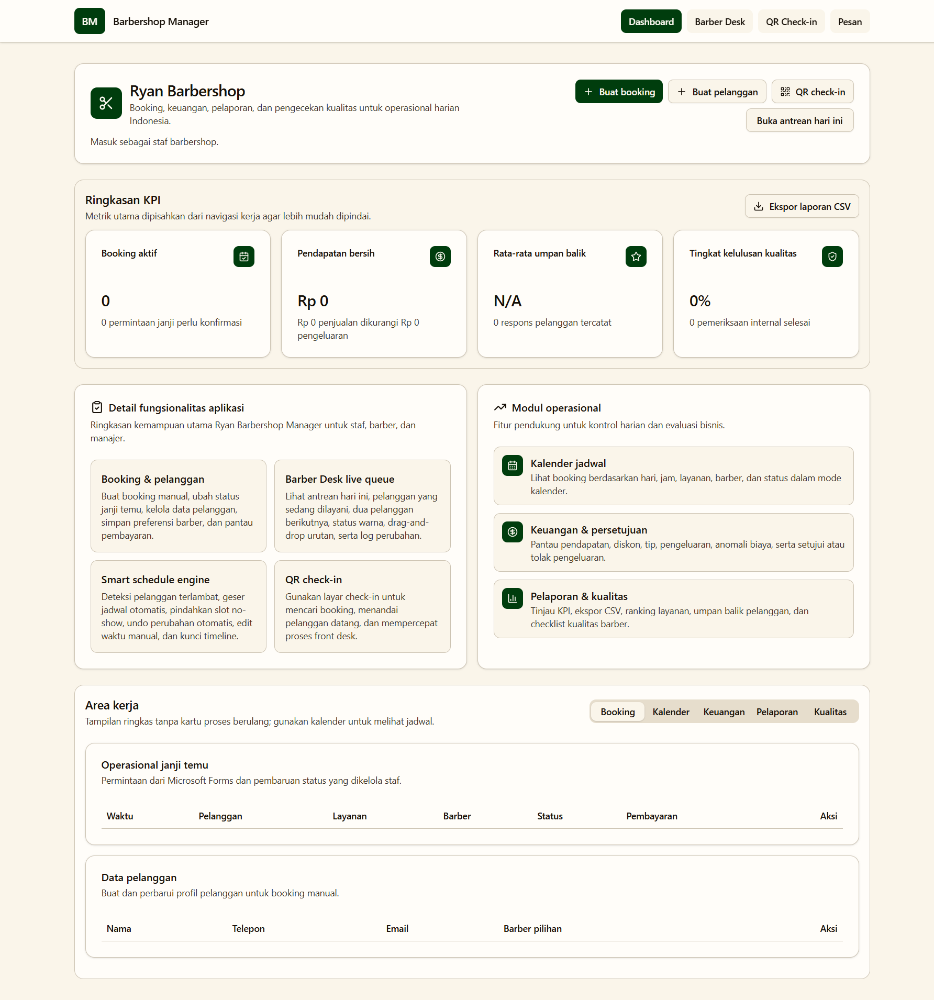
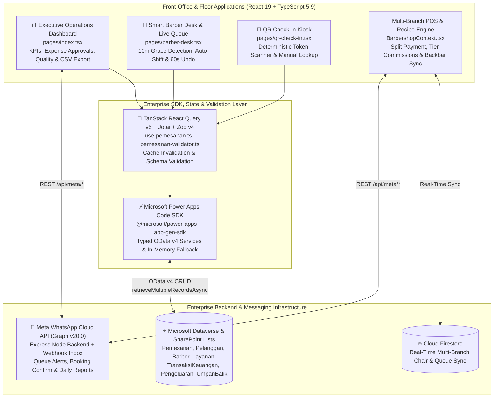

# Barbershop Management System — Enterprise Power Platform & React 19 Code App Suite



---

## 1. Project Overview & Problem Solved

**Barbershop Management System** is an enterprise-grade, multi-branch barbershop operations, live chair queue orchestration, and financial governance platform. The project bridges **Microsoft Power Platform / Dataverse / SharePoint Online** enterprise infrastructure ([`03_barbershop/barbershop-management`](file:///C:/Users/AL_AAF/Project/03_barbershop/barbershop-management)) with a modern **React 19 + Microsoft Power Apps Code App SDK** front-office application ([`03_barbershop/mobile/project/apps/barbershop-manager`](file:///C:/Users/AL_AAF/Project/03_barbershop/mobile/project/apps/barbershop-manager)) and a real-time **Multi-Branch POS, Recipe Inventory & WhatsApp Cloud API** suite ([`Barbershop-Managment`](file:///C:/Users/AL_AAF/Project/03_barbershop/barbershop-management/Barbershop-Managment)).

### Core Business Problems Solved
High-volume barbershops face a constant tug-of-war between pre-scheduled online bookings and walk-in chair turnover:
1. **Cascading Schedule Breakdowns from Late Arrivals & No-Shows**: When a booked customer arrives past the 10-minute grace period or fails to show up, static appointment calendars collapse—leaving barbers idle during no-shows or causing compounding delays for subsequent clients.
2. **Front-Desk Bottlenecks at Check-In**: Receptionists manually verifying booking codes while answering phones slows down floor seating and leaves barbers unaware that their next client is waiting in the lobby.
3. **Opaque Barber Commissions, Split Payments & Backbar Shrinkage**: Calculating tiered barber commissions (`Junior`, `Senior`, `Master`) across service fees versus retail pomade/serum sales, handling split cash + QRIS checkouts, and tracking consumable depletion (razor blades, shaving gel, neck strips per haircut) manually leads to revenue leakage and unexpected stockouts.
4. **Disconnected Enterprise Governance & Customer Messaging**: Shop owners need automated SharePoint/Dataverse data governance, outlier expense approval workflows, and instant Meta WhatsApp Cloud API booking confirmations and daily sales reports without manual copy-pasting.

The Barbershop Management System resolves these challenges through an **Automated Grace-Period & Timeline Auto-Shift Queue Engine** with a 60-second undo snapshot window, a **Staff-Assisted QR Check-In Kiosk**, **Automated Service-Recipe Backbar Deduction**, **Multi-Tier Commission & Split-Payment POS**, and **Meta WhatsApp Graph API v20.0** automation.

---

## 2. Tech Stack & Architecture Choices

### System Architecture Diagram



### Technology Stack Table

| Layer | Technology | Version | Architectural Role & Justification |
| :--- | :--- | :--- | :--- |
| **Frontend UI** | React 19 + Vite | `19.1.1` / `7.3.2` | Concurrent rendering for zero-latency floor queue management and executive dashboards. |
| **Power Platform SDK** | `@microsoft/power-apps` | `^0.5.2` | Native Power Apps Code App host initialization (`initialize()`) and Dataverse/OData data connector bridge. |
| **Server & Client State** | TanStack Query v5 + Jotai | `5.87.1` / `2.14.0` | Declarative async query caching, optimistic mutations, automatic query invalidation, and atomic UI state. |
| **Schema & Validation** | Zod v4 + React Hook Form | `4.1.5` / `7.62.0` | Strict UUID, ISO-8601 DateTime, and enum key validation (`PemesananSchema`, `PelangganSchema`). |
| **Component Primitives** | Radix UI + Tailwind CSS v4 | `4.1.13` | Accessible headless dialogs, switches, tabs, and data tables with `Recharts` financial visualizations. |
| **Enterprise Provisioning** | PnP PowerShell + SharePoint | PowerShell 7 | Automated relational list provisioning ([`provision-lists.ps1`](file:///C:/Users/AL_AAF/Project/03_barbershop/barbershop-management/provision-lists.ps1)) with Lookup constraints & OData indexes. |
| **Messaging Backend** | Express + Meta Graph API | `v20.0` | Outbound E.164 WhatsApp notifications, appointment reminders, daily owner reports, and webhook inbox. |
| **Quality & Tooling** | Storybook 10 + Vitest + Oxlint | `10.5.10` / `1.25.0` | Component visual regression (`@storybook/addon-a11y`), unit testing, and ultra-fast `tsgo` + `oxlint` checks. |

---

## 3. Key Features & UI Implementation

### 1. Smart Barber Desk & Live Queue Timeline (`pages/barber-desk.tsx`)
Designed specifically for barbers and floor managers operating in fast-paced environments, [`barber-desk.tsx`](file:///C:/Users/AL_AAF/Project/03_barbershop/mobile/project/apps/barbershop-manager/src/pages/barber-desk.tsx) provides a two-zone floor layout:
- **Active Chairs Grid**: Displays live per-barber stations (`Chair #1`, `Chair #2`, etc.), showing who is currently `In Service`, elapsed minutes in the chair (`inChairMinutes`), and one-tap buttons to seat the next arrived customer or complete & bill the session.
- **Interactive Queue with Drag-and-Drop & Timeline Lock**: Supports drag-and-drop manual queue reordering (`reorderQueue`), inline appointment start-time editing, a **Lock Timeline** switch (`timelineLocked`) to prevent automatic schedule shifts during peak hours, and a live 12-entry audit log (`QueueLog`) recording every floor action with timestamps.

### 2. Staff-Assisted QR Check-In Kiosk (`pages/qr-check-in.tsx`)
Deployed at the barbershop entrance or reception tablet, [`qr-check-in.tsx`](file:///C:/Users/AL_AAF/Project/03_barbershop/mobile/project/apps/barbershop-manager/src/pages/qr-check-in.tsx) generates deterministic, human-readable check-in tokens (`buildCheckInToken`, e.g., `35e84374-budi`) from the appointment UUID and customer name.
- Customers or receptionists can scan/paste a QR token or use the instant manual search fallback (`manualQuery` matching customer name, service, or token) to transition the appointment to `Sudah Hadir` (`StatusKey2`), immediately alerting the assigned barber on the Barber Desk.

### 3. Executive Operations, Expense Governance & Quality Audit Center (`pages/index.tsx`)
The main management hub ([`pages/index.tsx`](file:///C:/Users/AL_AAF/Project/03_barbershop/mobile/project/apps/barbershop-manager/src/pages/index.tsx)) consolidates 8 relational Dataverse/SharePoint entities (`Barber`, `Pelanggan`, `Pemesanan`, `Layanan`, `TransaksiKeuangan`, `Pengeluaran`, `UmpanBalik`, `PemeriksaanKualitas`):
- **Financial & Anomaly Detection**: Calculates gross revenue, total expenses, net revenue, and automatically flags **Outlier Expenses** (`isExpenseOutlier`) whenever a single expense exceeds $2\times$ revenue or $\text{Rp } 1.000.000$, providing one-click manager approval/rejection (`handleExpenseApproval`) with automated audit comments.
- **Quality Check & Customer Feedback Escalation**: Tracks hygiene/service inspection pass rates (`passRate`) and isolates low-rating customer reviews ($\le 3$ stars or `perluTindakLanjut`) requiring manager follow-up.

### 4. Meta WhatsApp Cloud API Diagnostic & Dispatch Hub (`pages/messages.tsx`)
Provides a live operational console ([`pages/messages.tsx`](file:///C:/Users/AL_AAF/Project/03_barbershop/mobile/project/apps/barbershop-manager/src/pages/messages.tsx) + [`whatsapp.service.ts`](file:///C:/Users/AL_AAF/Project/03_barbershop/barbershop-management/Barbershop-Managment/backend/src/services/whatsapp.service.ts)) that inspects Meta WhatsApp Business Account (WABA) review/verification status, dispatches E.164 messages and booking reminders, and streams incoming webhook messages (`wamid` status & customer replies).

---

## 4. Technical Challenges Overcome

### Challenge 1: Automated Grace-Period Late Detection, Cascading Schedule Auto-Shift & 60-Second Transactional Undo
**Problem:** When a customer checks in more than 10 minutes late (`gracePeriodMinutes = 10`) or is marked `No-Show`, manually editing the start times of all subsequent appointments for the rest of the day is slow and error-prone—especially if a staff member clicks `No-Show` by mistake and needs to revert the entire schedule shift.
**Solution:** Engineered an automated schedule-shift state machine in [`src/pages/barber-desk.tsx`](file:///C:/Users/AL_AAF/Project/03_barbershop/mobile/project/apps/barbershop-manager/src/pages/barber-desk.tsx#L135-L189). Marking a customer `Arrived` past the 10-minute grace period triggers a late-shift confirmation dialog (`pendingLate`) that pushes subsequent appointments back by the exact delay (`minutesLate`), while marking `No-Show` pulls subsequent appointments earlier by `item.durationMinutes`. Before mutating Dataverse records in parallel, `updateTimes` captures a pre-mutation snapshot (`UndoSnapshot`) valid for 60 seconds so the barber can atomically restore all original timestamps with one click:

```typescript
// From src/pages/barber-desk.tsx (lines 135-185)
async function updateTimes(items: QueueItem[], minutes: number, direction: 'later' | 'earlier', label: string) {
  const changes = items.map((item: QueueItem) => ({ id: item.id, tanggalWaktuJanji: item.tanggalWaktuJanji }));
  await Promise.all(
    items.map((item: QueueItem) =>
      updateBooking.mutateAsync({
        id: item.id,
        changedFields: {
          tanggalWaktuJanji: addMinutes(
            new Date(item.tanggalWaktuJanji),
            direction === 'later' ? minutes : -minutes
          ).toISOString(),
        },
      })
    )
  );
  setUndoSnapshot({ expiresAt: Date.now() + 60_000, changes, label });
  recordLog(label, 'Auto-shift');
}

async function undoAutoShift() {
  if (!undoSnapshot || Date.now() > undoSnapshot.expiresAt) {
    setUndoSnapshot(null);
    toast.info('Undo window expired.');
    return;
  }
  await Promise.all(
    undoSnapshot.changes.map((change) =>
      updateBooking.mutateAsync({
        id: change.id,
        changedFields: { tanggalWaktuJanji: change.tanggalWaktuJanji },
      })
    )
  );
  recordLog(undoSnapshot.label, 'Undo auto-shift');
  setUndoSnapshot(null);
  toast.success('Last auto-schedule change undone.');
}
```

### Challenge 2: Automated Backbar Consumable Recipe Deduction & Multi-Tier Commission Accounting on Checkout
**Problem:** Every barbershop service consumes backbar supplies (e.g., 1 disposable razor blade + 15ml shaving gel + 1 hot towel treatment per Gentleman's Cut) that are never rung up as retail barcodes, while barbers earn different commission percentages on services (e.g., 50%) versus retail add-ons (e.g., 15%) depending on their seniority tier (`Junior`, `Senior`, `Master`) and branch-specific pricing overrides.
**Solution:** In [`BarbershopContext.tsx`](file:///C:/Users/AL_AAF/Project/03_barbershop/barbershop-management/Barbershop-Managment/frontend/src/context/BarbershopContext.tsx#L560-L664), `completeService` resolves branch-specific price overrides (`pricingOverrides`), computes split service vs. retail commission allocations (`CommissionAllocation`), deducts sold retail items, and automatically traverses `serviceRecipes` to decrement backbar consumables and log `StockMovement` audit records:

```typescript
// From BarbershopContext.tsx (lines 590-639)
const targetBarber = barbers.find((b) => b.id === barberId || b.name === barberName);
const barberTierConfig = commissionTiers.find((t) => t.tier === targetBarber?.tier);
const serviceRate = targetBarber?.serviceCommissionRate ?? (barberTierConfig ? barberTierConfig.serviceRate : 0.50);
const retailRate = targetBarber?.retailCommissionRate ?? (barberTierConfig ? barberTierConfig.retailRate : 0.15);
const serviceCommission = Math.round(serviceAmount * serviceRate);
const retailCommission = Math.round(retailAmount * retailRate);
const totalCommission = serviceCommission + retailCommission;

// Auto-deduct backbar consumable recipes (e.g. blades, shaving gel)
if (matchedService) {
  const recipe = serviceRecipes.find(
    (r) => r.serviceId === matchedService.id || r.serviceName.toLowerCase() === matchedService.name.toLowerCase()
  );
  if (recipe && recipe.consumables) {
    for (const consumable of recipe.consumables) {
      const invItem = inventory.find(
        (i) => i.id === consumable.itemId || i.name.toLowerCase().includes(consumable.itemName.toLowerCase())
      );
      if (invItem) {
        await adjustStock(
          invItem.id,
          -Math.ceil(consumable.quantityUsed),
          'Penyesuaian',
          `Konsumsi otomatis pemakaian salon untuk layanan ${serviceName} (${customerName})`
        );
      }
    }
  }
}
```

### Challenge 3: Hybrid Dataverse / In-Memory OData v4 Data Layer with Strict Zod Schema Enforcement
**Problem:** Developing and testing a Microsoft Power Apps Code App locally or in CI/CD without live Dataverse tenant connectivity normally breaks data hooks, while loosely typed OData payloads can corrupt relational lookups (`pelanggan`, `layanan`, `barber`).
**Solution:** Built a layered data architecture combining generated Dataverse SDK services ([`pemesanan-service.ts`](file:///C:/Users/AL_AAF/Project/03_barbershop/mobile/project/apps/barbershop-manager/src/generated/services/pemesanan-service.ts)), TanStack React Query hooks with UUID guard clauses ([`use-pemesanan.ts`](file:///C:/Users/AL_AAF/Project/03_barbershop/mobile/project/apps/barbershop-manager/src/generated/hooks/use-pemesanan.ts)), an `odata-v4-inmemory` simulation engine (`HAS_IN_MEMORY_TABLES`), and strict Zod v4 validators ([`pemesanan-validator.ts`](file:///C:/Users/AL_AAF/Project/03_barbershop/mobile/project/apps/barbershop-manager/src/generated/validators/pemesanan-validator.ts)):

```typescript
// From src/generated/validators/pemesanan-validator.ts (lines 6-25)
export const PemesananSchema = z.object({
  id: z.string().uuid(),
  namaPemesanan: z.string().min(1, { message: "Nama Pemesanan is required" }),
  barber: z.object({ id: z.string().uuid(), namaBarber: z.string() }),
  catatan: z.string().optional(),
  layanan: z.object({ id: z.string().uuid(), namaLayanan: z.string() }),
  pelanggan: z.object({ id: z.string().uuid(), namaPelanggan: z.string() }),
  statusKey: z.enum(['StatusKey0', 'StatusKey1', 'StatusKey2', 'StatusKey3', 'StatusKey4', 'StatusKey5', 'StatusKey6']),
  statusPembayaranKey: z.enum(['StatusPembayaranKey0', 'StatusPembayaranKey1', 'StatusPembayaranKey2', 'StatusPembayaranKey3']),
  sumberKey: z.enum(['SumberKey0', 'SumberKey1', 'SumberKey2', 'SumberKey3', 'SumberKey4']),
  tanggalDibuat: z.string().regex(/^\d{4}-\d{2}-\d{2}T\d{2}:\d{2}/, "DateTime must be in ISO format"),
  tanggalSelesai: z.string().regex(/^\d{4}-\d{2}-\d{2}T\d{2}:\d{2}/, "DateTime must be in ISO format").optional(),
  tanggalWaktuJanji: z.string().regex(/^\d{4}-\d{2}-\d{2}T\d{2}:\d{2}/, "DateTime must be in ISO format"),
});
```

### Challenge 4: Automated SharePoint Relational Schema Provisioning via PnP PowerShell
**Problem:** Manually creating 6 interrelated SharePoint Lists (`Customers`, `Staff`, `Services`, `Appointments`, `Transactions`, `Feedback`) with exact internal field names, currency/choice constraints, and cross-list `Lookup` columns across staging and production tenants is tedious and prone to schema drift.
**Solution:** Authored idempotent PnP PowerShell provisioning scripts ([`provision-lists.ps1`](file:///C:/Users/AL_AAF/Project/03_barbershop/barbershop-management/provision-lists.ps1) and [`finalize-lists.ps1`](file:///C:/Users/AL_AAF/Project/03_barbershop/barbershop-management/finalize-lists.ps1)) that authenticate via Entra ID (`Connect-PnPOnline`), enable list versioning, enforce numeric bounds (`-MinValue 1 -MaxValue 5` on `Feedback` ratings), and wire relational `Lookup` columns linking `Appointments`, `Transactions`, and `Feedback` back to `Customers`, `Staff`, and `Services`.
