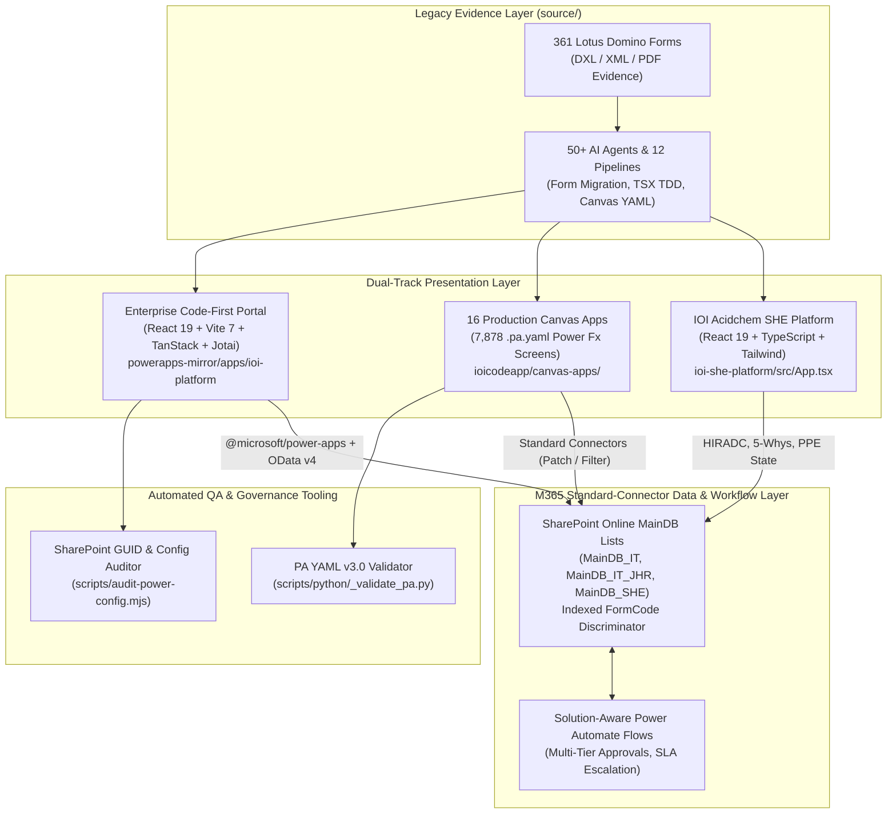

# IOI Enterprise M365 Migration & Acidchem SHE Modernization Platform


## 1. Project Overview & Problem Solved

Large manufacturing conglomerates operating oleochemical and palm processing plants face severe operational and compliance bottlenecks when critical business workflows remain trapped in legacy **IBM Lotus Domino (`.nsf` / DXL)** databases and paper-based safety registries. At **IOI Corporation Berhad / IOI Acidchem** (spanning the Penang Prai and Johor Pan-Century chemical plants and 28+ corporate and operational departments), legacy form infrastructure created four enterprise-wide challenges:
1. **Fragmented Legacy Footprint**: Over **361 Lotus Domino business forms** across 28+ departments relied on rigid Notes client deployments, unqueryable multi-line `Remarks` blobs, and manual email follow-ups with 3–5 day turnaround times.
2. **Prohibitive Licensing Costs at Scale**: Migrating 2,000+ employees onto premium Power Platform connectors (Dataverse/SQL per-app/per-user plans) would incur **$960,000+/year** (`$40/user/month`) in recurring licensing overhead.
3. **SharePoint List Sprawl & Governance Drift**: Creating one SharePoint list per form (`361+ lists`) across multi-plant environments (`Penang` vs. `Johor`) would break cross-department reporting, exceed lookup thresholds, and cause schema drift between Power Apps and SharePoint.
4. **High-Consequence Chemical Plant Safety (DOSH & SIRIM Compliance)**: Chemical plant operations—such as 240°C fatty acid distillation sampling, 50% NaOH bulk tanker unloading, and confined space tank entry—require real-time **HIRADC** (Hazard Identification, Risk Assessment, and Determining Control), **5-Whys Root Cause Incident Investigation (SHEAI / SHEICAR)**, and multi-site **PPE Inventory Compliance** tracking.

To solve this, we engineered a comprehensive **Dual-Track Enterprise Modernization Program** spanning two tightly coupled repositories:
- **`domino-m365-migration`** (`C:/Users/AL_AAF/Project/05_enterprise_m365_ioi/domino-m365-migration`): The master migration monorepo housing **7,878 Power Apps YAML screens (`.pa.yaml`)**, **16 production `.msapp` packages**, a **400+ file React 19 + TypeScript code-first mirror (`ioi-platform`)**, **1,800+ Python/PowerShell/Node automation scripts**, and **50+ specialized AI agent definitions** orchestrated across 12 migration pipelines.
- **`ioi-she-platform`** (`C:/Users/AL_AAF/Project/05_enterprise_m365_ioi/ioi-she-platform`): The dedicated React 19 + TypeScript **Safety, Health & Environment (SHE) Enterprise Suite** built for IOI Acidchem's Penang and Johor chemical plants, delivering an interactive 5×5 DOSH/SIRIM Risk Matrix Heatmap, automated $L \times S$ HIRADC scoring, 5-Whys Incident & CAPA tracking, and real-time multi-plant PPE threshold monitoring.

---

## 2. Tech Stack & Architecture Choices

### System Architecture Diagram



### Technology Stack Table

| Layer | Technology | Version | Architectural Role |
| :--- | :--- | :--- | :--- |
| **Frontend Framework** | React 19 + TypeScript | `^19.0.0` / `~5.7.2` | Core UI runtime for both `ioi-she-platform` and `powerapps-mirror/apps/ioi-platform` |
| **Build & Bundler** | Vite + ESBuild + `tsgo` | `^6.0.7` / `7.3.2` | Sub-second HMR dev server and concurrent native type-checking (`@typescript/native-preview`) |
| **Power Platform SDK** | `@microsoft/power-apps` + PAC CLI | `^1.1.3` / `2.7.4+` | Code-first Power Apps host integration and `.msapp` Canvas packing/unpacking |
| **State & Data Fetching** | TanStack Query v5 + Jotai + React Hook Form | `^5.87.1` / `^2.14.0` | Asynchronous SharePoint list caching, atomic client state, and Zod-validated (`^4.1.5`) forms |
| **UI System** | Tailwind CSS + Radix UI + Lucide React | `^3.4.17` / `^4.1.13` | Glassmorphic dark-mode industrial safety UI (`ioi-she-platform`) and 25+ Radix primitives (`ioi-platform`) |
| **Data Backend** | SharePoint Online (`MainDB_*`) + OData v4 | M365 Standard | Single `MainDB_{Dept}` list per site with `FormCode` discriminator (`DEC-2026-001`), saving $960K/yr in licensing |
| **Automation & QA** | Python 3 + Node.js `.mjs` + Vitest + Playwright | `1.60.0` | `.pa.yaml` static AST/indentation linting (`_validate_pa.py`) and `power.config.json` GUID verification |

---

## 3. Key Features & UI Implementation

### 1. Executive SHE Telemetry Dashboard (`ioi-she-platform/src/components/she/DashboardOverview.tsx`)
Implemented in [`DashboardOverview`](file:///C:/Users/AL_AAF/Project/05_enterprise_m365_ioi/ioi-she-platform/src/components/she/DashboardOverview.tsx#L7-L82), the command center aggregates real-time safety metrics across the **Penang Acidchem** and **Johor Pan-Century** chemical plants:
- **4 KPI StatCards**: Tracks `Safe Work Days (Zero LTI)` (`482 Days`), dynamic `Hazard Operations` (`High / Med` counts computed live from `hiradcList`), `Open Incident & CAPA` investigations, and `PPE Compliance Index` (`99.4% DOSH / SIRIM Certified Stock`).
- **Interactive 5×5 DOSH/SIRIM Risk Matrix Heatmap** ([`RiskMatrixHeatmap.tsx`](file:///C:/Users/AL_AAF/Project/05_enterprise_m365_ioi/ioi-she-platform/src/components/ui/RiskMatrixHeatmap.tsx#L9-L68)): Renders a 6×6 CSS Grid mapping Severity ($S \in \{5..1\}$) against Likelihood ($L \in \{1..5\}$), dynamically color-coding cells into Low (`1–4`, Emerald), Medium (`5–12`, Amber), and High (`15–25`, Red) with interactive selection rings.
- **Critical High-Risk Feed**: Filters `hiradcList` for `riskLevel === "HIGH"` items (such as `HIRADC-JOH-LOG-2026-004` for pressurized NaOH 50% ISO tanker unloading with Risk Score `16`) and provides instant drill-down navigation.

### 2. HIRADC Risk Register & Dynamic Control Hierarchy (`ioi-she-platform/src/components/she/HIRADCModule.tsx`)
[`HIRADCModule`](file:///C:/Users/AL_AAF/Project/05_enterprise_m365_ioi/ioi-she-platform/src/components/she/HIRADCModule.tsx#L7-L267) digitizes chemical plant hazard assessments:
- **Multi-Plant Search & Site Filtering**: Filters assessments in real time across `ALL`, `PENANG_PLANT`, and `JOHOR_PLANT` by process activity, hazard description, or reference code.
- **Live $L \times S$ Modal Calculator**: As safety engineers adjust the Likelihood (`1–5`) and Severity (`1–5`) range sliders inside the creation modal, `calculateRiskScore(likelihood, severity)` computes the exact score and updates the [`RiskBadge`](file:///C:/Users/AL_AAF/Project/05_enterprise_m365_ioi/ioi-she-platform/src/components/ui/RiskBadge.tsx#L5-L14) in real time.
- **5-Tier Hierarchy of Controls**: Enforces the occupational safety hierarchy (`1. Elimination`, `2. Substitution`, `3. Engineering Controls`, `4. Administrative`, `5. PPE`) with distinct semantic badges via `getControlBadge()` and auto-generates standardized reference numbers (`HIRADC-{PEN|JOH}-{DEPT}-2026-{NNN}`).

### 3. 5-Whys Incident Investigation & CAPA Engine (`ioi-she-platform/src/components/she/IncidentModule.tsx`)
[`IncidentModule`](file:///C:/Users/AL_AAF/Project/05_enterprise_m365_ioi/ioi-she-platform/src/components/she/IncidentModule.tsx#L5-L243) replaces legacy Lotus Domino `SHEAI` and `SHEICAR` forms with a master-detail investigation workbench:
- **Incident Classification & Containment**: Tracks `NEAR_MISS`, `FIRST_AID`, `MEDICAL_TREATMENT`, `LOST_TIME_INJURY`, and `PROPERTY_DAMAGE` events alongside immediate LOTO (Lockout/Tagout) and spill containment actions.
- **Structured 5-Whys Root Cause Chain**: Visualizes the 5-step causal chain from immediate physical symptom down to Management of Change (MOC) system gaps, paired with time-bound Corrective & Preventive Actions (`CAPA`) and assignee completion badges.

### 4. Multi-Plant PPE Inventory & Reorder Alerting (`ioi-she-platform/src/components/she/PPEModule.tsx`)
[`PPEModule`](file:///C:/Users/AL_AAF/Project/05_enterprise_m365_ioi/ioi-she-platform/src/components/she/PPEModule.tsx#L5-L89) tracks DOSH/SIRIM-certified protective gear (`RESPIRATORY`, `BODY_SUIT`, `HAND_ARM`, `FALL_PROTECTION`) across both Penang and Johor stockrooms, comparing `ppe.stockPenang + ppe.stockJohor` against `ppe.minimumThreshold` to trigger visual `Reorder Alert` badges.

---

## 4. Technical Challenges Overcome

### Challenge 1: Consolidating 361 Domino Forms Without SharePoint List Sprawl or Unqueryable JSON Blobs
**Problem**: Creating 361 separate SharePoint lists would make cross-departmental reporting and Power App connection management impossible, while an early prototype that serialized form fields as JSON inside a single `remarks` text column broke SharePoint OData filtering, indexing, and Power Automate condition triggers. Furthermore, Johor plant forms required site-specific columns (e.g., 60 vs. 58 fields on Hardware Inventory).
**Solution**: Documented in [`docs/decision-log.md`](file:///C:/Users/AL_AAF/Project/05_enterprise_m365_ioi/domino-m365-migration/docs/decision-log.md#L12-L101) (`DEC-2026-001`, `DEC-2026-004`, and `DEC-2026-007`), we designed a **Single `MainDB_{Dept}` List per Site with an Indexed `FormCode` Discriminator** (`maindb_it`, `maindb_it_jhr`, `maindb_she`, etc.) where every form attribute maps to a discrete, typed SharePoint model column. To prevent broken bindings across 13+ SharePoint data sources in the code-first app, we built [`audit-power-config.mjs`](file:///C:/Users/AL_AAF/Project/05_enterprise_m365_ioi/domino-m365-migration/ioicodeapp/powerapps-mirror/apps/ioi-platform/scripts/audit-power-config.mjs#L8-L120) to strip JSON comments, canonicalize multi-encoded SharePoint URLs, verify GUID table identifiers, and detect duplicate or placeholder data sources in CI:

```javascript
// File: C:\Users\AL_AAF\Project\05_enterprise_m365_ioi\domino-m365-migration\ioicodeapp\powerapps-mirror\apps\ioi-platform\scripts\audit-power-config.mjs (Lines 59-109)
function canonicalSiteUrl(raw) {
  let value = raw;
  for (let i = 0; i < 3; i++) {
    try {
      const decoded = decodeURIComponent(value);
      if (decoded === value) break;
      value = decoded;
    } catch {
      break;
    }
  }
  return value.replace(/\/$/, '').toLowerCase();
}

function isGuid(value) {
  return /^[0-9a-f]{8}-[0-9a-f]{4}-[0-9a-f]{4}-[0-9a-f]{4}-[0-9a-f]{12}$/i.test(value);
}

for (const source of sources) {
  if (source.tableName === '00000000-0000-0000-0000-000000000000') {
    issues.push({ type: 'placeholder-guid', ...source });
  } else if (!source.tableNameIsGuid) {
    issues.push({ type: 'non-guid-table-name', ...source });
  }
}
```

### Challenge 2: Automated Static Verification of 7,878 Power Apps `.pa.yaml` Screens
**Problem**: Power Apps Canvas source files (`.pa.yaml` v3.0) are notoriously fragile when packed via `pac canvas pack`: a single unindented child under `Properties:`, a missing leading `=` on a Power Fx formula, an unsupported screen-level key, or a duplicate control name across a screen causes silent corruption or opaque pack failures.
**Solution**: We engineered [`scripts/python/_validate_pa.py`](file:///C:/Users/AL_AAF/Project/05_enterprise_m365_ioi/domino-m365-migration/scripts/python/_validate_pa.py#L4-L145) to statically validate `.pa.yaml` files before `pac canvas pack` runs—verifying top-level schema nodes (`Screens`, `App`, `ComponentDefinitions`), `Properties:` block indentation hierarchy, multiline YAML block scalar (`|`, `|-`, `|+`) formula states, leading `=` Power Fx prefixes, and global control name uniqueness:

```python
# File: C:\Users\AL_AAF\Project\05_enterprise_m365_ioi\domino-m365-migration\scripts\python\_validate_pa.py (Lines 53-83)
    formula_issues = []
    in_formula_block = False
    formula_block_indent = None
    for i, line in enumerate(lines):
        stripped = line.rstrip()
        current_indent = len(stripped) - len(stripped.lstrip()) if stripped else 0

        if in_formula_block:
            if stripped and current_indent <= formula_block_indent:
                in_formula_block = False
                formula_block_indent = None
            else:
                continue

        m = re.match(r'^(\s+)(\w[\w.]*):\s*(.*)', stripped)
        if m:
            indent = len(m.group(1))
            key = m.group(2)
            val = m.group(3).strip()
            if val in ('|', '|-', '|+'):
                in_formula_block = True
                formula_block_indent = indent
                continue
            if key in skip_keys or key.startswith('#'):
                continue
            if val and not val.startswith('='):
                if not any(val.startswith(p) for p in ['{', '|', '#', '[', 'LayoutDirection.', 'LayoutOverflow.', 'LayoutAlignItems.', 'FontWeight.', 'Layout.']):
                    if val not in ('true', 'false', 'True', 'False'):
                        formula_issues.append((i+1, key, val[:50]))
```

### Challenge 3: Deterministic DOSH/SIRIM Risk Scoring & Reference Code Generation
**Problem**: In chemical manufacturing plants, manual risk assessments frequently misclassify medium vs. high risks or assign inconsistent document reference codes across Penang and Johor sites.
**Solution**: In [`ioi-she-platform/src/services/sheService.ts`](file:///C:/Users/AL_AAF/Project/05_enterprise_m365_ioi/ioi-she-platform/src/services/sheService.ts#L3-L39) and [`HIRADCModule.tsx`](file:///C:/Users/AL_AAF/Project/05_enterprise_m365_ioi/ioi-she-platform/src/components/she/HIRADCModule.tsx#L33-L57), we encapsulated the DOSH 5×5 risk matrix math (`score >= 15` → `HIGH`, `score >= 5` → `MEDIUM`, `< 5` → `LOW`) and deterministic reference ID generation (`HIRADC-PEN-PRD-2026-001`) directly into the domain service and form submission handler:

```typescript
// File: C:\Users\AL_AAF\Project\05_enterprise_m365_ioi\ioi-she-platform\src\services\sheService.ts (Lines 3-23)
export function calculateRiskScore(likelihood: number, severity: number): { score: number; level: RiskLevel } {
  const score = likelihood * severity;
  let level: RiskLevel = "LOW";
  if (score >= 15) {
    level = "HIGH";
  } else if (score >= 5) {
    level = "MEDIUM";
  }
  return { score, level };
}

export function getRiskLevelBadge(level: RiskLevel): { label: string; bg: string; text: string; border: string } {
  switch (level) {
    case "HIGH":
      return { label: "HIGH RISK", bg: "bg-red-950/60", text: "text-red-400", border: "border-red-600/40" };
    case "MEDIUM":
      return { label: "MEDIUM RISK", bg: "bg-amber-950/60", text: "text-amber-400", border: "border-amber-600/40" };
    case "LOW":
      return { label: "LOW RISK", bg: "bg-emerald-950/60", text: "text-emerald-400", border: "border-emerald-600/40" };
  }
}
```
