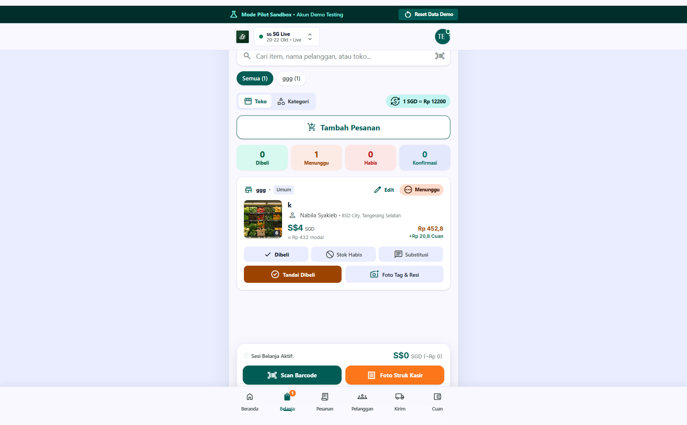
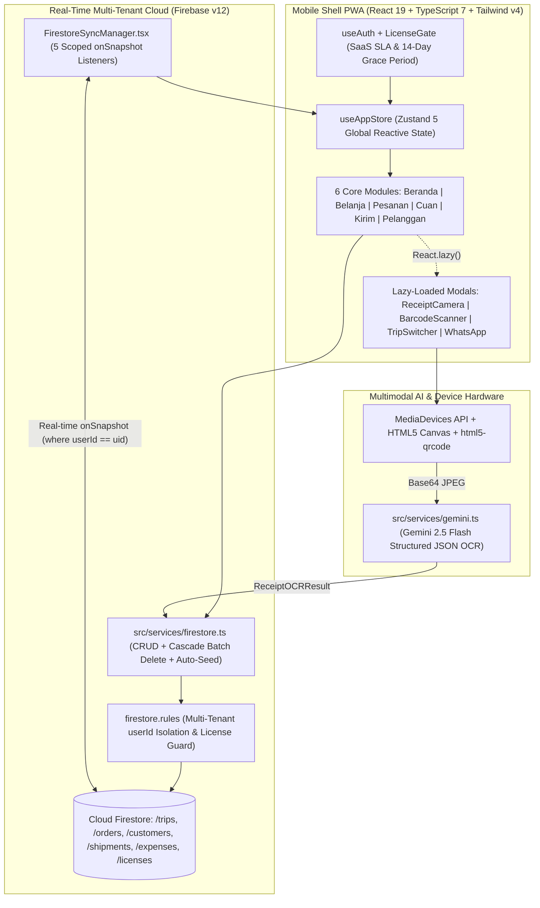

# Jastip Cross-Border Order Management System

## 1. Project Overview & Problem Solved

**Jastip Cross-Border Manager** is a full-stack, mobile-first SaaS Progressive Web Application (PWA) designed for professional cross-border personal shoppers (*Jastipers*) operating high-volume live shopping trips in international retail hubs such as Bangkok (THB), Kuala Lumpur (MYR), Singapore (SGD), and Tokyo (JPY).

### The Core Business Problem
Cross-border personal shoppers routinely manage hundreds of custom item requests across dozens of physical stores while racing against tight flight schedules and strict airline baggage limits. Managing these operations via fragmented WhatsApp chats, phone galleries, and manual spreadsheets leads to critical operational failures:
- **Floor Triage Chaos**: Shoppers walking through Pratunam, Platinum Fashion Mall, or Big C in Bangkok cannot quickly filter which items are waiting to be bought in their current store/aisle, which are out of stock, and which require immediate customer confirmation for a variant substitution.
- **Unlinked Paper Receipts & Currency Leakage**: Physical thermal receipts in foreign currencies (`THB`, `MYR`, `SGD`, `JPY`) get lost, making it impossible to reconcile actual store spend against customer deposits or calculate exact net profit margins combining direct service fees (*Fee Jastip*) and foreign exchange spread arbitrage (*Cuan Kurs*).
- **Domestic Hub Sorting Bottlenecks**: Once luggage lands in Indonesia, matching ratusan SKU to individual customer shipments, checking remaining unpaid balances (*Belum Lunas*), weighing chargeable volumetric kg, and blasting domestic courier tracking numbers (*Resi*) takes days of manual admin work.

### The Solution
Jastip Cross-Border Manager unifies the entire cross-border lifecycle into a single 480px mobile-shell workspace with 6 specialized modules:
1. **Beranda (Trip Command Center)**: Live trip switcher, baggage capacity tracker (`baggageUsedKg` / `baggageTotalKg`), and instant multi-currency rate calculator.
2. **Belanja (Live Mall Triage)**: Dynamic store & aisle grouping, 4-state status triage (`Dibeli`, `Menunggu`, `Habis`, `Perlu Konfirmasi`), 1-tap WhatsApp substitution auto-drafting, HTML5 barcode scanning (`html5-qrcode`), and **Gemini 2.5 Flash Multimodal OCR** receipt extraction.
3. **Pesanan (Order & Deposit Invoicing)**: Tracks DP deposits vs. remaining balances and dispatches automated WhatsApp billing reminders.
4. **Cuan (Margin & FX Arbitrage Ledger)**: Real-time breakdown of Gross Omset, Thailand/Foreign COGS, Travel/Customs/Packaging expenses, Net Jastip Fee, and FX Spread Arbitrage (`+Rp spread/THB`), with 1-tap CSV financial export and trip locking.
5. **Kirim (Domestic Hub Sorting & Waybills)**: Batch shipment status transitions (`packing` -> `ready` -> `transit` -> `done`) with unpaid balance hold alerts.
6. **Pelanggan (VIP Tiered CRM)**: Tracks repeat order history, VIP/Loyal customer badges, and delivery addresses across multiple trips.

---

## 2. Tech Stack & Architecture Choices

### Architecture Diagram



### Tech Stack Table

| Layer | Technology | Version | Architectural Role & Justification |
| :--- | :--- | :--- | :--- |
| **Frontend UI** | React 19 + TypeScript | `^19.0.1` / `^7.0.2` | Component architecture with `Suspense` and `React.lazy` code-splitting across 11 heavy operational modals. |
| **State Management** | Zustand | `^5.0.15` | Ultra-lightweight store (`src/store/useAppStore.ts`) bridging 5 concurrent Firestore real-time listeners with zero Context provider nesting overhead. |
| **Styling & Motion** | Tailwind CSS v4 + Motion | `^4.3.3` / `^12.23.24` | High-contrast mobile-first UI (`#005c55` emerald-teal brand palette) optimized for one-handed operation under bright mall lighting. |
| **Multimodal AI OCR** | Google Gen AI SDK (`@google/genai`) | `^2.4.0` | Powers `parseReceiptWithGemini` using `gemini-2.5-flash` with strict `responseSchema` JSON output to extract merchant, receipt number, total, and VAT from camera snapshots. |
| **Barcode & Camera** | `html5-qrcode` + WebRTC `getUserMedia` | `^2.3.8` | In-browser 1D/2D product barcode scanning and environment-facing camera capture (`1280x720` JPEG canvas serialization). |
| **Backend & Real-Time DB** | Firebase Auth & Cloud Firestore | `^12.19.0` | Multi-tenant real-time document synchronization (`onSnapshot`), atomic `writeBatch` cascading deletes, and SaaS license enforcement. |
| **PWA & Testing** | `vite-plugin-pwa` + Workbox + Playwright | `^1.3.0` / `^1.63.0` | `injectManifest` Service Worker for offline reliability in underground mall basements, verified via Playwright E2E test suites. |

---

## 3. Key Features & UI Implementation

### 1. Live Mall Triage & Store-Scoped Shopping Deck (`src/components/BelanjaView.tsx`)
Designed specifically for fast one-handed operation while walking through overseas shopping districts:
- **Dynamic Store Pill Tabs**: Automatically aggregates and sorts active orders by physical store count (`Platinum Mall`, `Big C Rajdamri`, `Eveandboy`, `Pop Mart`), paired with a toggle between Store (`toko`) and Category (`kategori`) views.
- **4-State Interactive Triage Strip**: Clickable metric cards for `Dibeli`, `Menunggu`, `Habis`, and `Konfirmasi` filter the list instantaneously.
- **Dual-Currency Pricing & Instant Substitution**: Each item card displays the native foreign price (`฿`, `RM`, `S$`, `¥`), converted IDR modal cost, selling price, and net `+Rp Cuan` per item. Items marked `konfirmasi` expose a 1-tap **Chat WhatsApp Auto-Draft Solusi** button that pre-fills a polite substitution message with `item.replacementSuggestion`.
- **Sticky Bottom Triage Action Deck**: Keeps the live session total (`฿ sessionTotalForeign ≈ Rp sessionTotalIDR`), **Scan Barcode**, and **Foto Struk Kasir** buttons permanently under the user's thumb.

### 2. Gemini 2.5 Flash Multimodal Receipt OCR (`src/components/modals/ReceiptCameraModal.tsx`)
Eliminates manual data entry of foreign-language thermal receipts:
- Streams live video from the rear camera (`facingMode: 'environment'`) or accepts gallery uploads, drawing frames onto a hidden `<canvas>` (`0.85` JPEG quality).
- Sends the base64 payload to `parseReceiptWithGemini(dataUrl, currencyCode)`, displaying an interactive verification card where the shopper can review or edit the extracted **Nama Toko**, **No. Struk**, **Tanggal Transaksi**, **Total Belanja**, and **Pajak/PPN** before linking the receipt directly to the shopping item and marking it `dibeli`.

### 3. Multi-Currency Arbitrage & Trip Profit Ledger (`src/components/CuanView.tsx`)
Provides complete financial transparency per trip:
- **Segmented Capital & Profit Bar**: Visualizes the exact proportion of Foreign Merchandise Cost (`65.5%`), Travel/Customs/Packaging Overhead (`11.2%`), and Net Jastiper Profit (`23.3%`).
- **Dual Profit Engine**: Separates earnings into **Fee Jastip Bersih** (direct markup per item) and **Keuntungan Kurs** (`+Rp rateSpreadMargin` per unit of foreign currency).
- **Categorized Expense Ledger & CSV Export**: Groups trip overhead into *1. Biaya Perjalanan (Travel)*, *2. Bea Masuk & Pajak (Customs)*, and *3. Operational & Packaging*, with 1-tap client-side CSV generation (`handleDownloadReport`), WhatsApp clipboard summary sharing (`handleShareSummary`), and trip archiving (`handleCloseTrip`).

---

## 4. Technical Challenges Overcome

### Challenge 1: Structured Multimodal Receipt OCR with Zero-Downtime Currency Fallbacks
**Problem**: Thermal receipts from Thailand, Malaysia, Singapore, and Japan use different languages, scripts (Thai, Japanese Kanji/Kana), tax structures (7% VAT vs. 8% GST vs. 10% Consumption Tax), and date formats. Furthermore, if a shopper is inside a mall basement with degraded connectivity or an unconfigured API key, a failed OCR request must never block them from linking a receipt photo and advancing the item status.

**Solution**: Engineered `parseReceiptWithGemini` in `src/services/gemini.ts` using `@google/genai` and `gemini-2.5-flash` with a strict `Type.OBJECT` `responseSchema` enforcing numeric `totalAmount` and `vatAmount` in the active trip's `targetCurrencyCode`. If the API key is absent or the network call throws an exception, the service transparently falls back to `generateFallbackOCR(targetCurrencyCode)`, returning realistic currency-specific defaults (`Big C Supercenter Rajdamri` for `THB`, `Suria KLCC` for `MYR`, `Takashimaya Orchard` for `SGD`, `Don Quijote Shinjuku` for `JPY`) that the user can immediately adjust in `ReceiptCameraModal.tsx`.

```ts
// src/services/gemini.ts (Lines 53-96)
const response = await ai.models.generateContent({
  model: 'gemini-2.5-flash',
  contents: [
    {
      role: 'user',
      parts: [
        { text: prompt },
        { inlineData: { mimeType, data: cleanBase64 } },
      ],
    },
  ],
  config: {
    responseMimeType: 'application/json',
    responseSchema: {
      type: Type.OBJECT,
      properties: {
        store: { type: Type.STRING, description: 'Store or merchant name' },
        receiptNo: { type: Type.STRING, description: 'Receipt or invoice number' },
        totalAmount: { type: Type.NUMBER, description: 'Total amount paid in native currency' },
        vatAmount: { type: Type.NUMBER, description: 'Tax or VAT amount' },
        date: { type: Type.STRING, description: 'Transaction date' },
      },
      required: ['store', 'receiptNo', 'totalAmount'],
    },
  },
});
```

### Challenge 2: Real-Time SaaS License Enforcement, Feature Gating & 14-Day Read-Only Grace Period
**Problem**: Because the platform is commercialized as a B2B SaaS product for Jastip agencies (`license_basic`, `license_pro`, `trial_30d`, `agency_team`), the system needed a real-time licensing engine that enforces annual subscription validity, gates premium add-on modules (such as `aiReceiptOcr`, `waAutoBlast`, `multiAdmin`), and protects customer data during billing lapses without abruptly locking users out of their accounting records.

**Solution**: Built `useLicense` in `src/hooks/useLicense.ts` and `LicenseGate` in `src/components/LicenseGate.tsx` backed by a real-time Firestore `onSnapshot` listener on `/licenses/{user.uid}` (protected in `firestore.rules` with `allow write: if false;` so only the Firebase Admin SDK provisioning script `scripts/provision-license.mjs` can mutate licenses). The hook computes `daysRemaining` dynamically:
- When `daysRemaining <= 0` and `>= -14`, the account enters a 14-day SLA `grace_period` (`isReadOnly = true`).
- Every write handler in `src/App.tsx` calls `assertNotReadOnly(actionDesc)`, which blocks mutations and displays a contextual toast while allowing full read/export access to historical trips and invoices.
- Premium capabilities call `hasFeature('aiReceiptOcr')`, triggering `FeatureLockedModal` when an add-on is not enabled on the current plan.

```ts
// src/hooks/useLicense.ts (Lines 55-71 & 146-158)
let derivedStatus: LicenseStatus = 'active';
if (data.status === 'suspended') {
  derivedStatus = 'suspended';
} else if (daysRemaining > 0) {
  derivedStatus = 'active';
} else if (daysRemaining >= -14) {
  derivedStatus = 'grace_period'; // Masa Tenggang 14 hari
} else {
  derivedStatus = 'expired';
}

const readOnlyMode =
  derivedStatus === 'grace_period' ||
  derivedStatus === 'expired' ||
  derivedStatus === 'suspended';
```

### Challenge 3: Multi-Tenant Real-Time Synchronization, Atomic Cascade Deletes & Idempotent Pilot Seeding
**Problem**: Managing 5 interrelated Firestore collections (`trips`, `orders`, `customers`, `shipments`, `expenses`) per tenant required strict data isolation, instant cross-tab reactivity when switching active trips or exchange rates, atomic cleanup when deleting a trip, and automatic sandbox seeding for demo/pilot evaluators (`test@jastip.com`) without causing infinite snapshot loops.

**Solution**:
1. Created `FirestoreSyncManager` (`src/components/FirestoreSyncManager.tsx`), a headless component mounting 5 `onSnapshot` listeners filtered by `where('userId', '==', uid)` that pipe updates directly into `useAppStore`. An `isAutoSeedingRef` guard detects when a pilot user has `0` trips and triggers `resetDemoDataToInitial(uid)` exactly once.
2. Implemented `deleteTripWithCascade(tripId)` in `src/services/firestore.ts`, which queries all 4 child collections matching `where('tripId', '==', tripId)` in parallel (`Promise.all`) and commits all document deletions alongside the parent trip in a single atomic Firestore `writeBatch`.

```ts
// src/services/firestore.ts (Lines 54-80)
export const deleteTripWithCascade = async (tripId: string) => {
  const batch = writeBatch(db);
  const tripRef = doc(db, 'trips', tripId);
  batch.delete(tripRef);

  const deleteAssociatedDocs = async (collName: string) => {
    const q = query(collection(db, collName), where('tripId', '==', tripId));
    const snapshot = await getDocs(q);
    snapshot.forEach((document) => {
      batch.delete(document.ref);
    });
  };

  await Promise.all([
    deleteAssociatedDocs('orders'),
    deleteAssociatedDocs('customers'),
    deleteAssociatedDocs('shipments'),
    deleteAssociatedDocs('expenses')
  ]);

  await batch.commit();
};
```
