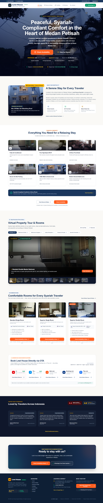
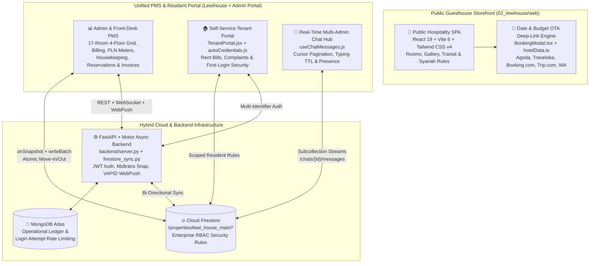

# Lewi House Syariah — Hybrid Guesthouse Booking & Boarding House (Kosan) Management Platform



---

## 1. Project Overview & Problem Solved

**Lewi House Syariah** (located at Jl. Sei Bahkapuran No. 16A, Medan Petisah, North Sumatra) is a 4-floor, 17-room hybrid hospitality property operating simultaneously as a **1-Star Syariah Guesthouse / Budget Hotel** for short-term daily travelers (listed across Agoda, Traveloka, Tiket.com, Booking.com, and Trip.com) and an **Exclusive Boarding House (Kosan Eksklusif)** for monthly/weekly professionals and university students, integrated with on-site **LEWI Laundry** services.

To digitize both sides of this hybrid operation, the platform was engineered as a dual-ecosystem suite across [`02_lewihouse/web`](file:///C:/Users/AL_AAF/Project/02_lewihouse/web) and [`Lewihouse`](file:///C:/Users/AL_AAF/Project/Lewihouse):
1. **Public Guesthouse Showcase & Multi-OTA Deep-Link Booking Engine**: A high-conversion hospitality storefront featuring verified local WebP room galleries, interactive neighborhood transit & culinary guides, Syariah compliance verification, and a date/budget-aware OTA deep-link router.
2. **Full-Stack Property Management System (PMS) & Self-Service Tenant Portal**: A real-time operational command center for property owners, front-desk staff, and long-term Kosan residents—handling room inventory across 4 floors (`Tipe A Exclusive`, `Tipe B Superior`, `Tipe C Single Standard`), atomic tenant move-in/check-out transactions, monthly rent & prepaid PLN electricity token ledgers, maintenance ticketing, and real-time multi-admin chat with presence collision detection.

### Core Business Problems Solved
1. **Hybrid Inventory & Channel Fragmentation**: Managing 17 rooms across daily OTA guests and monthly Kosan residents caused double-bookings, inconsistent room statuses (`available`, `occupied`, `cleaning`, `maintenance`), and manual spreadsheet reconciliation.
2. **Syariah Policy Enforcement Pre-Check-In**: As a Syariah-compliant property requiring married couples to present official marriage documentation (*Buku Nikah*) at check-in, guests booking via third-party channels frequently arrived unaware of house rules. The platform embeds a mandatory Syariah Policy acknowledgment gate directly into the availability & OTA redirect workflow.
3. **High-Friction Resident Onboarding**: Issuing portal credentials to new monthly Kosan tenants manually led to forgotten passwords and support bottlenecks. The system automates deterministic credential generation (`[NomorUnit]_[NamaDepan]` and NIK-derived temporary passwords) with one-click WhatsApp onboarding dispatch and mandatory first-login password hardening.
4. **Uncoordinated Front-Desk Tenant Support**: When tenants submitted maintenance complaints or chat inquiries, multiple admins often replied simultaneously or missed urgent messages. The platform introduces real-time Firestore chat with 15-minute SLA urgency escalation, typing indicators, and multi-admin presence collision tracking.

---

## 2. Tech Stack & Architecture Choices

### System Architecture Diagram



### Technology Stack Table

| Layer | Technology | Version | Architectural Role & Justification |
| :--- | :--- | :--- | :--- |
| **Frontend Framework** | React + TypeScript | `19.0.1` / `5.8.2` | Powers the public guesthouse booking SPA, Admin PMS screens, and interactive modals. |
| **Build & Styling** | Vite + Tailwind CSS | `6.2.3` / `4.1.14` | Sub-second HMR, modern utility styling, and Framer Motion (`12.23.24`) micro-interactions. |
| **Real-Time Database** | Firebase Cloud Firestore | `^12.18.0` | Hierarchical property data model (`/properties/lewi_house_main/*`) with custom-claim RBAC rules. |
| **Backend API Server** | Python FastAPI + Motor | Python 3.11+ | Asynchronous REST & WebSocket backend ([`backend/server.py`](file:///C:/Users/AL_AAF/Project/Lewihouse/backend/server.py)) with MongoDB + Firestore sync. |
| **Authentication & Security** | Firebase Auth + PyJWT / bcrypt | `12.18.0` | Custom claims RBAC on Firestore + HTTP-only cookie JWT access/refresh rotation & 5-attempt lockout. |
| **Payments & Push** | Midtrans Snap + PyWebPush / FCM | VAPID / REST | Automated rent invoice checkout links and native/browser push reminders for due bills. |
| **Data Visualization** | Recharts + Lucide Icons | `3.10.1` / `0.546.0` | Occupancy rate analytics, monthly revenue breakdown charts, and PLN kWh consumption tracking. |

---

## 3. Key Features & UI Implementation

### 1. Date & Budget-Aware Multi-OTA Deep-Link Booking Modal (`BookingModal.tsx`)
Instead of sending prospective daily guests to generic OTA homepages, [`BookingModal.tsx`](file:///C:/Users/AL_AAF/Project/02_lewihouse/web/src/components/BookingModal.tsx) and [`hotelData.ts`](file:///C:/Users/AL_AAF/Project/02_lewihouse/web/src/data/hotelData.ts#L258-L295) compute exact stay duration in nights (using WIB timezone-safe date formatting `toLocalDateString`), filter by nightly budget tier (`Budget <= Rp 180k`, `Standard Rp 180k–250k`, `Premium Rp 250k+`), enforce a mandatory **Syariah Policy Acknowledgment checkbox**, and dynamically construct parameterized deep links into **Agoda, Traveloka, Booking.com, Tiket.com, Trip.com**, or pre-filled **WhatsApp Front Desk** inquiry threads.

### 2. 4-Floor, 17-Room Interactive Kosan & Guesthouse PMS (`AdminApp.tsx` & `Rooms.jsx`)
Models the exact physical layout of Lewi House Medan across Floors 1 to 4 (`K-101` through `K-404`) and 3 distinct room tiers (`Tipe A Exclusive/VIP`, `Tipe B Superior`, `Tipe C Single Standard`).
- Tracks live room states (`available`, `occupied`, `cleaning`, `maintenance`), monthly rent rates (`Rp 1.600.000` – `Rp 2.600.000`), security deposits, and in-room amenities.
- Integrates dedicated modules for **Prepaid PLN Electricity Meters & Token Top-Ups** (`useElectricityMeters`, `useElectricityTokens`), **Housekeeping Task Queues** (`HousekeepingScreen.tsx`), **Maintenance & Complaint Tickets** (`Complaints.jsx`), and **Guest Review Moderation** (`ReviewsModerationScreen.tsx`).

### 3. Automated Tenant Credential Provisioning & Self-Service Portal (`TenantPortal.jsx`)
When a new Kosan resident signs a lease, the system automatically generates a sanitized, collision-free username (`[NomorUnit]_[NamaDepan]`, e.g., `k204_budi`) and a deterministic temporary password (`[NomorKamarBersih][3DigitAkhirNIK]`, e.g., `K204789`), formatting a ready-to-send WhatsApp onboarding card (`formatOnboardingWhatsAppMessage`). Upon first login, tenants are guided through mandatory password hardening with real-time strength scoring and anti-repetition history validation.

---

## 4. Technical Challenges Overcome

### Challenge 1: Multi-Identifier Authentication with Brute-Force Lockout Protection
**Problem:** Kosan residents frequently forget whether their login identifier is their email address, their WhatsApp phone number, their auto-generated username (`204_ali`), or simply their room number (`K-204`). Supporting flexible login without sacrificing security against brute-force attacks required a unified resolution pipeline.
**Solution:** Implemented a 4-stage identifier resolver in [`backend/server.py`](file:///C:/Users/AL_AAF/Project/Lewihouse/backend/server.py#L159-L225) that normalizes input and sequentially checks email, case-insensitive username regex, digit-normalized phone number, and active room-to-tenant lookup—guarded by a 5-attempt, 15-minute automatic lockout in `db.login_attempts`:

```python
# From backend/server.py (lines 165-202)
attempt = await db.login_attempts.find_one({"identifier": identifier})
if attempt and attempt.get("count", 0) >= 5:
    locked_at = datetime.fromisoformat(attempt["last_at"])
    if datetime.now(timezone.utc) - locked_at < timedelta(minutes=15):
        raise HTTPException(status_code=429, detail="Terlalu banyak percobaan. Coba lagi 15 menit.")
    await db.login_attempts.delete_one({"identifier": identifier})

user = None
if "@" in ident:
    user = await db.users.find_one({"email": ident})
else:
    # 1. Match by username (e.g. "204_ali")
    user = await db.users.find_one({"username": {"$regex": f"^{re.escape(ident)}$", "$options": "i"}})
    if not user:
        # 2. Match by normalized phone
        clean_phone = norm_phone(ident)
        if clean_phone:
            user = await db.users.find_one({"phone": clean_phone})
    if not user:
        # 3. Match by room name / unit number (e.g. "204" or "K-101")
        room = await db.rooms.find_one({"name": {"$regex": f"^{re.escape(ident)}$", "$options": "i"}})
        if room:
            tenant = await db.tenants.find_one({"room_id": str(room["_id"]), "status": "active"})
            if tenant:
                user = await db.users.find_one({"tenant_id": str(tenant["_id"])})
```

### Challenge 2: Atomic Room Assignment & Move-Out State Consistency in Cloud Firestore
**Problem:** Assigning a resident to a room or processing a move-out requires updating both the `residents` collection and the `rooms` collection. If a network drop occurs mid-operation during sequential writes, a room can be marked `OCCUPIED` with no active tenant or a checked-out tenant can remain linked to an `AVAILABLE` room.
**Solution:** Engineered atomic Firestore `writeBatch` transactions in [`frontend/src/services/propertyTransactions.js`](file:///C:/Users/AL_AAF/Project/Lewihouse/frontend/src/services/propertyTransactions.js#L7-L66) (`assignTenantMoveIn` and `releaseTenantCheckout`) so resident creation/archival and room occupancy state mutations commit or roll back as a single indivisible unit:

```javascript
// From frontend/src/services/propertyTransactions.js (lines 7-41)
export async function assignTenantMoveIn({ tenantData, roomId, roomNumber }) {
  const batch = writeBatch(db);
  const tenantId = tenantData.id || `resident_${Date.now()}`;
  
  const tenantDocRef = doc(db, `${PROPERTY_PATH}/residents`, tenantId);
  const roomDocRef = doc(db, `${PROPERTY_PATH}/rooms`, roomId);

  const residentPayload = {
    id: tenantId,
    fullName: tenantData.fullName || tenantData.name || "",
    roomNumber: roomNumber || tenantData.roomNumber || "",
    roomId: roomId,
    monthlyRent: Number(tenantData.monthlyRent || tenantData.rent_amount) || 0,
    depositAmount: Number(tenantData.depositAmount || tenantData.deposit_amount) || 0,
    status: "ACTIVE",
    updatedAt: serverTimestamp(),
  };

  batch.set(tenantDocRef, residentPayload, { merge: true });
  batch.update(roomDocRef, {
    status: "OCCUPIED",
    currentTenantId: tenantId,
    currentTenantName: residentPayload.fullName,
    updatedAt: serverTimestamp(),
  });

  await batch.commit();
  return { tenantId, roomId };
}
```

### Challenge 3: Cost-Optimized Real-Time Chat with Cursor Pagination, Typing TTL & Multi-Admin Collision Detection
**Problem:** Unbounded Firestore `onSnapshot` listeners on long-lived tenant chat threads cause quadratic read billing growth, while multiple property admins viewing the same tenant thread risk sending duplicate responses.
**Solution:** In [`frontend/src/hooks/useChatMessages.js`](file:///C:/Users/AL_AAF/Project/Lewihouse/frontend/src/hooks/useChatMessages.js#L83-L250), the live message listener is bounded to `limitToLast(30)` (`PAGE_SIZE = 30`) with cursor-based historical pagination via `endBefore(firstDocRef.current)`, internal admin-only note filtering (`if (isTenant && data.isInternalNote) return`), a 4-second TTL typing indicator stream, and a heartbeat presence subcollection (`/chats/{threadId}/presence/{userId}`) that alerts staff when another admin is actively viewing the same conversation:

```javascript
// From frontend/src/hooks/useChatMessages.js (lines 156-201)
const loadOlderMessages = useCallback(async () => {
  if (!activeThreadId || loadingOlder || !hasMoreOlder || !firstDocRef.current) return;

  setLoadingOlder(true);
  try {
    const messagesRef = collection(db, `${PROPERTY_PATH}/chats/${activeThreadId}/messages`);
    const q = query(
      messagesRef,
      orderBy("timestamp", "asc"),
      endBefore(firstDocRef.current),
      limitToLast(PAGE_SIZE)
    );

    const snapshot = await getDocs(q);
    if (!snapshot.empty) {
      firstDocRef.current = snapshot.docs[0];
      setHasMoreOlder(snapshot.docs.length >= PAGE_SIZE);
      // Prepend older messages while deduplicating by document ID...
    }
  } finally {
    setLoadingOlder(false);
  }
}, [activeThreadId, loadingOlder, hasMoreOlder, isTenant]);
```

### Challenge 4: Zero-Extra-Read Enterprise RBAC & Anti-Privilege Escalation in Firestore Rules
**Problem:** Standard Firestore security rules often use `get()` calls on every request to check a user's role in the `/users/{uid}` collection, doubling Firestore read costs and exposing vectors where a tenant could update their own user document to `role: 'admin'`.
**Solution:** Authored hardened security rules in [`firestore.rules`](file:///C:/Users/AL_AAF/Project/Lewihouse/firestore.rules#L12-L57) that verify `request.auth.token.role` via Firebase Auth Custom Claims (incurring zero extra database read billing) and enforce strict field-level diff checks (`affectedKeys().hasOnly(...)` and `!affectedKeys().hasAny(['role', 'admin', 'id'])`) to block privilege escalation:

```javascript
// From firestore.rules (lines 39-57 & 142-148)
match /users/{userId} {
  allow read: if isSelf(userId) || isOwnerOrAdmin();
  
  // Prevent users from granting themselves 'admin'/'owner' roles on creation
  allow create: if isAuthenticated() && (
    isOwnerOrAdmin() ||
    (isSelf(userId) &&
     request.resource.data.role == 'tenant' &&
     request.resource.data.keys().hasOnly(['email', 'name', 'role', 'residentId', 'propertyId', 'createdAt']))
  );

  // Prevent users from elevating roles on document update
  allow update: if isOwnerOrAdmin() || (
    isSelf(userId) &&
    !request.resource.data.diff(resource.data).affectedKeys().hasAny(['role', 'admin', 'id'])
  );
}
```
