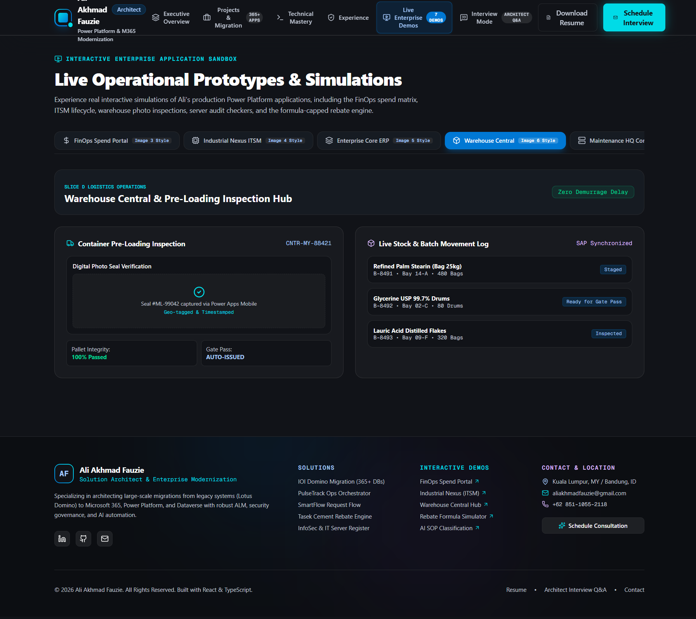
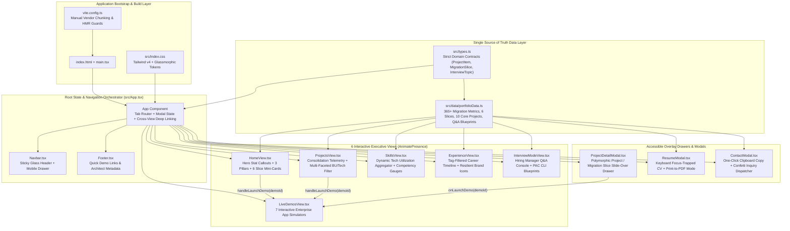

# Enterprise Power Platform & Cloud Solutions Architecture Portfolio (`power-platform-portfolio`)

> **Repository:** [`aliakhmadfauzie/power-platform-portfolio`](https://github.com/aliakhmadfauzie/power-platform-portfolio)  
> **Local Workspace:** `C:\Users\AL_AAF\Project\04_portfolio_and_resumes\al-resume-projects\power-platform-portfolio`  
> **Role:** Principal Solution Architect & Full-Stack Modernization Engineer

> [!NOTE]
> **Unified Enterprise Engagement Context:** The 13 Departmental Power Apps and modern cloud workflows showcased in this architecture are the concrete production deliverables and operational output of the **IOI Oleo Lotus Domino Modernization Program**. For the full chemical plant case study and telemetry, see [IOI Oleo Enterprise Modernization & Departmental Power Apps Suite](../enterprise-m365-ioi/portfolio-case-study.md).

---

## 1. Project Overview & Problem Solved

### The Enterprise Architecture Portfolio Challenge
For enterprise Solution Architects specializing in Microsoft Power Platform, Dynamics 365, and legacy infrastructure modernization (such as **Lotus Domino to Microsoft 365 / Dataverse** migrations), demonstrating real-world impact presents a major obstacle:

1. **NDA & Tenant Isolation Boundaries:** Production enterprise systems—such as multi-tier financial rebate engines, ISO 9001/27001 document control registries, and SAP-synchronized warehouse portals—reside inside locked corporate tenants protected by Azure AD Conditional Access, Data Loss Prevention (DLP) policies, and strict customer confidentiality agreements.
2. **Static Resume Limitations:** Traditional PDFs and flat portfolio pages fail to convey the architectural depth of migrating **365+ legacy Lotus Domino databases across 28+ business units**, consolidating **314 unique application groups**, or designing **878 Canvas screens** and **400+ custom React PCF components**.
3. **Lack of Interactive Proof for Technical Evaluators:** Hiring managers and principal architects conducting technical interviews need to inspect live business rules—such as a 7-component financial rebate cap formula, confidence-gated AI Builder NLP ticket routing, or PAC CLI Application Lifecycle Management (ALM) pipelines—rather than reading static bullet points.

### The Solution
**Enterprise Power Platform & Cloud Solutions Architecture Portfolio (`power-platform-portfolio`)** solves this by delivering an interactive, dark-mode executive showcase and live operational application sandbox built with **React 19**, **TypeScript 5.8**, **Tailwind CSS 4**, and **Motion (Framer Motion 12)**.

Instead of static screenshots, the application embeds **7 live interactive operational prototypes** (`LiveDemosView.tsx`), a **6-slice interactive migration explorer** (`ProjectsView.tsx`), a **real-time technology utilization telemetry engine** (`SkillsView.tsx`), a **WCAG-compliant focus-trapped executive CV viewer with print-to-PDF support** (`ResumeModal.tsx`), and an **Architect Q&A Technical Defense Console** (`InterviewModeView.tsx`).

### Quantified Portfolio & Migration Highlights Represented
- **365+ Databases Migrated:** Complete legacy Lotus Domino cutover across **28+ business units** (Quality, Supply Chain, Warehouse, IT, HR, Finance) with zero lost revision histories.
- **16–23 Production Power Apps & 878 Canvas Screens:** Documented across 6 functional domain slices (Slices A–F) derived from 54 system reports.
- **99% Financial Approval Cycle Reduction:** Simulated live via the **Tasek Cement Rebate Approval Engine**, compressing a 3-day email/manual check process into a **~15-minute** workflow with a hard statutory ceiling of **RM 0.20 / metric tonne**.
- **90% Manual Reporting Elimination:** Demonstrated through **PulseTrack** and **SmartFlow** architectures, achieving **98% status accuracy** and **60–80% reduction in leadership administrative overhead**.

---

## 2. Tech Stack & Architecture Choices

### System & Component Architecture Diagram



### Technology Stack Table

| Layer | Technology / Library | Version | Architectural Justification |
| :--- | :--- | :--- | :--- |
| **Core UI Framework** | React (`react`, `react-dom`) | `^19.0.1` | Concurrent rendering, instantaneous tab switching, and zero-latency interactive state updates across all 7 embedded enterprise simulators. |
| **Type System** | TypeScript (`typescript`) | `~5.8.2` | Enforces discriminated union contracts (`ProjectItem \| MigrationSlice`) and strict prop validation across 14 components and data stores. |
| **Build & Bundler** | Vite (`vite`, `@vitejs/plugin-react`) | `^6.2.3` | Sub-second cold starts, Rollup manual vendor chunk splitting (`react-vendor`, `ui-vendor`), and AI Studio HMR/watcher guards. |
| **Styling Engine** | Tailwind CSS (`tailwindcss`, `@tailwindcss/vite`) | `^4.1.14` | Zero-runtime CSS-first `@import "tailwindcss"` pipeline paired with custom glassmorphic surfaces (`.glass-card`, `.executive-card`). |
| **Animation & Layout** | Motion (`motion/react`) | `^12.23.24` | Hardware-accelerated `AnimatePresence` view transitions and `layout` FLIP animations when filtering projects and migration slices. |
| **Iconography** | Lucide React (`lucide-react`) | `^0.546.0` | Crisp, consistent vector icons representing cloud architecture, telemetry, security governance, and industrial workflows. |
| **Micro-Interactions** | Canvas Confetti (`canvas-confetti`) | `^1.9.4` | Executive celebration feedback upon authorizing financial rebates in the live simulator or dispatching consultation inquiries. |

---

## 3. Key Features & UI Implementation

### 1. Executive Hero & Modernization Blueprint (`src/components/views/HomeView.tsx`)
- **High-Contrast Telemetry Grid (`lines 108–133`):** Renders `KEY_METRICS` (`365+` Databases Migrated, `28+` BUs Transformed, `16+` Production Slice Apps & 23 Enterprise, `90%` Manual Reporting Reduction) using gradient-clipped monospace typography (`bg-clip-text bg-gradient-to-br`).
- **Three Architectural Pillars (`lines 154–228`):** Details *Legacy Domino Cutover*, *Enterprise Workflow Engine*, and *AI-Assisted Intelligence* inside custom `.executive-card` containers with top-edge linear gradient light bars (`src/index.css`, `lines 56–72`).
- **Flagship Migration Banner (`lines 231–285`):** Displays the IOI Oleo Lotus Domino → Microsoft 365 overview alongside 6 interactive mini-cards (`Slice A` through `Slice F`) that open the slide-over inspection drawer on click.

### 2. Interactive Migration Explorer & Consolidation Matrix (`src/components/views/ProjectsView.tsx`)
- **Complexity & Consolidation Telemetry (`lines 102–161`):** Breaks down the 64 documented slice reports into **24 High**, **28 Medium**, and **12 Low** complexity tiers, and surfaces consolidation statistics: **314 Unique App Groups Analyzed**, **7 Cross-Department Shared Apps Merged**, **8 Same-Department Variants Unified**, and **8 Routing Conflicts Resolved** (e.g., unifying Johor/Penang routing behaviors into Dataverse).
- **Dual-Axis Migration Slice Filter (`lines 57–71`, `170–217`):** Filters Slices A–F in real time across Business Unit groupings (`Quality & QA` → Slices A/B, `Operations & IT` → Slices C/D, `Finance & HR` → Slices E/F) and underlying technology stacks (`Power Apps`, `Dataverse`, `SAP`), animated smoothly with `<motion.div layout>` and `<AnimatePresence mode="popLayout">` (`lines 219–265`).
- **Multi-Faceted Project Search (`lines 38–55`, `270–338`):** Combines Domain Category tabs (`core`, `standalone`, `security`), Core Technology pills (`Power Apps`, `Power Automate`, `AI Builder`, `SharePoint`, `Power BI`), and a live keyword search bar that queries across `title`, `problem`, `solution`, and `tools`.

### 3. Seven Embedded Live Enterprise Application Simulators (`src/components/views/LiveDemosView.tsx`)
Rather than showing static mockups, `LiveDemosView.tsx` (`lines 31–814`) implements **7 functional interactive simulations** directly in the browser:
1. **FinOps Spend Portal (`activeDemo === 'finops'`, `lines 159–236`):** Tracks `$3,200,000` allocated cloud/licensing budget, `$2,847,500` MTD spend (`88.9%` burn rate), and `$642,100` M365 license optimization via CoE Starter Kit, with interactive one-click `Sign & Approve` toggles for pending SmartFlow requisitions (`REQ-4921`, `REQ-4922`, `REQ-4923`).
2. **Industrial Nexus ITSM Service Desk (`activeDemo === 'it-service'`, `lines 239–311`):** Simulates the 56-column IT Support lifecycle (`Submit → Admin Triage → Assign → Resolve → Requestor Accept & Rate → Close`) with a 72-hour accept window, live SLA countdown badges, and interactive ticket creation (`+ Submit Ticket`, `lines 258–279`).
3. **Enterprise Core ERP (`activeDemo === 'erp'`, `lines 314–358`):** Displays procurement POs (`PO-2025-9941`, `PO-2025-9948`) and the 4-tier Staff Requisition engine enforcing a mandatory 5-working-day internal advertisement lockout (`REQ-STAFF-014`).
4. **Warehouse Central & Pre-Loading Inspection Hub (`activeDemo === 'warehouse'`, `lines 361–439`):** Simulates Slice D mobile container seal verification (`Seal #ML-99042`, geo-tagged & timestamped), automated gate pass issuance, and SAP-synchronized batch movement logs.
5. **Maintenance HQ Command & Server Audit (`activeDemo === 'maintenance'`, `lines 442–500`):** Demonstrates standardized weekly server health audit numbering (`Server Checklist-2025-W12-004`), OEE telemetry (`78.4%`), and ISO 27001 Dataverse DR snapshots (`RPO < 15 minutes`, `RTO < 1 hour`).
6. **Tasek Cement 7-Component Rebate Calculator (`activeDemo === 'rebate'`, `lines 504–690`):** Interactive range sliders for Base Tier Rate, Order Volume (`200–5,000` metric tonnes), Logistics Distance Adjustment, Special Contract Terms, Seasonal Incentive, and Credit Risk Deduction, dynamically enforcing the statutory **RM 0.20 / tonne cap** and triggering a confetti-backed Group COO approval.
7. **AI Builder SOP Classifier Engine (`activeDemo === 'cs-resolver'`, `lines 693–808`):** Real-time NLP ticket classification sandbox with preset test scenarios (*QA Deviation Slice B*, *IT Server Checklist*, *Tasek Rebate*, *Logistics Slice D*), outputting predicted SOP categories, confidence score progress bars, and an **85% confidence gate** indicator.

### 4. Dynamic Technology Utilization Dashboard (`src/components/views/SkillsView.tsx`)
- **Automated Cross-Portfolio Aggregation (`lines 24–36`):** Computes live deployment counts across all `CORE_PROJECTS` and `MIGRATION_SLICES` via `useMemo`, sorting tools by real production frequency.
- **Responsive Mobile Tab Switcher (`lines 69–82`):** Provides a compact segmented control (`Tools & Platforms` vs. `Business Impact`) on mobile viewports while expanding to a dual-column telemetry grid on desktop (`lg:grid-cols-2`).
- **Pro-Code Gauges & Semantic Tool Badges (`lines 215–333`):** Renders percentage bars for `DEV_STACK` (`Power Fx 98%`, `AI Builder & Copilot Studio 92%`, `REST & Graph API 90%`, `T-SQL / PL-SQL 88%`, `TypeScript 85%`, `React PCF 80%`) and dynamically pairs support platforms (`Salesforce CRM`, `Jira`, `Power BI`, `MS Teams`, `Excel`) with color-coded vector icons (`lines 304–328`).

### 5. Hiring Manager & Technical Interview Defense Console (`src/components/views/InterviewModeView.tsx`)
- **Interactive Q&A Workbench (`lines 17–140`):** Allows interviewers to select architectural defense topics (`domino-migration-strategy`, `dataverse-security-isolation`, `alm-pac-cli`, `ai-builder-integration`) and inspect the **Executive Architectural Summary**, **Technical Implementation Strategy**, **PAC CLI / Flow Architecture Blueprint** (`pac solution export` / `pac solution unpack`), and **Key Proven Deliverables**.

---

## 4. Technical Challenges Overcome

### Challenge 1: Real-Time 7-Component Statutory Financial Rebate Cap & Cross-View Deep Linking
**Problem:** In the production Tasek Cement Rebate Approval System, sales teams previously calculated multi-variable rebates manually in spreadsheets over 2–3 days, frequently violating the corporate statutory ceiling of **RM 0.20 per metric tonne**. The portfolio needed to prove how the deterministic formula and statutory ceiling work in real time—and allow users reading any project card or detail drawer to jump straight into the corresponding live simulator without losing context.

**Solution:** Implemented a reactive 7-variable calculation engine in [`src/components/views/LiveDemosView.tsx`](file:///C:/Users/AL_AAF/Project/04_portfolio_and_resumes/al-resume-projects/power-platform-portfolio/src/components/views/LiveDemosView.tsx#L34-L49) paired with a cross-view deep-linking dispatcher in [`src/App.tsx`](file:///C:/Users/AL_AAF/Project/04_portfolio_and_resumes/al-resume-projects/power-platform-portfolio/src/App.tsx#L34-L37). Whenever the raw sum exceeds `0.20`, `cappedRebatePerTonne` clamps the rate via `Math.min(rawRebatePerTonne, 0.20)` and surfaces an immediate governance alert banner (`lines 646–651`).

```tsx
// src/components/views/LiveDemosView.tsx (lines 34–49)
  // State for Rebate Calculator
  const [rebateBaseRate, setRebateBaseRate] = useState<number>(0.08);
  const [rebateVolume, setRebateVolume] = useState<number>(1200); // tonnes
  const [rebateDistance, setRebateDistance] = useState<number>(0.03);
  const [rebateSpecialTerm, setRebateSpecialTerm] = useState<number>(0.02);
  const [rebateSeasonal, setRebateSeasonal] = useState<number>(0.01);
  const [rebateTax, setRebateTax] = useState<number>(0.01);
  const [rebateCreditDeduction, setRebateCreditDeduction] = useState<number>(0.01);
  const [rebateApproved, setRebateApproved] = useState<boolean>(false);

  // Rebate calculations
  const rawRebatePerTonne = Math.max(0, rebateBaseRate + rebateDistance + rebateSpecialTerm + rebateSeasonal + rebateTax - rebateCreditDeduction);
  const cappedRebatePerTonne = Math.min(rawRebatePerTonne, 0.20);
  const isCapped = rawRebatePerTonne > 0.20;
  const totalRebateAmountRM = (cappedRebatePerTonne * rebateVolume).toFixed(2);
```

And in [`src/App.tsx`](file:///C:/Users/AL_AAF/Project/04_portfolio_and_resumes/al-resume-projects/power-platform-portfolio/src/App.tsx#L34-L37), `handleLaunchDemo` synchronizes `activeDemoId` and switches the active tab to `'demos'` in a single atomic transition:

```tsx
// src/App.tsx (lines 34–37)
  const handleLaunchDemo = (demoId: string) => {
    setActiveDemoId(demoId);
    setCurrentTab('demos');
  };
```

---

### Challenge 2: Polymorphic Type Narrowing for Unified Project & Migration Slice Inspection
**Problem:** The portfolio needed a single slide-over inspection drawer (`ProjectDetailModal.tsx`) capable of rendering two structurally distinct domain entities defined in [`src/types.ts`](file:///C:/Users/AL_AAF/Project/04_portfolio_and_resumes/al-resume-projects/power-platform-portfolio/src/types.ts#L3-L33):
- `ProjectItem` (which contains `subtitle`, `category`, `date`, `impactMetrics`, `technicalDetails`, and `liveDemoId`)
- `MigrationSlice` (which contains `letter`, `appCount`, `examples`, and `keyHighlights`)

**Solution:** Used TypeScript property-in narrowing (`'letter' in project`, `'impactMetrics' in project`, `'technicalDetails' in project`, `'liveDemoId' in project`) inside [`src/components/modals/ProjectDetailModal.tsx`](file:///C:/Users/AL_AAF/Project/04_portfolio_and_resumes/al-resume-projects/power-platform-portfolio/src/components/modals/ProjectDetailModal.tsx#L31-L58) and [`lines 144–236`](file:///C:/Users/AL_AAF/Project/04_portfolio_and_resumes/al-resume-projects/power-platform-portfolio/src/components/modals/ProjectDetailModal.tsx#L144-L236) to dynamically adapt the header badge, quantified outcome cards, collapsible `<details>` specification accordion, and footer simulation launcher without runtime type errors or duplicated modal components.

```tsx
// src/components/modals/ProjectDetailModal.tsx (lines 31–57)
  if (!isOpen || !project) return null;

  const isMigrationSlice = 'letter' in project;
  const itemTitle = project.title;
  const problemText = project.problem;
  const solutionText = project.solution;
  const impactText = project.impact;
  const tools = project.tools;
  // ...
            <div className="w-10 h-10 rounded-xl bg-[#0078d4]/20 border border-[#0078d4]/40 flex items-center justify-center text-[#a3c9ff] font-mono font-bold shadow-[0_0_15px_rgba(0,120,212,0.2)]">
              {isMigrationSlice ? (project as MigrationSlice).letter : <Workflow className="w-5 h-5" />}
            </div>
            <div>
              <span className="text-[10px] uppercase font-mono tracking-wider text-[#00dbe7] font-semibold">
                {isMigrationSlice ? `IOI Domino Migration • Slice ${(project as MigrationSlice).letter}` : 'Enterprise Automation Solution'}
              </span>
              <h2 className="text-lg font-bold text-white tracking-tight leading-tight mt-0.5">{itemTitle}</h2>
            </div>
```

---

### Challenge 3: WCAG-Compliant Keyboard Focus Trap & Print-Ready Executive Resume Modal
**Problem:** Modal overlays in single-page React applications frequently fail keyboard accessibility audits because pressing `Tab` or `Shift+Tab` allows focus to escape into background elements behind the backdrop. Additionally, executives reviewing the CV modal needed a native `Download PDF` action (`window.print()`) that cleanly adapts the dark-mode UI (`#111318`) for paper/PDF output.

**Solution:** Engineered a custom DOM focus-trap and keyboard listener inside [`src/components/modals/ResumeModal.tsx`](file:///C:/Users/AL_AAF/Project/04_portfolio_and_resumes/al-resume-projects/power-platform-portfolio/src/components/modals/ResumeModal.tsx#L30-L72) with `role="dialog"`, `aria-modal="true"`, `Escape` key dismissal, cyclic `Tab` / `Shift+Tab` boundary wrapping, automatic initial focus, and Tailwind `print:bg-white print:text-black` print media modifiers (`line 164`).

```tsx
// src/components/modals/ResumeModal.tsx (lines 32–72)
  useEffect(() => {
    if (!isOpen) return;
    
    // Focus trap implementation
    const focusableElements = modalRef.current?.querySelectorAll(
      'button, [href], input, select, textarea, [tabindex]:not([tabindex="-1"])'
    );
    
    const firstElement = focusableElements?.[0] as HTMLElement;
    const lastElement = focusableElements?.[focusableElements.length - 1] as HTMLElement;

    const handleKeyDown = (e: KeyboardEvent) => {
      if (e.key === 'Escape') {
        onClose();
      }
      if (e.key === 'Tab') {
        if (e.shiftKey) {
          if (document.activeElement === firstElement) {
            e.preventDefault();
            lastElement?.focus();
          }
        } else {
          if (document.activeElement === lastElement) {
            e.preventDefault();
            firstElement?.focus();
          }
        }
      }
    };

    document.addEventListener('keydown', handleKeyDown);
    
    // Auto-focus first element when opened
    setTimeout(() => {
      firstElement?.focus();
    }, 100);

    return () => {
      document.removeEventListener('keydown', handleKeyDown);
    };
  }, [isOpen, onClose]);
```

---

### Challenge 4: Production Bundle Splitting, Environment-Safe HMR & Resilient External Assets
**Problem:** Bundling React 19, Lucide icons, and Motion animations into a single JavaScript chunk increases initial parse time, while running Vite inside cloud agent/sandbox environments can cause screen flickering during automated file edits. Furthermore, external corporate logo URLs in the experience timeline (`ExperienceView.tsx`) can fail under strict corporate proxies or ad-blockers.

**Solution:**
1. Configured Rollup `manualChunks` in [`vite.config.ts`](file:///C:/Users/AL_AAF/Project/04_portfolio_and_resumes/al-resume-projects/power-platform-portfolio/vite.config.ts#L14-L31) to isolate `react-vendor` (`react`, `react-dom`) and `ui-vendor` (`lucide-react`, `motion`) into cacheable vendor bundles, alongside `DISABLE_HMR` environment guards.
2. Added `referrerPolicy="no-referrer"` and an inline `onError` DOM fallback handler in [`src/components/views/ExperienceView.tsx`](file:///C:/Users/AL_AAF/Project/04_portfolio_and_resumes/al-resume-projects/power-platform-portfolio/src/components/views/ExperienceView.tsx#L73-L85) so broken external image URLs degrade cleanly without broken image icons.

```ts
// vite.config.ts (lines 14–31)
    build: {
      chunkSizeWarningLimit: 1000,
      rollupOptions: {
        output: {
          manualChunks: {
            'react-vendor': ['react', 'react-dom'],
            'ui-vendor': ['lucide-react', 'motion'],
          },
        },
      },
    },
    server: {
      hmr: process.env.DISABLE_HMR !== 'true',
      watch: process.env.DISABLE_HMR === 'true' ? null : {},
    },
```
