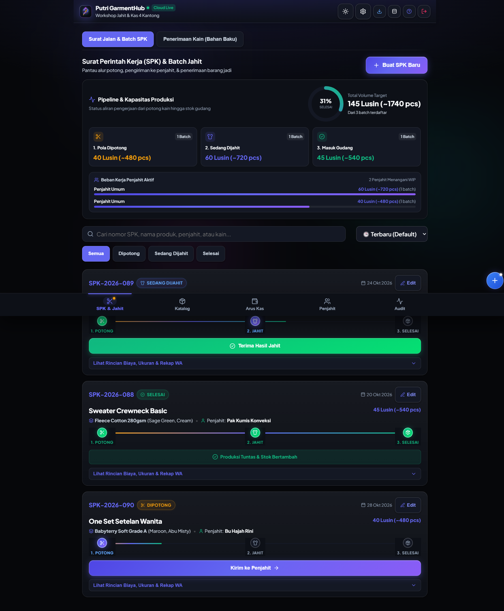
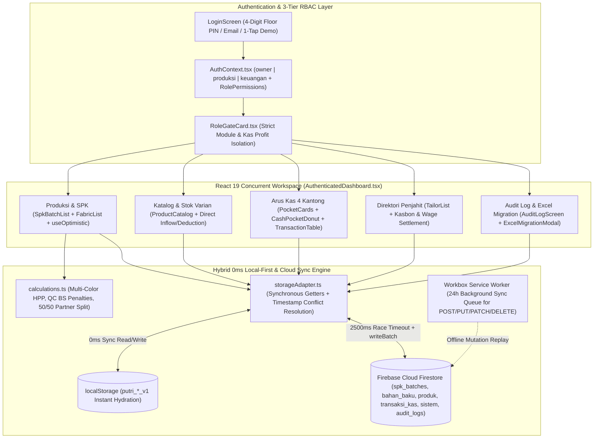

# GarmentHub Workshop ERP & Cash Flow Management

## 1. Project Overview & Problem Solved

**GarmentHub Workshop ERP & Cash Flow Management (`v2.12.11`)** is an enterprise-grade, offline-first garment manufacturing ERP and multi-pocket financial ledger Progressive Web Application (PWA) custom-engineered for **Putri Konveksi**, a high-volume apparel production workshop and online marketplace seller (Shopee/TikTok Shop).

### The Core Business Problem
Small-to-medium garment workshops (*konveksi*) face deeply intertwined production and accounting challenges that generic point-of-sale or accounting software cannot model:
1. **Fragmented SPK Batch & Partial Drop Tracking**: Raw fabric rolls (*Bahan Baku* measured in `kg` and `roll`) are cut into multi-color, multi-size curves (`XS`, `S`, `M`, `L`, `XL`, `XXL` measured in *Lusin* / dozens) and distributed to external piece-rate tailors (*Mitra Penjahit*) via work orders (*Surat Perintah Kerja / SPK*). Tailors rarely return an entire batch at once—they deliver partial drops (*Setoran Jahit Bertahap*), some of which contain fatal fabric defects (*BS Fatal*) or require rework (*BS Repair*), while also carrying running cash advances (*Kasbon*).
2. **Commingled Workshop Cash & Profit Leakage**: Without strict fund segregation, revenue from online store restocks gets mixed with raw material capital, electricity/shipping overhead, Shopee Ads budgets, and owner profit withdrawals (*Prive* / *Bagi Hasil 50/50 Putri & Rival*). Furthermore, floor cutting teams (`produksi`) and store admins (`keuangan`) should not have visibility into net owner profits (`kas_profit`).
3. **Unreliable Workshop Floor Connectivity & Legacy Ledger Migration**: Workshop floors often suffer from spotty cellular reception, requiring 0ms optimistic UI responsiveness with background cloud synchronization, alongside a safe mechanism to import historical paper/Excel records without double-counting active finished-goods inventory.

### The Solution
Putri GarmentHub delivers a cohesive, role-gated ERP and accounting suite:
- **End-to-End SPK & Multi-Drop QC Engine**: Tracks fabric intake (`FabricList`), 3-step SPK progression (`1. Potong` -> `2. Jahit` -> `3. Selesai`), partial tailor deliveries (`IntakeDrop`), automated QC defect penalty deductions (`calculateDropWageAndDefects`), *Kasbon* offsets (`calculateTailorSettlement`), and 1-tap WhatsApp pay-slip and production recap generation (*Format Rekap Putri*).
- **4-Pocket Segregated Cash Ledger (`Arus Kas 4 Kantong`)**: Divides capital into **Kas Bahan** (`#06b6d4`), **Kas Operasional** (`#10b981`), **Kas Iklan** (`#f59e0b`), and **Kas Profit** (`#d946ef`, strictly isolated to `owner` role), with automated cross-posting when finished goods are restocked or sold.
- **3-Tier Role-Based Access Control (RBAC) & Immutable Audit Trail**: Enforces granular permissions across `owner`, `produksi`, and `keuangan` roles with 4-digit PIN floor login (`quickLogin`), backed by embedded document audit trails and an Owner-only `AuditLogScreen`.

---

## 2. Tech Stack & Architecture Choices

### Architecture Diagram



### Tech Stack Table

| Layer | Technology | Version | Architectural Role & Justification |
| :--- | :--- | :--- | :--- |
| **UI Runtime** | React 19 + TypeScript | `^19.0.0` / `~5.7.3` | Leverages React 19 native `useOptimistic` and `useTransition` hooks (`SpkBatchList.tsx`) for instant zero-latency status transitions on the workshop floor. |
| **Build & Bundler** | Vite 6 + Rollup | `^6.2.0` | Code-splits authenticated views (`AuthenticatedDashboard`) and vendor chunks (`vendor-react`, `vendor-firestore`, `vendor-firebase-auth`, `vendor-icons`). |
| **Cloud Database** | Firebase Cloud Firestore | `^11.4.0` | Multi-collection cloud persistence (`bahan_baku`, `penjahit`, `produk`, `spk_batches`, `transaksi_kas`, `sistem`, `audit_logs`) hardened by schema-validating `firestore.rules`. |
| **AI & Automation** | Genkit (`genkit`, `@genkit-ai/googleai`) | `^1.42.0` / `^1.28.0` | Integrated AI toolkit for intelligent workshop workflow assistance and structured data parsing. |
| **Offline & Background Sync** | `vite-plugin-pwa` + Workbox | `^0.21.1` | Configures strict `NetworkOnly` with 24-hour `backgroundSync` queues (`putri-background-sync-post/put/patch/delete`) for Firestore mutations and `NetworkFirst` for queries. |
| **Visualizations & UX** | Custom SVG Charts + Web Vibration API | Custom | Zero-dependency interactive SVG charts (`ProductionPipelineVisual`, `CashPocketDonut`), GPU-composited `FluidMeshCanvas`, and tactile feedback (`triggerHaptic`). |
| **Testing & QA Suite** | Vitest 5 + Testing Library + Playwright | `^5.0.0` / `^1.63.0` | Comprehensive unit, deep stage-2 (`test:stage2`), RBAC security (`test:rbac`), V8 coverage (`@vitest/coverage-v8`), and Playwright E2E verification. |

---

## 3. Key Features & UI Implementation

### 1. 3-Step SPK Batch Pipeline, Multi-Color Curves & Partial Drop QC (`src/components/production/SpkBatchList.tsx`)
Models the exact physical workflow of a garment cutting and sewing workshop:
- **Interactive Pipeline Analytics (`ProductionPipelineVisual`)**: Displays live batch counts across `Dipotong`, `Sedang Dijahit`, and `Selesai` stages.
- **Multi-Color & 6-Size Curve Breakdown**: Supports single-curve or multi-color SPK batches (`colorBreakdowns`) across sizes `XS` through `XXL` in *Lusin* (`formatLusin` with automatic `pcs` helper conversion), tracking granular item costs (`biayaKain`, `ongkosJahit`, `biayaMerek`, `biayaPlastik`, `ongkirBahan`) and unit HPP.
- **Partial Intake & QC Defect Deduction Bottom Sheet**: When receiving garments from a tailor (`finishBatchWithIntake`), operators can click **100% Target**, **Isi Sisa Target**, or input custom *Lusin* quantities per color/size, record **BS Fatal (Kain Rusak)** and **BS Perbaikan (Re-work)** quantities, and automatically generate a formatted WhatsApp **Slip Pembayaran Upah Jahit** (`generateTailorWageSlipText`) or **Format Rekap Putri** 50/50 partner profit split (`generateWhatsAppRecapText`).

### 2. 4-Pocket Cash Flow Architecture & Automated Cross-Module Posting (`src/components/cashflow/PocketCards.tsx`)
Replaces messy single-ledger bookkeeping with 4 purpose-built financial pockets (`src/types/cashflow.ts`):
- **Kas Bahan (`#06b6d4`)**: Raw fabric rolls, sewing thread, labels, and polymailers. Direct finished-goods purchases (`addDirectVariantStock` / `addDirectBatchCurveStock`) can automatically post an expense transaction to `kas_bahan`.
- **Kas Operasional (`#10b981`)**: PLN electricity tokens, thermal shipping labels, courier fees, and sewing machine maintenance.
- **Kas Iklan (`#f59e0b`)**: Shopee Ads top-ups, live streaming costs, and promotional campaigns.
- **Kas Profit (`#d946ef`, Owner Only)**: Net profit allocations, owner withdrawals (*Prive*), and *Dana Rival* capital injections. When online store restocks are deducted from catalog inventory (`deductVariantStock`), the calculated net profit can be automatically posted directly into `kas_profit`.
- **Interactive Donut & Segmented Bar Analytics**: Users can toggle between `CashPocketDonut` and a proportional allocation bar (`PROPORSI ALOKASI DANA MULTI-KANTONG`) to inspect fund distribution at a glance.

### 3. Role-Gated Workspace & Historical Excel Migration (`src/components/migration/ExcelMigrationModal.tsx`)
- **3-Tier RBAC & 4-Digit PIN Floor Switcher**: `AuthContext.tsx` and `RoleGateCard.tsx` enforce strict boundaries—`produksi` users can manage SPKs, fabrics, tailors, and catalog stock but are completely blocked from viewing `Arus Kas 4 Kantong`; `keuangan` users can manage operational cash pockets (`kas_bahan`, `kas_operasional`, `kas_iklan`) while `kas_profit` and its transactions are filtered out inside `CashFlowContext.tsx` (`permissions.canViewProfit`).
- **Idempotent Historical Excel Migration (`FR-4.3`)**: Allows owners to upload `.json` exports converted from legacy Excel spreadsheets, validating records via `parseHistoricalJson` and tagging every imported SPK and cash mutation with `isHistorical: true` so opening balances are established without double-incrementing live catalog stock.

---

## 4. Technical Challenges Overcome

### Challenge 1: Eliminating 6,070ms Total Blocking Time (TBT) & Network Stalls via 0ms Synchronous Hydration + 2,500ms Race Timeouts
**Problem**: Early iterations suffered from two severe performance bottlenecks on mobile devices:
1. A CPU-driven 2D `<canvas>` background animation loop consumed 46 seconds of main-thread work and caused 6,070ms of Total Blocking Time (TBT).
2. Waiting for Firebase Cloud Firestore queries on weak workshop Wi-Fi caused UI hangs during tab switches, and late-arriving stale server reads occasionally overwrote fresh optimistic local edits.

**Solution**:
1. Replaced the CPU canvas in `src/components/common/FluidMeshCanvas.tsx` with hardware-accelerated CSS GPU compositor layers (`ambient-orb`), achieving 60–120fps animations with `0ms` JavaScript main-thread execution, and lazy-loaded `AuthenticatedDashboard` in `src/App.tsx`.
2. Engineered a dual-layer storage adapter in `src/services/storageAdapter.ts` combining `0ms` synchronous local getters (`getInitialBatchesSync`, `getInitialPocketsSync`, `getInitialProductsSync`) with a `fetchWithTimeout` race wrapper (2,500ms cap) and timestamp-based conflict resolution (`localTime >= serverTime`) so optimistic local mutations are never clobbered by stale cloud snapshots.

```ts
// src/services/storageAdapter.ts (Lines 121-136 & 916-927)
async function fetchWithTimeout<T>(promise: Promise<T>, timeoutMs = 2500): Promise<T | null> {
  let timer: ReturnType<typeof setTimeout> | undefined;
  const timeoutPromise = new Promise<null>((resolve) => {
    timer = setTimeout(() => resolve(null), timeoutMs);
  });
  try {
    const result = await Promise.race([promise, timeoutPromise]);
    if (timer) clearTimeout(timer);
    return result as T | null;
  } catch (err) {
    if (timer) clearTimeout(timer);
    throw err;
  }
}

// Timestamp-aware merge prevents stale Firestore reads from erasing optimistic local writes
const mergedMap = new Map<string, SPKBatch>();
serverData.forEach(b => mergedMap.set(b.id, b));
localData.forEach(b => {
  const existing = mergedMap.get(b.id);
  const localTime = new Date(b.updatedAt || b.createdAt).getTime();
  const serverTime = existing ? new Date(existing.updatedAt || existing.createdAt).getTime() : 0;
  if (!existing || localTime >= serverTime) {
    mergedMap.set(b.id, b);
  }
});
```

### Challenge 2: Cumulative Multi-Drop SPK Intake, QC Defect Penalties & Selective Catalog Synchronization
**Problem**: When a tailor delivers a partial drop for a multi-color SPK batch, the system must:
1. Calculate the weighted sewing rate across multiple colors (`sewingRatePerLusin`).
2. Deduct both fatal defects (`bsFatalQty`) and rework items (`bsRepairQty`) from the gross received quantity (`passedQC = Math.max(0, safeTotal - (safeFatal + safeRepair))`), applying financial penalties only to fatal defects while withholding wage payment on unpassed items.
3. Increment the finished-goods catalog (`incrementBatchStock`) **strictly by the pro-rata quantity that passed QC**—not the raw delivered quantity—while maintaining cumulative drop history (`intakeHistory`) and remaining target balances (`sisaTargetLusin`).

**Solution**: Implemented `calculateDropWageAndDefects` in `src/utils/calculations.ts` and orchestrated the multi-step state transition inside `finishBatchWithIntake` in `src/context/ProductionContext.tsx`.

```ts
// src/utils/calculations.ts (Lines 223-253)
export function calculateDropWageAndDefects(
  totalReceived: number,
  sewingRatePerLusin: number,
  bsFatalQty = 0,
  bsRepairQty = 0,
  defectPenaltyRatePerLusin = 50000
): DropWageResult {
  const safeTotal = Math.max(0, Number(totalReceived) || 0);
  const safeFatal = Math.max(0, Number(bsFatalQty) || 0);
  const safeRepair = Math.max(0, Number(bsRepairQty) || 0);
  const rate = Math.max(0, Number(sewingRatePerLusin) || 0);
  const penaltyRate = Math.max(0, Number(defectPenaltyRatePerLusin) || 0);

  // Invariant: passedQC cannot be negative; nonPassed = fatal + repair
  const nonPassed = safeFatal + safeRepair;
  const passedQC = Math.max(0, safeTotal - nonPassed);

  const grossWage = Math.round(passedQC * rate);
  const defectPenalty = Math.round(safeFatal * penaltyRate);
  const netWage = Math.max(0, grossWage - defectPenalty);

  return { totalReceived: safeTotal, passedQC, bsFatal: safeFatal, bsRepair: safeRepair, grossWage, defectPenalty, netWage };
}
```

```ts
// src/context/ProductionContext.tsx (Lines 351-366)
// Increment finished goods catalog inventory ONLY by the items that passed QC in this drop!
const passRatio = dropLusin > 0 ? wageResult.passedQC / dropLusin : 1;
if (wageResult.passedQC > 0 && colorIntakes && colorIntakes.length > 0) {
  for (const ci of colorIntakes) {
    const passedSizes: SizeCurve = {
      XS: Math.round(Number(ci.sizes.XS || 0) * passRatio),
      S: Math.round(Number(ci.sizes.S || 0) * passRatio),
      M: Math.round(Number(ci.sizes.M || 0) * passRatio),
      L: Math.round(Number(ci.sizes.L || 0) * passRatio),
      XL: Math.round(Number(ci.sizes.XL || 0) * passRatio),
      XXL: Math.round(Number(ci.sizes.XXL || 0) * passRatio),
    };
    await incrementBatchStock(batch.produkId, ci.color, passedSizes);
  }
}
```

### Challenge 3: Atomic Multi-Pocket Ledger Integrity, Profit Isolation & Embedded Audit Trails
**Problem**: Financial mutations (`masuk`, `keluar`, `transfer`) across the 4 cash pockets must atomically update wallet balances, persist transaction records, and append immutable audit logs (`EmbeddedAuditLog` and global `audit_logs`) without race conditions, while strictly hiding `kas_profit` balances and transactions from non-owner roles (`produksi` and `keuangan`).

**Solution**:
1. In `src/context/CashFlowContext.tsx`, `visiblePockets` and `visibleTransactions` are filtered at the context boundary using `permissions.canViewProfit` (`FR-4.2`), ensuring `kas_profit` data never leaks into child components or total balance calculations (`totalVisibleBalance`) when a staff role is active.
2. In `src/services/storageAdapter.ts`, `recordCashTransaction` injects an embedded user audit trail (`injectEmbeddedAuditLog`), recalculates source and destination pocket balances (`updatedWallets`), updates `localStorage` synchronously, and commits the transaction document, global audit log, and updated wallet balances in a single atomic Firestore `writeBatch`.

```ts
// src/services/storageAdapter.ts (Lines 1105-1141)
export async function recordCashTransaction(trx: TransaksiKas): Promise<void> {
  const auditedTrx = injectEmbeddedAuditLog(trx, 'CREATE');
  const currentTrx = getInitialTransactionsSync();
  const wallets = await loadWalletBalances();

  const updatedWallets = { ...wallets };
  const nominal = Math.round(auditedTrx.nominal);

  if (auditedTrx.jenis === 'masuk') {
    updatedWallets[auditedTrx.kantong] = (updatedWallets[auditedTrx.kantong] || 0) + nominal;
  } else if (auditedTrx.jenis === 'keluar') {
    updatedWallets[auditedTrx.kantong] = Math.max(0, (updatedWallets[auditedTrx.kantong] || 0) - nominal);
  } else if (auditedTrx.jenis === 'transfer' && auditedTrx.kantongTujuan) {
    updatedWallets[auditedTrx.kantong] = Math.max(0, (updatedWallets[auditedTrx.kantong] || 0) - nominal);
    updatedWallets[auditedTrx.kantongTujuan] = (updatedWallets[auditedTrx.kantongTujuan] || 0) + nominal;
  }

  localStorage.setItem(STORAGE_KEYS.WALLETS, JSON.stringify(updatedWallets));
  localStorage.setItem(STORAGE_KEYS.TRANSACTIONS, JSON.stringify([auditedTrx, ...currentTrx]));

  if (isFirebaseConfigured && db) {
    const batch = writeBatch(db);
    batch.set(doc(db, 'transaksi_kas', auditedTrx.id), auditedTrx);
    const user = getCurrentUserForAudit();
    const globalLog = createGlobalAuditLog('CREATE', 'TransaksiKas', auditedTrx.id, user.uid, user.displayName);
    batch.set(doc(collection(db, 'audit_logs'), globalLog.id), globalLog);
    batch.set(doc(db, 'sistem', 'wallets'), updatedWallets);
    await batch.commit();
  }
}
```
