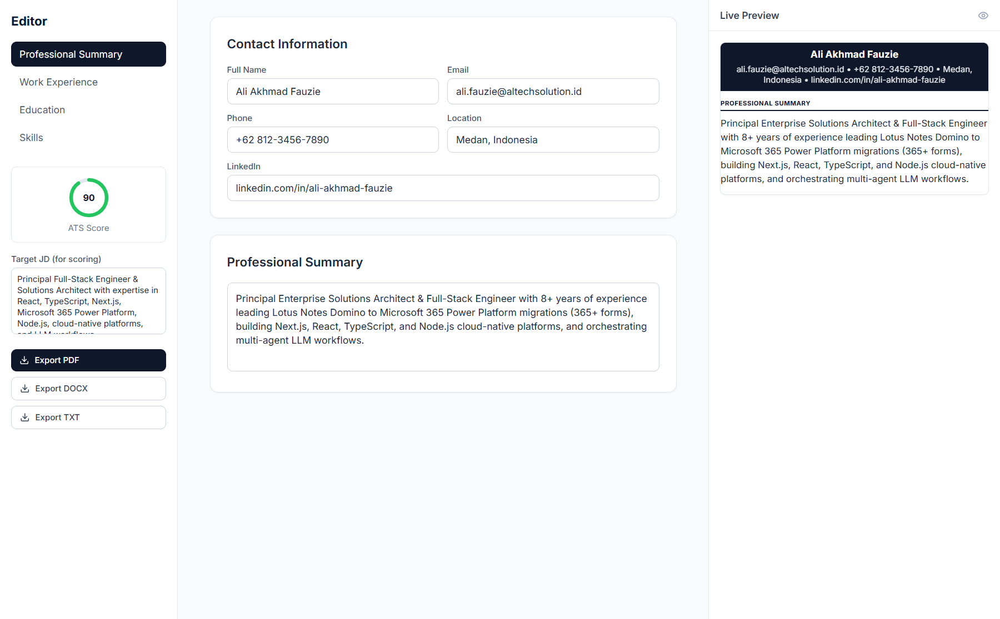
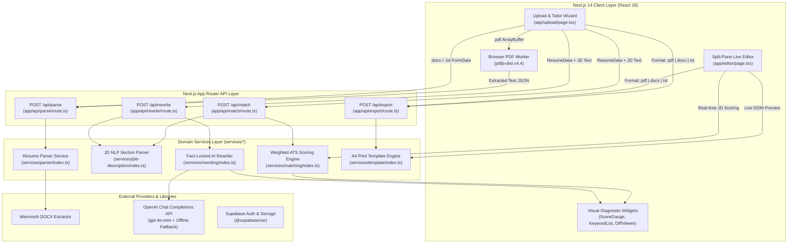

# ResumeForge — Next.js ATS-Optimized Resume Tailoring Engine



## 1. Project Overview & Problem Solved

Modern job seekers face an asymmetric filtering bottleneck: over 75% of resumes submitted to mid-to-large enterprises are parsed, scored, and ranked by Applicant Tracking Systems (ATS) such as Workday, Greenhouse, Lever, and Taleo before a human recruiter ever reviews them. Candidates with strong domain expertise frequently get filtered out due to two structural problems:
1. **Semantic & Keyword Mismatch**: A candidate's resume may list abbreviations (`K8s`, `JS`, `CI/CD`) or domain synonyms while the target Job Description (JD) weights exact multi-word terminology (`Kubernetes`, `JavaScript`, `Continuous Integration`) inside required sections.
2. **Destructive Formatting & Hallucinated Rewrites**: Multi-column layouts, embedded tables, and decorative Unicode glyphs (`★`, `◆`, `►`) corrupt ATS text-layer parsers. Meanwhile, generic LLM resume rewriters often fabricate metrics, alter employment dates, or invent job titles—creating compliance and background-check risks.

**ResumeForge** (`C:/Users/AL_AAF/Project/04_portfolio_and_resumes/resume-builder`) solves these challenges through a deterministic 4-phase pipeline (**Parse → Match → Rewrite → Export**) built on Next.js 14 App Router and TypeScript:
- **Multi-Format Document Ingestion**: Accepts `.pdf`, `.docx`, and `.txt` resumes up to 10 MB, combining browser-based Web Worker PDF extraction (`pdfjs-dist`) with server-side DOCX parsing (`mammoth`) and regex section segmentation.
- **Weighted ATS Scoring & Formatting Audit**: Parses raw job descriptions into 5 semantic buckets (`responsibilities`, `requirements`, `qualifications`, `niceToHaves`, `aboutCompany`), computes prominence-weighted keyword scores, resolves abbreviation roots, and audits bullet formatting for ATS-hostile symbols.
- **Fact-Locked AI Rewriting Engine**: Generates section-by-section rewrite suggestions (`summary`, `experience`, `skills`, `title`) via OpenAI (`gpt-4o-mini`) with explicit `factualLock` constraints and a deterministic keyword-injection fallback when running offline or without API keys.
- **Interactive Live Editor & Single-Column A4 Export**: Provides a split-pane real-time resume editor with live ATS gauge recalculation and exports clean, single-column A4 HTML/PDF and plain-text artifacts with sanitized filenames.

---

## 2. Tech Stack & Architecture Choices

### System Architecture Diagram



### Technology Stack Table

| Layer | Technology | Version | Architectural Role |
| :--- | :--- | :--- | :--- |
| **Framework** | Next.js (App Router) | `14.2.0` | Full-stack React framework with Route Handlers (`app/api/*`) and Server Actions (`10mb` body limit) |
| **Language** | TypeScript | `^5.5.0` | Strict static typing across domain models (`ResumeData`, `JobDescription`, `MatchResult`, `RewriteSuggestion`) |
| **UI Primitives** | Radix UI + Tailwind CSS | `^3.4.0` | Accessible dialogs, tabs, tooltips, dropdowns, and responsive utility styling |
| **State & Validation** | Zustand + Zod | `^4.5.0` / `^3.23.0` | Client state management and runtime schema validation |
| **Document Parsing** | `pdfjs-dist` + `mammoth` | `^4.4.0` / `^1.8.0` | Client-side Web Worker PDF text extraction and server-side DOCX raw text extraction |
| **Document Generation** | `docx` + Custom A4 HTML Engine | `^9.7.1` | Printable A4 single-column resume generation (`Classic`, `Modern`, `Minimal` templates) |
| **AI / LLM Integration** | `openai` SDK / REST API | `^4.50.0` | Fact-locked bullet and summary rewriting via `gpt-4o-mini` with deterministic fallback |
| **Backend-as-a-Service** | Supabase (`@supabase/ssr`) | `^2.45.0` | PostgreSQL persistence and SSR authentication readiness |
| **Testing Suite** | Vitest + Testing Library + Playwright | `^1.6.0` / `^1.44.0` | Unit testing for parsers/scorers and E2E browser workflow verification |

---

## 3. Key Features & UI Implementation

### 4-Stage Guided Tailoring Wizard (`app/upload/page.tsx`)
The primary tailoring workflow is implemented in [`UploadPage`](file:///C:/Users/AL_AAF/Project/04_portfolio_and_resumes/resume-builder/app/upload/page.tsx#L20-L316) as a finite state machine (`type Step = 'upload' | 'parsing' | 'matching' | 'rewriting' | 'review'`):
1. **Drag-and-Drop Multi-Format Dropzone**: Built with `react-dropzone`, enforcing MIME-type allowlists (`.pdf`, `.docx`, `.txt`) and a 10 MB file size cap alongside a Job Description input pane.
2. **Real-Time Step Progress Indicator**: Transitions smoothly through `Parsing resume`, `Scoring against JD`, and `Generating AI rewrites` with live `react-hot-toast` notifications and `lucide-react` status spinners.
3. **Interactive Review Dashboard**: Displays a 3-column diagnostic header pairing the animated [`ScoreGauge`](file:///C:/Users/AL_AAF/Project/04_portfolio_and_resumes/resume-builder/components/score-gauge.tsx#L11-L87) with categorized [`KeywordList`](file:///C:/Users/AL_AAF/Project/04_portfolio_and_resumes/resume-builder/components/keyword-list.tsx#L12-L52) panels (`✓ Matched` vs. `✗ Missing`, marking required terms with a red asterisk `*`).
4. **Granular Diff Approval Cards**: Each AI rewrite suggestion renders inside [`DiffViewer`](file:///C:/Users/AL_AAF/Project/04_portfolio_and_resumes/resume-builder/components/diff-viewer.tsx#L12-L57), displaying the target section badge, a `🔒 Facts Locked` indicator when `suggestion.factualLock` is active, the count of newly injected JD keywords (`+N keywords`), side-by-side red/green `Original` vs. `Rewritten` comparison blocks, and individual `✓ Accept` / `✗ Reject` action buttons.

### Animated SVG Circular Score Gauge (`components/score-gauge.tsx`)
[`ScoreGauge`](file:///C:/Users/AL_AAF/Project/04_portfolio_and_resumes/resume-builder/components/score-gauge.tsx#L11-L87) renders an SVG radial progress meter (`viewBox="0 0 100 100"`, `r="40"`) with `strokeDasharray` and `strokeDashoffset` transitions (`duration-1000 ease-out`) and semantic color thresholds:
- **80–100**: Emerald Green (`#22c55e`)
- **60–79**: Amber Yellow (`#eab308`)
- **40–59**: Orange (`#f97316`)
- **0–39**: Red (`#ef4444`)

### Split-Pane Live Resume Editor (`app/editor/page.tsx`)
[`EditorPage`](file:///C:/Users/AL_AAF/Project/04_portfolio_and_resumes/resume-builder/app/editor/page.tsx#L23-L293) provides a 3-pane workspace:
- **Left Navigation & Real-Time JD Scorer (`w-64`)**: Switches between `Professional Summary`, `Work Experience`, `Education`, and `Skills`, embeds a compact `ScoreGauge`, and recalculates `calculateMatch(resume, jd)` on every keystroke whenever a target JD (>20 chars) is pasted.
- **Center Structured Form Editor (`flex-1`)**: Supports dynamic CRUD operations for work experience positions (`addExperience`, `updateExperience`, `removeExperience`), nested achievement bullets (`addBullet`, `updateBullet`, `removeBullet`), education entries, and comma-delimited skill arrays.
- **Right Live A4 Preview Pane (`w-[420px]`)**: Calls `renderResumeHtml(resume, 'classic')` via `useCallback` to render a scaled A4 preview in real time alongside one-click `Export PDF`, `Export DOCX`, and `Export TXT` buttons.

---

## 4. Technical Challenges Overcome

### Challenge 1: Isomorphic PDF Parsing Without Node.js Worker Crashes
**Problem**: `pdfjs-dist` v4 relies on Web Workers and browser `Canvas` APIs that frequently fail or throw module resolution errors inside Next.js Node.js serverless route handlers. Conversely, `.docx` binary extraction via `mammoth` works cleanly in Node.js buffers.
**Solution**: We architected a hybrid dual-path ingestion contract across [`app/upload/page.tsx`](file:///C:/Users/AL_AAF/Project/04_portfolio_and_resumes/resume-builder/app/upload/page.tsx#L66-L89), [`app/api/parse/route.ts`](file:///C:/Users/AL_AAF/Project/04_portfolio_and_resumes/resume-builder/app/api/parse/route.ts#L4-L36), and [`services/parser/index.ts`](file:///C:/Users/AL_AAF/Project/04_portfolio_and_resumes/resume-builder/services/parser/index.ts#L11-L67). When a user uploads a `.pdf`, the client dynamically imports `pdfjs-dist`, attaches the CDN worker, extracts page-by-page text strings in the browser, and posts JSON to `/api/parse`. When a `.docx` or `.txt` is uploaded, the client streams `FormData` directly to the server route, which invokes `mammoth.extractRawText({ arrayBuffer })`:

```typescript
// File: C:\Users\AL_AAF\Project\04_portfolio_and_resumes\resume-builder\app\upload\page.tsx (Lines 66-89)
if (ext === 'pdf') {
  // Client-side PDF extraction using pdfjs-dist
  const pdfjsLib = await import('pdfjs-dist');
  pdfjsLib.GlobalWorkerOptions.workerSrc = `//unpkg.com/pdfjs-dist@${pdfjsLib.version}/build/pdf.worker.min.mjs`;
  const arrayBuffer = await file.arrayBuffer();
  const pdf = await pdfjsLib.getDocument({ data: arrayBuffer }).promise;
  const textParts: string[] = [];
  for (let i = 1; i <= pdf.numPages; i++) {
    const page = await pdf.getPage(i);
    const content = await page.getTextContent();
    textParts.push(content.items.map((item: any) => item.str).filter(Boolean).join(' '));
  }
  const extractedText = textParts.join('\n\n');
  parseRes = await fetch('/api/parse', {
    method: 'POST',
    headers: { 'Content-Type': 'application/json' },
    body: JSON.stringify({ text: extractedText, fileName: file.name }),
  });
} else {
  // DOCX/TXT: send file directly
  const formData = new FormData();
  formData.append('file', file);
  parseRes = await fetch('/api/parse', { method: 'POST', body: formData });
}
```

### Challenge 2: Prominence-Weighted ATS Scoring & Abbreviation Root Resolution
**Problem**: Naive keyword matching treats a keyword mentioned once in a "Nice to Have" section identically to a core requirement, and fails when a candidate writes `k8s` or `ci/cd` instead of `kubernetes` or `continuous integration`.
**Solution**: In [`services/job-description/index.ts`](file:///C:/Users/AL_AAF/Project/04_portfolio_and_resumes/resume-builder/services/job-description/index.ts#L30-L124), `extractSections` first segments the JD into `responsibilities`, `requirements`, `qualifications`, and `niceToHaves`. `extractKeywords` then computes a composite prominence multiplier (`2x` in `requirements`, `1.5x` in `qualifications`, `0.5x` in `niceToHaves`, and an additional `2x` if `isRequiredTerm` is true). Next, [`calculateMatch`](file:///C:/Users/AL_AAF/Project/04_portfolio_and_resumes/resume-builder/services/matching/index.ts#L11-L135) in `services/matching/index.ts` evaluates exact matches (`1.0` weight), abbreviation root partial matches (`0.5` weight via `getAbbreviationRoots`), and formatting penalties (`auditFormatting`) using a weighted composite formula (`40%` hard skills, `30%` soft/domain skills, `20%` certifications, `10%` formatting compliance):

```typescript
// File: C:\Users\AL_AAF\Project\04_portfolio_and_resumes\resume-builder\services\matching\index.ts (Lines 29-42 & 85-117)
const hardSkillScore = calculateCategoryScore(matched, partial, jd.keywords, 'hard-skill');
const softSkillScore = calculateCategoryScore(matched, partial, jd.keywords, 'soft-skill');
const certScore = calculateCategoryScore(matched, partial, jd.keywords, 'certification');
const formattingIssues = auditFormatting(resume);
const formattingScore = calculateFormattingScore(formattingIssues);

// Weighted composite: 40% hard, 30% soft/domain, 20% education/certs, 10% formatting
const atsScore = Math.round(
  hardSkillScore * 0.4 +
  softSkillScore * 0.3 +
  certScore * 0.2 +
  formattingScore * 0.1
);
```

### Challenge 3: Preventing LLM Hallucinations with `factualLock` & Deterministic Fallback
**Problem**: When tailoring work experience bullets, LLMs tend to invent metrics or alter employer names and dates if not strictly constrained, and API outages or missing `OPENAI_API_KEY` values can break the user workflow.
**Solution**: In [`services/rewriting/index.ts`](file:///C:/Users/AL_AAF/Project/04_portfolio_and_resumes/resume-builder/services/rewriting/index.ts#L73-L230), `rewriteExperience` extracts only bullets that are missing target JD keywords (`findMissingKeywords`), passes `[exp.title, exp.company, exp.startDate, exp.endDate]` into `buildPrompt` as `Locked facts (DO NOT change these)`, sets `factualLock: true` on the resulting `RewriteSuggestion`, and falls back to `rewriteWithoutLLM` if `OPENAI_API_KEY` is absent or the API call fails:

```typescript
// File: C:\Users\AL_AAF\Project\04_portfolio_and_resumes\resume-builder\services\rewriting\index.ts (Lines 163-215)
async function callLLM(
  section: string,
  original: string,
  targetKeywords: string[],
  lockedFacts: string[]
): Promise<string> {
  const apiKey = process.env.OPENAI_API_KEY;
  if (!apiKey) {
    // Fallback: keyword-aware rewriting without API
    return rewriteWithoutLLM(original, targetKeywords);
  }
  // ... OpenAI chat/completions fetch with SYSTEM_PROMPT and buildPrompt()
}

function rewriteWithoutLLM(original: string, keywords: string[]): string {
  let result = original;
  for (const kw of keywords) {
    if (!result.toLowerCase().includes(kw.toLowerCase())) {
      if (result.endsWith('.')) {
        result = result.slice(0, -1) + ` using ${kw}.`;
      } else {
        result += ` leveraging ${kw}`;
      }
    }
  }
  return result;
}
```
