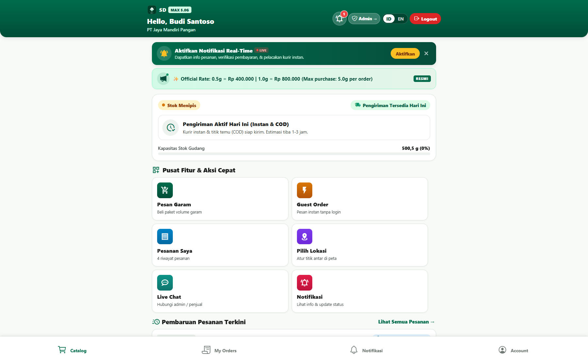
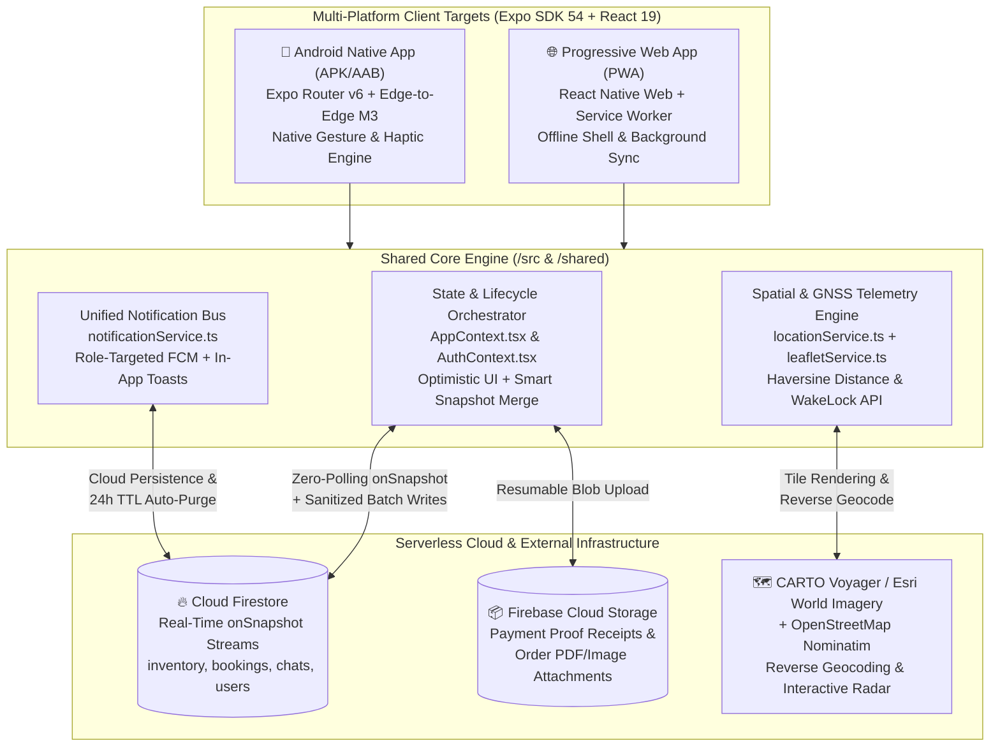

# SaltDistribute — Multi-Platform B2B Wholesale Salt Order & Logistics Management Platform



---

## 1. Project Overview & Problem Solved

**SaltDistribute** is an industrial-grade, cross-platform B2B order, logistics, and warehouse inventory management ecosystem built for wholesale distribution of high-purity refined salt (**NaCl 99.2% ISO/Halal Certified**). Operating out of the Medan Belawan industrial hub in North Sumatra, the platform serves both recurring enterprise food-processing buyers and rapid cash-on-delivery (COD) / direct-dispatch buyers across two synchronized targets: a **Progressive Web App (PWA)** deployed on Firebase Hosting and a native **Android Mobile Application** built with React Native and Expo SDK 54.

### Core Business Problems Solved
Traditional regional commodity distribution in North Sumatra relied on fragmented WhatsApp threads, manual stock ledgers, unverified bank transfer screenshots, and opaque driver dispatch coordination. This created four critical operational bottlenecks:
1. **Phantom Stock & Unpaid Order Lockups**: Buyers frequently reserved bulk tonnage without completing payment, freezing warehouse stock (`availableQuantityGram`) and blocking paying clients.
2. **High-Friction Onboarding vs. Accountability**: Occasional buyers needed an instant, zero-registration "Quick Order" flow (purchasing either by exact weight in grams or by target IDR budget), while recurring B2B corporate buyers required full multi-stage invoicing, historical audit trails, and repeat-order dashboards.
3. **Blind Last-Mile & COD Rendezvous Logistics**: Dispatching heavy cargo to industrial zones (KIM 1/2/3, Belawan Port gates, Highway Belmera rest areas) suffered from missed meetups because dispatchers lacked live telemetry on buyer proximity and ETA.
4. **Cross-Platform Maintenance Overhead**: Warehouse admins needed desktop/tablet Kanban and spatial radar tools while field dispatchers and mobile buyers needed an installable Android APK/AAB and offline-capable mobile web experience without maintaining two separate codebases.

SaltDistribute solves these challenges by unifying **zero-polling Cloud Firestore real-time synchronization**, **dual-mode ordering (Member & Ephemeral Guest Quick Orders)**, **automated 24-hour lazy stock expiration**, **GDPR/PDPA-compliant guest PII auto-purging**, and a **live GNSS Haversine proximity radar** inside a single shared TypeScript architecture.

---

## 2. Tech Stack & Architecture Choices

### System Architecture Diagram



### Technology Stack Table

| Layer | Technology | Version | Architectural Role & Justification |
| :--- | :--- | :--- | :--- |
| **Core Framework** | React & React Native | `19.1.0` / `0.81.5` | Concurrent UI rendering across native Android views and DOM via `react-native-web` (`0.21.0`). |
| **Navigation & Routing** | Expo SDK & Expo Router | `54.0.37` / `6.0.24` | File-based, type-safe routing with role-segregated route groups (`(admin)`, `(buyer)`, `(auth)`). |
| **Language & Typing** | TypeScript | `5.9.3` | Strict end-to-end domain contracts (`Booking`, `Inventory`, `LiveBuyerLocation`, `ProximityAnalysis`). |
| **Real-Time Database** | Firebase Cloud Firestore | `^12.18.0` | Zero-polling bi-directional sync via `onSnapshot` listeners with offline local cache fallback. |
| **Object Storage** | Firebase Cloud Storage | `^12.18.0` | Stores transfer receipts (`receipts/{bookingId}/*`) via `uploadBytesResumable`. |
| **Local Persistence** | AsyncStorage & Web Storage | `2.2.0` | Dual-layer offline persistence (`@saltdistribute_*_v3`) and browser `sessionStorage` auth isolation. |
| **Spatial & Mapping** | Leaflet.js + CARTO / Esri | `1.9.4` | Interactive HTML5/WebView vector & satellite radar maps with Nominatim reverse geocoding. |
| **PWA & Hardware APIs** | Service Worker + WakeLock | Custom ES6 | Stale-while-revalidate tile caching, Background Sync (`sync-buyer-location`), and Screen Wake Lock. |
| **Testing & QA** | Jest + Playwright | `30.5.0` / `1.62.1` | Unit verification of state machines, Haversine math, COGS accounting, and E2E browser flows. |

---

## 3. Key Features & UI Implementation

### 1. Role-Segregated Navigation & Material 3 Emerald Design System
The UI is engineered around a custom **Material 3 Emerald Industrial Palette** (`#006C4C` primary, `#003826` deep container, high-contrast semantic status tokens) defined in [`src/theme/index.ts`](file:///C:/Users/AL_AAF/Project/Orrder%20management%20spp/src/theme/index.ts) with strict minimum `48dp` touch targets (`touchTarget.minHeight: 48`) and haptic feedback triggers (`expo-haptics`).
- **Admin Dispatch Console (`app/(admin)/*`)**: Features an executive financial & inventory dashboard, a multi-stage Kanban order pipeline (`PENDING_CONFIRMATION` -> `AWAITING_PAYMENT` -> `PAYMENT_VERIFICATION` -> `CONFIRMED_DELIVERING` -> `COMPLETED`), an interactive restock & weighted-average COGS ledger, a live GNSS buyer radar modal, and store/tier configuration settings.
- **Buyer & Guest Portal (`app/(buyer)/*`)**: Provides a real-time stock availability banner, dynamic unit-tier pricing calculator (`0.5g` Mini Pouch up to `5.0g` Vault), dual purchase modes (`PER_GRAM` vs. `PER_AMOUNT` IDR nominal conversion), interactive COD meeting point selector, payment proof uploader, and per-order real-time chat.

### 2. Seller-Exclusive Live GNSS Proximity Radar (`AdminLiveRadarModal.tsx`)
When a buyer enables location sharing for a COD meetup or direct delivery, dispatchers can open [`AdminLiveRadarModal.tsx`](file:///C:/Users/AL_AAF/Project/Orrder%20management%20spp/src/components/AdminLiveRadarModal.tsx) to monitor real-time GNSS coordinates, accuracy radius in meters, ground speed (`km/h`), and dynamic ETA.
- Renders a custom interactive Leaflet map ([`generateLiveRadarMapHtml`](file:///C:/Users/AL_AAF/Project/Orrder%20management%20spp/src/services/leafletService.ts#L61-L105)) seamlessly inside an `<iframe>` on Web or `react-native-webview` on Android, supporting instant toggling between **CARTO Voyager Roadmap** and **Esri World Imagery Satellite** layers.
- Acquires a hardware **Screen Wake Lock** ([`wakeLockService.ts`](file:///C:/Users/AL_AAF/Project/Orrder%20management%20spp/src/services/wakeLockService.ts#L24-L45)) while the radar modal is open so the dispatcher's device screen never sleeps during active vehicle transit.
- Provides one-tap deep links to launch turn-by-turn navigation in **Google Maps** or **Waze** pre-populated with seller origin and live buyer destination coordinates.

### 3. Weighted-Average COGS & Real-Time Financial Analytics
In [`AppContext.tsx`](file:///C:/Users/AL_AAF/Project/Orrder%20management%20spp/src/context/AppContext.tsx#L1202-L1227), the `financialMetrics` memo computes real-time gross revenue, Cost of Goods Sold (COGS), and net gross profit across all completed orders by calculating the weighted-average acquisition cost per gram across historical supplier restock batches (`restockLogs`), complete with one-click CSV ledger export (`exportSalesCSV`) and full JSON database backup/restore.

### 4. Per-Order Real-Time Chat with Multimodal Attachments
Each booking spawns an isolated Firestore subcollection (`chats/{bookingId}/messages`) managed by [`ChatModal.tsx`](file:///C:/Users/AL_AAF/Project/Orrder%20management%20spp/src/components/ChatModal.tsx) and [`firestoreService.ts`](file:///C:/Users/AL_AAF/Project/Orrder%20management%20spp/src/services/firestoreService.ts#L434-L482). Buyers and admins can exchange text messages, PDFs, and images with role-targeted push/in-app toast notifications ([`notificationService.ts`](file:///C:/Users/AL_AAF/Project/Orrder%20management%20spp/src/services/notificationService.ts#L46-L60)).

---

## 4. Technical Challenges Overcome

### Challenge 1: Zero-Cost Lazy Expiration & Automatic Stock Rollback Without Cloud Cron Jobs
**Problem:** Unpaid orders in `PENDING_CONFIRMATION` or `AWAITING_PAYMENT` status deduct warehouse inventory immediately upon creation to prevent over-selling. Relying on paid cloud scheduled functions to expire stale orders adds infrastructure cost and fails when devices operate offline.
**Solution:** Engineered a deterministic client-driven **Lazy Expiration Engine** (`runLazyExpirationCheck`) inside [`src/context/AppContext.tsx`](file:///C:/Users/AL_AAF/Project/Orrder%20management%20spp/src/context/AppContext.tsx#L453-L496) that executes on state hydration and manual refreshes, scanning active bookings against a 24-hour threshold, transitioning expired orders to `CANCELLED_UNPAID`, and atomically restoring the exact gram quantity back to `availableQuantityGram`:

```typescript
// From src/context/AppContext.tsx (lines 453-496)
const runLazyExpirationCheck = (currentBookings: Booking[], currentInventory: Inventory) => {
  const now = Date.now();
  const TWENTY_FOUR_HOURS_MS = 24 * 60 * 60 * 1000;
  let totalStockToRestoreGram = 0;
  let hasExpired = false;

  const updatedBookings = currentBookings.map((b) => {
    if (
      (b.status === "PENDING_CONFIRMATION" || b.status === "AWAITING_PAYMENT") &&
      !b.paymentProofUrl
    ) {
      const orderTime = new Date(b.createdAt).getTime();
      if (now - orderTime > TWENTY_FOUR_HOURS_MS) {
        hasExpired = true;
        totalStockToRestoreGram += b.quantityGram;
        const updatedB: Booking = {
          ...b,
          status: "CANCELLED_UNPAID" as BookingStatus,
          rejectionReason: "Order auto-expired after 24h inactivity without payment proof.",
          updatedAt: new Date().toISOString(),
        };
        updateBookingInFirestore(b.bookingId, {
          status: "CANCELLED_UNPAID",
          rejectionReason: "Order auto-expired after 24h inactivity without payment proof.",
          updatedAt: new Date().toISOString(),
        }).catch(() => {});
        return updatedB;
      }
    }
    return b;
  });

  if (hasExpired) {
    saveBookings(updatedBookings);
    const updatedInv: Inventory = {
      ...currentInventory,
      availableQuantityGram: currentInventory.availableQuantityGram + totalStockToRestoreGram,
      isStockAvailable: true,
      updatedAt: new Date().toISOString(),
    };
    saveInventory(updatedInv);
  }
};
```

### Challenge 2: Ephemeral Guest Privacy & Automated PII Redaction on Order Completion
**Problem:** Walk-in or one-time B2B buyers using the Quick Order flow (`createGuestBooking`) want frictionless ordering without permanent account creation or long-term storage of their personal phone numbers, addresses, and payment receipts once delivery is fulfilled.
**Solution:** Implemented an ephemeral guest session key (`guestAccessKey`) paired with automatic PII redaction inside `markCompleted` in [`src/context/AppContext.tsx`](file:///C:/Users/AL_AAF/Project/Orrder%20management%20spp/src/context/AppContext.tsx#L1059-L1092) and automated Firestore batch TTL purges (`purgeExpiredNotificationsFromFirestore` and `purgeExpiredChatsFromFirestore` in [`src/services/firestoreService.ts`](file:///C:/Users/AL_AAF/Project/Orrder%20management%20spp/src/services/firestoreService.ts#L487-L548)). When a guest order is marked `COMPLETED`, financial metrics (`grandTotal`, `quantityGram`) are preserved for accounting while all personal identifiers are irreversibly scrubbed:

```typescript
// From src/context/AppContext.tsx (lines 1059-1078)
const markCompleted = (bookingId: string) => {
  const updated = bookings.map((b) => {
    if (b.bookingId !== bookingId) return b;
    if (b.isGuest) {
      return {
        ...b,
        status: "COMPLETED" as BookingStatus,
        buyerName: "Guest Buyer [Purged]",
        buyerPhone: "[Purged]",
        deliveryAddress: "[Purged]",
        notes: undefined,
        paymentProofUrl: undefined,
        dataPurgeStatus: "PURGED" as const,
        purgedAt: new Date().toISOString(),
        updatedAt: new Date().toISOString(),
      };
    }
    return { ...b, status: "COMPLETED" as BookingStatus, updatedAt: new Date().toISOString() };
  });
  saveBookings(updated);
};
```

### Challenge 3: Optimistic Local Creation vs. Asynchronous Firestore Snapshot Race Conditions
**Problem:** When a buyer creates a booking under high-latency mobile network conditions, an incoming Firestore `onSnapshot` event from other collection updates can fire before the new local booking's network write finishes, causing the newly created order to momentarily vanish from the UI.
**Solution:** Built a smart snapshot reconciliation algorithm in [`src/context/AppContext.tsx`](file:///C:/Users/AL_AAF/Project/Orrder%20management%20spp/src/context/AppContext.tsx#L577-L593) and recursive `undefined`-field sanitization (`sanitizeFirestoreData` in [`src/services/firestoreService.ts`](file:///C:/Users/AL_AAF/Project/Orrder%20management%20spp/src/services/firestoreService.ts#L312-L325)) so Firestore never rejects optional TypeScript properties and pending local bookings are preserved across snapshot emissions:

```typescript
// From src/context/AppContext.tsx (lines 577-593)
const unsubBookings = subscribeToBookings((remoteBookings) => {
  if (remoteBookings && remoteBookings.length > 0) {
    setBookings((prev) => {
      const remoteMap = new Map(remoteBookings.map((b) => [b.bookingId, b]));
      const merged = [...remoteBookings];
      // Preserve any local booking created that hasn't appeared in snapshot yet
      for (const localB of prev) {
        if (!remoteMap.has(localB.bookingId)) {
          merged.push(localB);
        }
      }
      merged.sort((a, b) => new Date(b.createdAt).getTime() - new Date(a.createdAt).getTime());
      AsyncStorage.setItem(BOOKINGS_STORAGE_KEY, JSON.stringify(merged)).catch(() => {});
      return merged;
    });
  }
});
```

### Challenge 4: Real-Time Haversine Proximity State Classification & Service Worker Telemetry Caching
**Problem:** Raw GPS coordinates from a buyer's phone are noisy and difficult for a warehouse dispatcher to interpret at a glance during busy loading operations, and browser tab backgrounding can interrupt telemetry updates.
**Solution:** Created `calculateDistanceKm` and `analyzeProximity` in [`src/services/locationService.ts`](file:///C:/Users/AL_AAF/Project/Orrder%20management%20spp/src/services/locationService.ts#L40-L66) and coupled them with a Service Worker Background Sync queue (`sync-buyer-location` in [`public/service-worker.js`](file:///C:/Users/AL_AAF/Project/Orrder%20management%20spp/public/service-worker.js#L96-L157)). The engine translates spherical Haversine distance into actionable proximity states (`AT_MEETING_POINT` $\le 150\text{m}$, `APPROACHING` $\le 800\text{m}$, `IN_TRANSIT` $> 800\text{m}$, and `OFFLINE`) with urban speed ETA estimation:

```typescript
// From src/services/locationService.ts (lines 40-66 & 291-323)
export function calculateDistanceKm(lat1: number, lon1: number, lat2: number, lon2: number): number {
  const R = 6371; // Earth's radius in km
  const dLat = ((lat2 - lat1) * Math.PI) / 180;
  const dLon = ((lon2 - lon1) * Math.PI) / 180;
  const a =
    Math.sin(dLat / 2) * Math.sin(dLat / 2) +
    Math.cos((lat1 * Math.PI) / 180) *
      Math.cos((lat2 * Math.PI) / 180) *
      Math.sin(dLon / 2) *
      Math.sin(dLon / 2);
  const c = 2 * Math.atan2(Math.sqrt(a), Math.sqrt(1 - a));
  return Number((R * c).toFixed(2));
}
```
