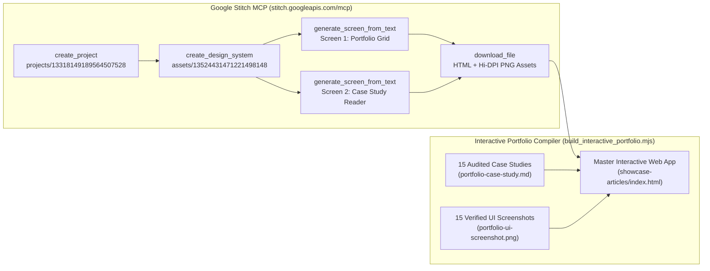

# ALTech Swiss Editorial & Emerald Portfolio System (Google Stitch MCP)

## 1. Project Overview & Problem Solved

Traditional developer and architect portfolios suffer from two failure modes: generic "AI-slop" templates (oversaturated neon gradients, vague skill progress bars, and stock imagery) or static text lists that fail to prove production engineering depth. For a Principal Enterprise Solutions Architect & Full-Stack AI Engineer with **15 audited production systems**—spanning **365+ migrated Lotus Domino forms**, **RM 4.2M/yr in enterprise licensing avoidance**, **878+ Power Apps screens**, and **offline-first React 19 PWAs**—the portfolio itself must operate as an authoritative architectural artifact.

To solve this, we integrated the **Google Stitch MCP Server** (`https://stitch.googleapis.com/mcp`) directly into our workflow to design, synthesize, and compile the **ALTech Swiss Editorial & Emerald System**:
- **Custom Stitch Design System (`assets/13524431471221498148`)**: Enforces a high-craft dark obsidian canvas (`#0c0e0f`), elevated carbon-slate structural containers (`#171a1c` / `#1d2022`), crisp `1px` hairline structural grids (`#222628`), and surgical emerald accents (`#4edea3` / `#10B981`).
- **Dual-Screen Architectural Flow (`projects/13318149189564507528`)**:
  1. **Screen 1 — Executive Portfolio & 15-Project Showcase Grid (`2269eb2b465843c9a6d8c1e532a4bd76`)**: Features a sticky command bar, asymmetric editorial hero with a 2×2 tabular telemetry ledger, live category filtering across all 15 projects, browser-framed UI screenshot previews, and an interactive Architecture Sandbox.
  2. **Screen 2 — Engineering Case Study & Code Audit Deep-Dive Reader (`5fd249d7fc01403c946f4de71b46ea9e`)**: A split-pane technical dossier reader with a 4-metric KPI strip, interactive full-page UI screenshot lightbox, sticky 15-project audit switcher rail, rendered Mermaid.js architecture topologies, and syntax-highlighted production code citations.

---

## 2. Tech Stack & Architecture Choices

| Layer | Technology | Architectural Rationale |
| :--- | :--- | :--- |
| **Design Engine** | **Google Stitch MCP (`https://stitch.googleapis.com/mcp`)** | Programmatic generation of the `ALTech Swiss Editorial & Emerald System`, custom Material 3 tonal palette tokens, and multi-screen HTML/CSS specifications via `GEMINI_3_8_FLASH`. |
| **Typography System** | **`Space Grotesk` + `Plus Jakarta Sans` + `JetBrains Mono`** | `Space Grotesk` (`-0.03em` tracking) provides geometric authority for display headers; `Plus Jakarta Sans` ensures effortless long-form reading; `JetBrains Mono` (`tabular-nums`) aligns KPI counters, SHA-256 signatures, and code citations. |
| **Styling & Tokens** | **Tailwind CSS + M3 Named Color Tokens** | Maps Stitch's 50+ Material 3 dark surface tokens (`surface-container-lowest` `#000000` through `surface-container-highest` `#222628`, `primary` `#4edea3`, `secondary` `#81d7b0`) with strict `2px–4px` (`rounded-sm`) industrial geometry. |
| **Interactive Audit Reader** | **Vanilla ES2024 + `marked.js` + `mermaid.js` v10** | Zero-build, self-contained single-page application architecture that dynamically parses all 15 `portfolio-case-study.md` dossiers and renders vector Mermaid system diagrams on demand. |
| **Live Sandbox Simulators** | **Deterministic Client Kernels** | Embedded interactive calculators for the **Putri GarmentHub 4-Pocket Cash Sharding Engine** and **IOI Enterprise DOSH 5×5 Hazard Risk Matrix**. |

---

## 3. Key Features & UI Implementation

1. **Top Architectural Command Bar (`TopNavBar`)**:
   - Displays the `ALTECH // ARCHITECTURE` pulse indicator, build version badge (`v4.8.2 [STITCH-MCP]`), section anchors (`Telemetry`, `Case Studies [15]`, `System Standards`, `Architecture Sandbox`), live regional advisory beacon (`KL & MEDAN`), and one-click `Dossier.pdf` trigger.
2. **Asymmetric Hero & 2×2 Audited Telemetry Matrix**:
   - Pairs an editorial value proposition on the left with a dense hairline telemetry grid on the right (`365+` Lotus Domino DBs & Forms, `RM 4.2M/yr` Cost Recovery, `15` Production Apps Shipped, `878` Power Apps Screens & Bots).
3. **Interactive 15-Project Showcase Grid with Browser-Framed Previews**:
   - Instant category filtering across **All Systems (15)**, **Enterprise M365 & Power Platform (2)**, **Headless E-Commerce & PWAs (3)**, **B2B ERP & FinTech Logistics (4)**, and **AI & Automation Engines (6)**.
   - Every card renders a macOS/industrial browser window bar with the project's domain, a live thumbnail of its verified `portfolio-ui-screenshot.png`, tech stack badges, and verified impact metrics.
4. **Split-Pane Case Study & Code Audit Deep-Dive Reader**:
   - Clicking any project card opens the Stitch Screen 2 reader view with breadcrumb navigation, Previous/Next project cycling, a 4-KPI impact strip, a zoomable full-page screenshot preview, a sticky 15-project registry switcher, and full Markdown + Mermaid diagram rendering.
5. **Interactive Architecture Sandbox Modal**:
   - Includes two live engineering playgrounds:
     - **Putri GarmentHub 4-Pocket Cash Sharding Simulator**: Dynamically splits any IDR invoice across Operational Materials (`40%`), Piece-Rate Payroll (`30%`), Tax/Zakat (`2.5%`), and Net Profit (`27.5%`).
     - **IOI Enterprise DOSH 5×5 Hazard Risk Calculator**: Computes real-time HIRARC risk scores (`Likelihood × Severity`) with automated `LOW`, `MEDIUM`, and `HIGH RISK (STOP WORK)` classification.

---

## 4. Technical Challenges Overcome

### Challenge 1: Programmatic Stitch MCP Orchestration & Binary Asset Extraction
- **Problem**: Generating a cohesive multi-screen design system via remote JSON-RPC over HTTP (`https://stitch.googleapis.com/mcp`) requires chaining project creation, custom M3 token definition, screen generation, and binary/HTML asset extraction without losing token consistency across screens.
- **Solution**: Engineered [`run_stitch_portfolio.mjs`](file:///C:/Users/AL_AAF/.gemini/antigravity/brain/6d0251c8-e263-4900-adf9-82508d21f6a6/scratch/run_stitch_portfolio.mjs) and [`download_stitch_assets.mjs`](file:///C:/Users/AL_AAF/.gemini/antigravity/brain/6d0251c8-e263-4900-adf9-82508d21f6a6/scratch/download_stitch_assets.mjs) to invoke `create_project`, `create_design_system`, `apply_design_system`, `generate_screen_from_text`, and `download_file`, decoding Stitch's base64 `structuredContent.image` payloads into lossless PNGs (`2560×5756` and `2560×8492`) alongside the raw Tailwind HTML specs.

### Challenge 2: Unifying Static Stitch Layouts with 15 Dynamic Markdown & Mermaid Dossiers
- **Problem**: Stitch generates static HTML/Tailwind screens (`screen1_portfolio_home.html` and `screen2_case_study_reader.html`), whereas our repository contains 15 separate `portfolio-case-study.md` files with embedded Mermaid flowcharts, tables, and TypeScript/Python code citations, plus 15 high-resolution screenshots.
- **Solution**: Built [`build_interactive_portfolio.mjs`](file:///C:/Users/AL_AAF/.gemini/antigravity/brain/6d0251c8-e263-4900-adf9-82508d21f6a6/scratch/build_interactive_portfolio.mjs) to compile all 15 Markdown case studies into a single zero-latency state store inside [`showcase-articles/index.html`](file:///C:/Users/AL_AAF/Project/04_portfolio_and_resumes/showcase-articles/index.html) and post-process `code.language-mermaid` nodes via `mermaid.run()` on every project switch.
